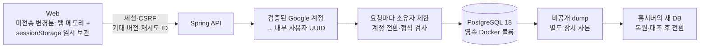
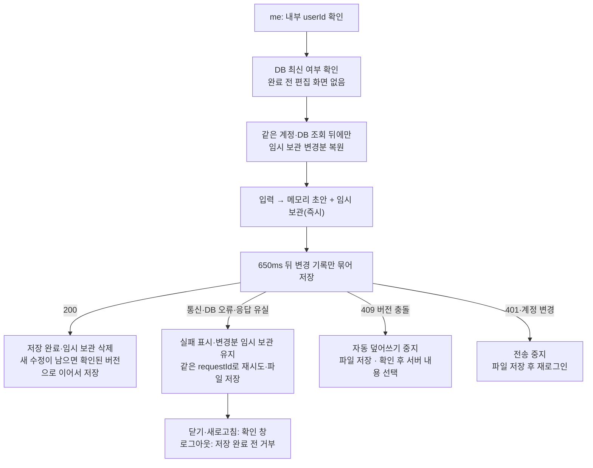

# 계정별 서버 저장 설계

2026-09-26 · 2026-09-28 DB 영구 저장 + 탭 임시 보관(sessionStorage)으로 변경 · **PostgreSQL 확정. 현재 컴퓨터에서 실행하고 이후 홈서버로 이전한다.** 첫 공개에 서버 저장을 포함하며 공개 주소는 `plannet.mhd-mhd.duckdns.org`다(이전 `plannet-lab.duckdns.org`는 callback 등록만 유지). [저장 API 계약](contracts/planner-storage-v1.md) · [DB 실행·복구 절차](postgresql-operations.md)

## 1. 구성과 보관 단위

| 단위 | 저장 내용 | 규칙 |
|---|---|---|
| 사용자 | 내부 UUID와 `(provider, subject)` 고유 매핑, 프로필 이메일(V4, nullable) | 동시 최초 로그인도 한 사용자. 이메일은 검증된 Google 클레임으로만 갱신하는 메타데이터이며 고유 키·병합 키가 아니다([보고](session-reports/account-email.md)) |
| 플랜 1개 | 소유자·kind·기존 ID·본문 JSONB·형식/수정 버전·삭제 표식 | `(user_id, kind, id)`로 격리. 제목·기간 컬럼은 본문에서 같은 트랜잭션으로 추출 |
| 설정 2개 | 반복 할 일, 사용자 휴일 | 각각 `recurring/default`, `holidays/default` |
| 저장 영수증 | 사용자·요청 UUID·요청 hash·응답 메타데이터(본문 제외) | 응답 유실 시 같은 요청을 재전송해도 버전은 한 번만 증가 |
| 기기 상태 | 선택한 플랜·조회 기간·열린 패널 | 서버에 동기화하지 않음. 로그인한 서비스에서는 브라우저에도 저장하지 않아 새로 들어오면 초기화된다 |
| 미전송 변경분 | 저장 전 초안(바뀐 기록만, 원래 기대 버전 포함)·응답 대기 요청 | 이 탭 메모리 + `plannet-pending@<내부 UUID>` sessionStorage 키 하나. 새로고침에는 남고 탭을 닫으면 사라진다. DB가 모두 확인하면 이 키만 지운다. 서버 기록 전체·기준 사본은 담지 않으며 localStorage·IndexedDB에는 쓰지 않는다 |

PostgreSQL의 관계형 제약과 JSONB를 함께 사용한다. 플랜마다 별도 행으로 저장하되, 한 계정의 커밋은 사용자 행 잠금으로 직렬화한다. 서로 다른 계정은 독립적이다. 각 템플릿도 다른 템플릿 없이 사용할 수 있다.

### JSONB 확장성 — 현재 범위

| 적용한 최소 개선 | 효과와 한계 |
|---|---|
| 계정별 ETag 조건부 조회 | 변경 없는 재조회는 버전 메타데이터만 읽고 `304`로 응답. 사본은 계정별 메모리에만 둔다. 첫 조회·변경이 있는 조회는 여전히 전체 본문을 받는다 |
| 탭 재진입 최신화(10/4, 작업자 검증·총괄 검토 대기) | 탭 재표시·창 초점·네트워크 복구 때 같은 ETag 조회를 다시 쓴다. 미저장·전송 중·충돌/계정 차단·읽을 수 없는 임시 보관·편집 중이면 내용을 바꾸지 않고, 바뀐 플랜 종류의 store만 교체한다. 임시 보관 키는 건드리지 않는다. [보고](session-reports/safe-refresh.md) |
| 영수증 본문 중복 제거(V3) | 자동 저장마다 플랜 본문 사본이 쌓이지 않는다. 기존 영수증도 축소하며, 동일 요청 해시와 원래 결과 메타데이터로 재시도 응답을 복원한다. 안전한 재시도를 위해 작은 영수증 행 자체는 계속 보관한다 |
| 유지하는 구조 | 플랜당 JSONB 1행·전체 플랜 단위 저장·버전 충돌 처리. 범용 JSONB 인덱스는 추가하지 않는다 |
| 규모 증가 시 다음 단계 | 실제 응답 크기/지연·계정당 플랜 수·영수증 용량을 보고 목록/상세 분리, 영수증 보관 구조, 필요한 검색 인덱스를 결정한다. 부분 조회는 현재 전체 스냅샷 기반 삭제 판정도 함께 바꿔야 한다 |

## 2. 저장·실패·충돌 흐름

| 경계 | 구현 원칙 |
|---|---|
| 권한 | 모든 SQL은 세션으로 정한 내부 사용자에 한정. 브라우저 헤더는 현재 세션과 일치하는지만 확인 |
| 첫 로드 | 매번 DB를 새로 읽고, 완료 전에는 편집 화면을 열지 않음. 예전 브라우저 캐시를 복원하지 않음. 인증·DB 장애를 저장 성공으로 표시하지 않음 |
| 변경 | 플랜별 기대 버전 비교. 연동 변경은 하나의 커밋에서 모두 성공하거나 모두 롤백 |
| 삭제 | 내용을 비우고 수정 버전·삭제 표식을 남겨 오래된 기기의 기록 부활 방지 |
| 재시도 | 같은 탭에서 새로고침 전후에 정확히 같은 요청·UUID를 다시 보낸다. 서버 영수증으로 버전은 한 번만 증가. 탭을 닫으면 미확인 요청도 사라진다(DB에 이미 반영됐는지는 다음 조회로 확인) |
| 충돌 | 내 초안을 메모리·탭 임시 보관에 유지. 파일 저장을 제공하고, 서버 내용 선택은 버리기 확인 후에만. 확인 뒤·조회 중 새 수정이 생기면 버리지 않음 |
| 이탈 | 미저장·응답 대기 중일 때만 `beforeunload` 확인. 로그아웃은 저장 완료(`settle`)를 기다리고 실패하면 로그아웃하지 않음. fire-and-forget 전송을 저장 성공으로 보지 않음 |
| 제한 | 요청 8MiB, 기록 2MiB, 한 번에 100개. 형식·날짜·색상·중복 ID·JSON 깊이 검증 |

첫 단계는 **다른 기기에서 불러와 편집**하는 방식이다. 실시간 공동 편집·자동 충돌 병합은 제공하지 않는다. 탭끼리 브라우저 저장소로 조정하지 않으며 같은 계정의 여러 탭·기기는 DB 버전 충돌로 판정한다. 임시 보관 쓰기 실패(차단·용량 초과)는 DB 자동 저장을 막지 않고 "새로고침 대비 임시 보관을 쓸 수 없어요" 안내만 보인다. 읽을 수 없는 임시 보관은 적용·덮어쓰기·삭제하지 않고 파일 저장·명시적 삭제를 제공한다. 탭 닫기·브라우저 종료 뒤의 복구는 약속하지 않는다.

서버 저장이 없는 로그인 상태(`storageEnabled` 없음·false, userId 없음)는 계정 LocalStorage로 대체하지 않고 "계정 저장소에 연결할 수 없어요"와 다시 시도·로그아웃만 보인다. LocalStorage 저장은 명시적 `AUTH_ENABLED=false` 로컬 개발 모드에만 남는다.

## 3. 기존 기록 이전

| 원본·조건 | 사용자 동작 | 결과 |
|---|---|---|
| 기존 계정별 브라우저 키 (`@acct:`) | `이전 계정 기록 가져오기` | 현재 계정 서버 저장으로 복사 |
| 예전 서버 저장 캐시 (`@cloud:<UUID>`) | 없음 | DB의 사본이므로 표시·가져오기하지 않는다. 지우지 않는다 |
| 예전 미전송 봉투 (`plannet-server-sync@<UUID>`, `:backup:*`) | `예전 초안 파일로 저장` | 같은 계정일 때만 안내. 원문 그대로 파일로 받는다. 자동 재전송·가져오기 없음(오래된 기준 버전이 새 DB 기록을 덮을 수 있음) |
| 비로그인 브라우저 키 | `로그인 전 기록 가져오기` | 명시적으로 선택한 계정에만 복사. 인증이 켜진 환경에서는 로그인 전에 이 키를 표시하지 않는다(로그인 랜딩) |
| 같은 kind·ID·같은 내용 | 같은 가져오기 재실행 | 건너뜀. 버전·레코드 중복 생성 없음 |
| 같은 kind·ID·다른 내용 또는 삭제 표식 | 가져오기 시도 | 충돌 안내, 해당 가져오기 전체를 시작하지 않음 |

4개 템플릿·반복 할 일·휴일과 원본 ID·출처 참조를 함께 보존한다. 이전 store 버전의 알려진 형식을 변환하고 서버에서 다시 검증한다. 원래 LocalStorage 키는 삭제·수정하지 않는다(읽기만). 큰 이전은 커밋 크기에 맞춰 나누며 실패한 나머지는 이 탭의 미저장 변경분으로 남는다(메모리·임시 보관, 닫기 전 확인·파일 저장). 과거에 잘못 기록한 출처를 추측하여 고치지 않는다.

## 4. 로컬 → 홈서버

| 지금 준비하는 것 | 홈서버 준비 후 할 것 |
|---|---|
| Docker PostgreSQL 18.6, localhost `15432`, 전용 볼륨·앱 역할 | 같은 버전 DB와 영속 디스크, API가 접근할 사설 DB 주소 |
| 비공개 환경 파일, Flyway migration, DB 없을 때 기동 실패 | Secret 주입·DB 방화벽·별도 장치 백업 위치 |
| 백업·새 DB 복원·내용 대조 | 예행 복원 → 쓰기 중지 → 최종 dump → 전송/checksum → 새 DB 복원 |
| 실제 Spring·PostgreSQL·브라우저 저장 검증 | 공인 TLS·Google callback·공개 origin·실제 AI·운영 롤백 검증 |

DB 포트는 공개하거나 공유기에서 포워딩하지 않는다. API와 Web은 현재 각각 1 replica이며 세션은 메모리이므로 API 재시작 후 재로그인이 필요하다. 플랜·사용자·저장 영수증은 DB에 유지된다. 홈서버에서 새 쓰기를 받기 시작한 뒤에는 오래된 로컬 DB로 단순히 되돌리면 안 된다.

DuckDNS 주소 설정은 준비했지만 실제 공개 배포는 아직 하지 않았다. 홈서버 접속 정보·영속 디스크·공인 인증서는 그 배포 단계에서 확인한다. 현 단계의 로컬 구현과 검증은 이 정보 없이 진행할 수 있다.
