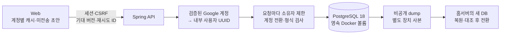
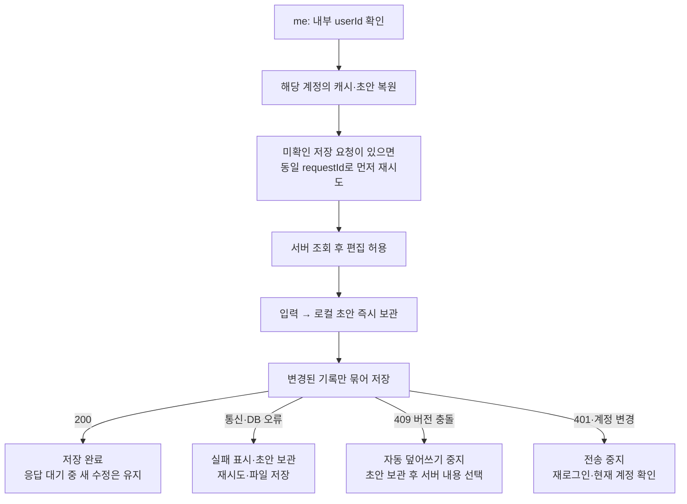

# 계정별 서버 저장 설계

2026-09-26 · **PostgreSQL 확정. 현재 컴퓨터에서 실행하고 이후 홈서버로 이전한다.** 첫 공개에 서버 저장을 포함하며 공개 주소는 `plannet-lab.duckdns.org`다. [저장 API 계약](contracts/planner-storage-v1.md) · [DB 실행·복구 절차](postgresql-operations.md)

## 1. 구성과 보관 단위

| 단위 | 저장 내용 | 규칙 |
|---|---|---|
| 사용자 | 내부 UUID와 `(provider, subject)` 고유 매핑, 프로필 이메일(V4, nullable) | 동시 최초 로그인도 한 사용자. 이메일은 검증된 Google 클레임으로만 갱신하는 메타데이터이며 고유 키·병합 키가 아니다([보고](session-reports/account-email.md)) |
| 플랜 1개 | 소유자·kind·기존 ID·본문 JSONB·형식/수정 버전·삭제 표식 | `(user_id, kind, id)`로 격리. 제목·기간 컬럼은 본문에서 같은 트랜잭션으로 추출 |
| 설정 2개 | 반복 할 일, 사용자 휴일 | 각각 `recurring/default`, `holidays/default` |
| 저장 영수증 | 사용자·요청 UUID·요청 hash·응답 | 응답 유실 시 같은 요청을 재전송해도 버전은 한 번만 증가 |
| 기기 상태 | 선택한 플랜·조회 기간·열린 패널 | 서버에 동기화하지 않음 |

PostgreSQL의 관계형 제약과 JSONB를 함께 사용한다. 플랜마다 별도 행으로 저장하되, 한 계정의 커밋은 사용자 행 잠금으로 직렬화한다. 서로 다른 계정은 독립적이다. 각 템플릿도 다른 템플릿 없이 사용할 수 있다.

## 2. 저장·실패·충돌 흐름

| 경계 | 구현 원칙 |
|---|---|
| 권한 | 모든 SQL은 세션으로 정한 내부 사용자에 한정. 브라우저 헤더는 현재 세션과 일치하는지만 확인 |
| 첫 로드 | 서버 조회 전 빈 store를 저장하지 않음. 인증·DB 장애를 저장 성공으로 표시하지 않음 |
| 변경 | 플랜별 기대 버전 비교. 연동 변경은 하나의 커밋에서 모두 성공하거나 모두 롤백 |
| 삭제 | 내용을 비우고 수정 버전·삭제 표식을 남겨 오래된 기기의 기록 부활 방지 |
| 재시도 | 정확히 같은 요청·UUID를 로컬에 먼저 보관. 서버 영수증 확인 후 버전 검사 |
| 충돌 | 내 초안을 유지. 서버 내용 선택 전 별도 브라우저 사본을 보관하고 다운로드 경로 제공 |
| 제한 | 요청 8MiB, 기록 2MiB, 한 번에 100개. 형식·날짜·색상·중복 ID·JSON 깊이 검증 |

첫 단계는 **다른 기기에서 불러와 편집**하는 방식이다. 실시간 공동 편집·자동 충돌 병합은 제공하지 않는다. 같은 계정의 다른 탭이 캐시를 변경하면 현재 탭을 멈추고 초안 보관과 새로고침을 안내한다. 로컬 저장소 용량 초과도 별도 실패로 표시한다.

## 3. 기존 기록 이전

| 원본·조건 | 사용자 동작 | 결과 |
|---|---|---|
| 기존 계정별 브라우저 키 | `이전 계정 기록 가져오기` | 현재 계정 서버 저장으로 복사 |
| 비로그인 브라우저 키 | `로그인 전 기록 가져오기` | 명시적으로 선택한 계정에만 복사 |
| 같은 kind·ID·같은 내용 | 같은 가져오기 재실행 | 건너뜀. 버전·레코드 중복 생성 없음 |
| 같은 kind·ID·다른 내용 또는 삭제 표식 | 가져오기 시도 | 충돌 안내, 해당 가져오기 전체를 시작하지 않음 |

4개 템플릿·반복 할 일·휴일과 원본 ID·출처 참조를 함께 보존한다. 이전 store 버전의 알려진 형식을 변환하고 서버에서 다시 검증한다. 원래 LocalStorage 키는 삭제하지 않는다. 큰 이전은 커밋 크기에 맞춰 나누며 실패한 나머지는 초안으로 남는다. 과거에 잘못 기록한 출처를 추측하여 고치지 않는다.

## 4. 로컬 → 홈서버

| 지금 준비하는 것 | 홈서버 준비 후 할 것 |
|---|---|
| Docker PostgreSQL 18.6, localhost `15432`, 전용 볼륨·앱 역할 | 같은 버전 DB와 영속 디스크, API가 접근할 사설 DB 주소 |
| 비공개 환경 파일, Flyway migration, DB 없을 때 기동 실패 | Secret 주입·DB 방화벽·별도 장치 백업 위치 |
| 백업·새 DB 복원·내용 대조 | 예행 복원 → 쓰기 중지 → 최종 dump → 전송/checksum → 새 DB 복원 |
| 실제 Spring·PostgreSQL·브라우저 저장 검증 | 공인 TLS·Google callback·공개 origin·실제 AI·운영 롤백 검증 |

DB 포트는 공개하거나 공유기에서 포워딩하지 않는다. API와 Web은 현재 각각 1 replica이며 세션은 메모리이므로 API 재시작 후 재로그인이 필요하다. 플랜·사용자·저장 영수증은 DB에 유지된다. 홈서버에서 새 쓰기를 받기 시작한 뒤에는 오래된 로컬 DB로 단순히 되돌리면 안 된다.

DuckDNS 주소 설정은 준비했지만 실제 공개 배포는 아직 하지 않았다. 홈서버 접속 정보·영속 디스크·공인 인증서는 그 배포 단계에서 확인한다. 현 단계의 로컬 구현과 검증은 이 정보 없이 진행할 수 있다.
