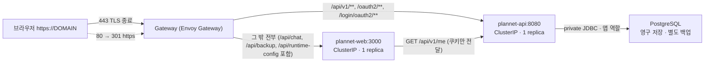

# 공개 배포 준비 (같은 origin · HTTPS)

작성일: 2026-09-26 · 대상: 현재 작업 트리의 인증·PostgreSQL 저장 구현 · 배포 예제: [`infra/deploy`](../infra/deploy/README.md) · 계약: [auth-v1](./contracts/auth-v1.md), [planner-storage-v1](./contracts/planner-storage-v1.md), [Web 연동](./web-auth-integration.md)

Web(Next.js)과 API(Spring)를 **하나의 HTTPS origin** 뒤에 두는 설정과 검증 절차다. 로컬 HTTPS 배포 검증을 마쳤으며, 공개 호스트는 사용자 제공 `plannet-lab.duckdns.org`로 준비했으며 공인 인증서·공개 callback 등록·운영 클러스터 적용은 아직 하지 않았다. 별도 인증 세션에서는 9월 26일 로컬 Web+API의 실제 Google 로그인·새로고침·로그아웃을 검증했다([인증 검증 기록](./research/2026-07-31-api-owned-auth-phase1.md)). 아래 미검증 항목은 공개 배포 환경을 뜻한다.

공개 API에는 PostgreSQL 연결이 필수다. 먼저 로컬 컴퓨터에서 실행한 뒤 홈서버로 이전하며, DB 운영 도구와 dump/restore 절차는 [PostgreSQL 운영 문서](./postgresql-operations.md)를 따른다. 이 Kubernetes 예제는 DB 자체를 배포하지 않는다. 기존 로컬 HTTPS 검증은 `storage=false`인 인증 전용 환경이며 운영 저장 검증과 구분한다.

## 1. 상태

| 구분 | 결과 | 근거 |
|---|---|---|
| **모의 인증 검증** (실제 Spring·Web 이미지 + Google·AI 대역, kind 클러스터, 자체 서명 HTTPS) | **기존 검증 통과** (E2E 12개, 공개 점검 18항목). local-verify는 storage=false이며 이번 DB 배포 설정 수정 뒤 클러스터 재배포는 하지 않음 | `scripts/verify-local.sh`, `scripts/check-public.sh` |
| 매니페스트 정적 검증 (정책·스키마) | **통과** (production 저장 필수·DB Secret, local-verify 저장 off 검사 포함. production 예제는 placeholder 경고만) | `scripts/validate-manifests.sh` |
| 로컬 PostgreSQL 운영 도구 | **통과**: 전용 DB 기동·재시작 영속성·신규 DB 백업 복원 일치·기존 데이터 덮어쓰기 거부 | [운영 도구 보고](./session-reports/storage-infra.md) |
| 운영 Pod → PostgreSQL 연결·복구 | **미완료**. 홈서버 private endpoint·방화벽·영구 디스크·별도 장치 백업을 배포 시 확정 | [PostgreSQL 운영](./postgresql-operations.md), 6절 |
| API 테스트 (스냅샷에서 실행) | **통과** | `build-images.sh` `RUN_API_TESTS=1` |
| **공개 배포 origin의 실제 Google 로그인** | **미검증**. 공개 callback 등록과 운영 client 설정이 필요하다. 로컬 실제 로그인은 별도 검증 완료 | 5·6절 |
| **실제 공개 HTTPS** (공인 인증서·도메인·공유기) | **미완료**. DuckDNS 확인, HTTPS는 자체 서명 인증서 검증 오류. 운영 대상·공인 TLS·외부 접근 검증 필요 | 8절 |

이번 DB 배포 설정 검증에서 production 15개·local-verify 23개 리소스의 정책/스키마가 통과했다. 저장 비활성화·필수 DB 키 누락·optional 참조·리터럴 비밀번호 등 잘못된 정책 11개를 거부했고, Secret 스크립트는 가짜 kubectl로 stdin 주입·출력/명령 인수 미노출·줄바꿈/잘못된 JDBC URL 거부를 확인했다. 실제 Secret 생성이나 클러스터 적용은 하지 않았다.

## 2. 구조와 라우팅



- Gateway API `HTTPRoute`의 `PathPrefix`는 경로 요소 단위다. `/api/v1x`, `/oauth2x`는 Web으로 간다. `/api/**` 전체를 API로 넘기지 않는다.
- HTTP 리스너(80)에는 앱을 붙이지 않고 301 redirect만 둔다.
- **Host**는 그대로 보존한다(Web CSRF의 Origin 비교, Spring 요청 host). 클라이언트가 보낸 `X-Forwarded-Host`·`X-Forwarded-Port`·`Forwarded`는 Gateway에서 지운다. `X-Forwarded-Proto`와 `X-Forwarded-For`는 Envoy가 실제 연결 기준으로 다시 쓴다.
- Spring(prod)은 `PLANNET_TRUSTED_PROXIES`에 맞는 peer의 전달 헤더만 반영한다. 검증에서 API 응답에 HSTS가 붙는 것으로 HTTPS 인식을 확인했다(Spring Security는 보안 요청에만 HSTS를 보낸다).
- Web 응답에는 Gateway가 HSTS·`nosniff`·`X-Frame-Options: DENY`·`Referrer-Policy`를 붙이고 `X-Powered-By`를 지운다. `/api/chat`의 AI timeout(20초)을 위해 Web 경로 timeout은 30초다(Envoy 기본값은 15초).
- NetworkPolicy: Web에는 Gateway 프록시만, API에는 Gateway 프록시와 Web만 들어온다. 다른 namespace pod의 직접 접근은 막힌다(검증함).
- PostgreSQL은 공개 Gateway 뒤에 경로를 만들지 않는다. DB의 5432·호스트 Compose의 15432는 공유기에서 공개하지 않는다. 현재 NetworkPolicy는 Web/API ingress를 제한하며 DB 측 방화벽·접근 정책을 대신하지 않는다.

## 3. 설정값과 주입 위치

비밀값은 저장소·ConfigMap에 넣지 않는다. Secret은 `scripts/create-secrets.sh`로 만든다.

| 값 | 위치 | 공개 배포 값 |
|---|---|---|
| `PUBLIC_HOST` | `overlays/production/public/public.env` | 공개 도메인 (Gateway·HTTPRoute host로 들어감) |
| `APP_ORIGINS` | 같은 파일 | `https://DOMAIN` (Web CSRF 허용 origin 고정) |
| `GOOGLE_REDIRECT_URI` | 같은 파일 | `https://DOMAIN/login/oauth2/code/google` |
| `PLANNET_TRUSTED_PROXIES` | 같은 파일 | Gateway 프록시 pod IP 정규식. 예: pod CIDR `10.244.0.0/16` → `10\.244\.\d{1,3}\.\d{1,3}` |
| `AUTH_ENABLED=true`, `API_INTERNAL_URL=http://plannet-api:8080`, `LOCAL_BACKUP_ENABLED=false` | `base/web.env` | 고정 |
| `AI_RATE_LIMIT_PER_MINUTE` / `_PER_DAY` / `AI_GLOBAL_LIMIT_PER_DAY` | `base/web.env` | 5 / 50 / 500 |
| `OPENGATEWAY_BASE_URL`, `OPENGATEWAY_MODEL` | `base/web.env` | 기존 값 |
| `SPRING_PROFILES_ACTIVE=prod`, `PLANNET_SESSION_TIMEOUT=8h` | `base/api.env` | 고정 |
| `PLANNET_STORAGE_ENABLED=true` | `base/api.env` | 운영 필수. local-verify overlay만 false로 변경 |
| `GOOGLE_CLIENT_ID`, `GOOGLE_CLIENT_SECRET` | Secret `plannet-api-secret` | Google Console OAuth client |
| `PLANNET_DB_URL`, `PLANNET_DB_USERNAME`, `PLANNET_DB_PASSWORD` | Secret `plannet-api-secret` | Pod에서 연결 가능한 PostgreSQL JDBC URL·비superuser 앱 역할·비밀번호. 세 값 모두 필수 |
| `OPENGATEWAY_API_KEY` | Secret `plannet-web-secret` | AI 키 (Web만 받는다) |
| TLS 인증서 | Secret `plannet-tls` (`kubernetes.io/tls`) | cert-manager 또는 `--tls-cert/--tls-key` |
| 이미지 | `overlays/production/kustomization.yaml` `images` | 레지스트리 경로 + 고정 태그 |

- 설정 파일(`*.env`)은 해시 이름 ConfigMap으로 만들어진다. 값을 바꿔 적용하면 pod가 자동으로 다시 뜨고, 롤백하면 이전 ConfigMap을 다시 쓴다. Secret 값만 바꾼 경우는 `kubectl rollout restart`가 필요하다.
- prod 프로필은 Google client·`GOOGLE_REDIRECT_URI`·`PLANNET_TRUSTED_PROXIES` 및 활성 저장소의 DB 연결 정보가 없으면 기동하지 않는다. DB 연결 실패 시 메모리 저장으로 대체하지 않는다. 운영 DB Secret 참조는 `optional: false`다. Secret 또는 필수 키가 없으면 pod가 `CreateContainerConfigError`로 멈춘다.
- `create-secrets.sh`는 Google/AI/DB 값을 환경변수 또는 비표시 입력으로 받아 stdin으로 전달한다. 값 대신 길이만 출력하고 줄바꿈이 있는 값은 거부한다. `PLANNET_DB_URL`은 `jdbc:postgresql://<private endpoint>:<port>/<database>` 형식이다. 실제 주소와 DB 측 방화벽은 대상 홈서버·클러스터 구성이 정해진 뒤 확정한다.
- **Pod의 localhost는 그 Pod 자신**이다. 로컬 Compose가 만든 호스트용 `jdbc:postgresql://127.0.0.1:15432/plannet`을 Kubernetes Secret에 그대로 넣지 않는다. 같은 클러스터라면 private DB Service, 별도 서버라면 API Pod에서 도달 가능한 사설 주소와 제한된 접근을 사용한다.
- 공용 서버 백업은 `LOCAL_BACKUP_ENABLED=false`로 명시했다. `AUTH_ENABLED=true`면 코드에서도 항상 차단된다.
- Gateway 컨트롤러는 Envoy Gateway 1.9.1 기준이다(ingress-nginx는 2026-03 유지보수 종료). 다른 컨트롤러를 쓰면 `gatewayclass.yaml`의 `controllerName`과 `base/network-policy.yaml`의 프록시 선택자를 바꾼다.

## 4. 이미지 빌드와 설정 검증

```bash
IMAGE_TAG=v20261001 PLATFORM=linux/amd64 RUN_API_TESTS=1 infra/deploy/scripts/build-images.sh
infra/deploy/scripts/validate-manifests.sh --strict production
```

- `build-images.sh`는 먼저 **현재 작업 트리 스냅샷**(추적 파일 + `.gitignore` 대상이 아닌 새 파일, 미커밋 변경 포함)을 `$TMPDIR/plannet-deploy/src`에 만든다. `.env*`, `k8s/local/`, `node_modules`, `.next`, `build`는 들어가지 않는다. 그다음 스냅샷에서 jar(`--no-daemon`)와 두 이미지를 만들고, Web 이미지에 `.env*`·백업 파일이 없는지 확인한다. 레지스트리 push는 하지 않는다: `docker tag`/`docker push`로 직접 올린다.
- `PLATFORM`은 배포 노드 아키텍처에 맞춘다(Apple Silicon에서 amd64 노드용이면 `linux/amd64`).
- `validate-manifests.sh --strict`는 렌더 결과를 검사한다: Secret 미포함, 인증 on·백업 off·prod 프로필, **운영 storage=true 및 DB 세 값의 필수 Secret 참조**, local-verify storage=false 및 DB 참조 제거, 세 공개 값의 일치(`APP_ORIGINS` = `https://PUBLIC_HOST`, callback = origin + `/login/oauth2/code/google`), replica 1·Recreate·ClusterIP, API 경로가 계약의 세 개뿐인지, HTTP는 redirect만인지, NetworkPolicy, placeholder·예제 도메인·태그 미고정. Docker가 있으면 kubeconform으로 Kubernetes·Gateway API 스키마도 확인한다. 렌더 결과는 `$TMPDIR/plannet-deploy/artifacts/rendered-production.yaml`에 남는다.

## 5. Google Console callback 규칙

**승인된 리디렉션 URI** = `https://<공개 host>[:<443이 아닌 포트>]/login/oauth2/code/google`

- `GOOGLE_REDIRECT_URI`와 글자까지 같아야 한다(scheme, host, 포트, 경로, 끝 `/` 없음). 다르면 Google이 `redirect_uri_mismatch`로 거부한다.
- 로컬 개발(`http://localhost:18080/login/oauth2/code/google`)과 공개 주소는 **따로 등록**한다. 공개 주소는 `https`여야 한다.
- 승인된 JavaScript 원본은 필요 없다(브라우저가 Google API를 직접 부르지 않는다).
- 등록 후 `check-public.sh`가 Google에 로그인 화면 직전까지 요청해 `redirect_uri_mismatch`·`invalid_client` 여부를 알려 준다(판정 로직은 가짜 client의 `invalid_client` 응답으로 확인했다).

## 6. 적용 순서와 성공 판정

1. DNS: 공개 host의 A/AAAA 레코드 → 공인 IP. 공유기는 **443(필수)·80(redirect·ACME용)**만 Gateway 노드로 포워딩한다. 개발 포트 및 DB 5432/15432는 열지 않는다.
2. Envoy Gateway 설치: `helm install eg oci://docker.io/envoyproxy/gateway-helm --version 1.9.1 -n envoy-gateway-system --create-namespace`
3. 인증서: cert-manager를 쓰면 Gateway API 지원(`config.enableGatewayAPI: true`)을 켜고, Gateway에 `cert-manager.io/cluster-issuer: <issuer>` 주석을 달아 `plannet-tls`를 발급받는다(HTTP-01이면 80이 열려 있어야 한다). 직접 넣으면 5단계에서 `--tls-cert/--tls-key`를 준다.
4. PostgreSQL: 전용 영구 저장·비superuser 앱 계정·Pod에서 접근 가능한 private endpoint·DB 측 방화벽·별도 장치 백업을 준비한다. 이전 데이터가 있으면 쓰기 중지→dump→새 DB 복원→검증을 마친다. [홈서버 이전 절차](./postgresql-operations.md#홈서버-이전-순서)를 따른다.
5. Secret: Google·AI·DB 세 값을 준비한 뒤 `infra/deploy/scripts/create-secrets.sh --context <ctx>`로 확인하고 `--apply`한다. DB URL/사용자/비밀번호를 출력하거나 명령행 인수로 넣지 않는다.
6. `public.env`·이미지 태그 수정 → `validate-manifests.sh --strict production` 통과.
7. 적용: `kubectl --context <ctx> apply -k infra/deploy/k8s/overlays/production`
8. 상태: `kubectl -n plannet rollout status deploy/plannet-api deploy/plannet-web`, `kubectl -n plannet get gateway plannet` (`PROGRAMMED=True`). API가 DB에 연결되고 Flyway migration을 마쳤는지 확인한다.
9. 외부 점검: `infra/deploy/scripts/check-public.sh https://DOMAIN` → 실패 0건. 이 명령만으로 DB 저장 완료를 판정하지 않는다.
10. 브라우저: Google 로그인 → 이름 표시 → 플랜 저장 → 다른 브라우저에서 같은 계정으로 복원 → 다른 계정과 격리 확인 → API 재시작·재로그인 후 데이터 유지 → AI 요청 1회 성공 → 로그아웃 → AI 요청 거부.

**성공 판정**: 9의 모든 항목 PASS(인증서 유효, HTTP→HTTPS, 경로 분리, 인증 on·백업 off, 미인증 401, callback 주소, 쿠키 `Secure; HttpOnly; SameSite=Lax; Path=/`·host-only, Google 수락) + 10의 저장·계정 격리·재시작 흐름 성공 + 별도 새 DB 복원 검증. 로그에 client secret·AI 키·DB 비밀번호가 없어야 한다.

## 7. 운영: 상태 확인·재시작·롤백

| 작업 | 명령 |
|---|---|
| 상태 | `kubectl -n plannet get pods,gateway,httproute` · `curl -fsS https://DOMAIN/api/v1/health` |
| 로그 | `kubectl -n plannet logs deploy/plannet-api` / `deploy/plannet-web` |
| 재시작 | `kubectl -n plannet rollout restart deploy/plannet-web` (API도 같은 방식) |
| 롤백(즉시) | `kubectl -n plannet rollout undo deploy/plannet-web` (API 동일) → `rollout status` |
| 롤백(정식) | overlay `images.newTag`를 이전 태그로 되돌려 `kubectl apply -k` (다음 apply가 `undo`를 덮어쓰지 않게) |

- 이전 버전 태그와 이미지 ID는 `artifacts/images.txt`에 남는다. 배포마다 태그를 새로 만들고 이전 태그 이미지를 레지스트리에 남겨 둔다.
- 검증 클러스터에서 **존재하지 않는 이미지로 갱신 → 503 → `rollout undo` → 200 복구**를 확인했다.
- API 이미지 롤백은 DB schema를 되돌리지 않는다. Flyway migration 전에 백업하고 이전 이미지가 현재 schema와 호환되는지 먼저 확인한다. DB 복구가 필요하면 새 DB에 복원·검증한 후 연결을 전환한다. 이전 DB를 덮어쓰거나 migration 기록을 수동 삭제하지 않는다.

### 재시작·배포 시 제약

- **세션 초기화**: API 세션은 메모리에만 있다. API pod가 재시작·재배포되면 모든 사용자가 다시 로그인해야 한다(검증: 재시작 후 기존 쿠키 401).
- **플랜 데이터 유지**: 서버 저장 데이터는 별도 PostgreSQL 영구 볼륨에 있다. API 재시작으로 지워지지 않으며 세션 재로그인과 구분한다. 운영 환경에서 이 동작을 실제 확인해야 한다.
- **호출 한도 초기화**: AI 한도는 Web 프로세스 메모리에 있다. Web 재시작 시 분·일·전체 카운터가 모두 0이 된다(검증: 429 → 재시작 → 200). 비용 상한은 공급자(OpenGateway) 측 예산으로도 따로 걸어 둔다.
- **짧은 중단**: 두 Deployment는 replica 1 + `Recreate`다. 배포 중 Web은 수 초, API는 약 15~30초 응답하지 않는다(503). 잘못된 이미지는 롤백 전까지 중단이 이어지므로, 먼저 검증 클러스터에서 같은 태그로 `verify-local.sh`를 통과시킨다.
- replica를 늘리면 세션이 pod마다 갈리고 한도가 N배가 된다. 늘리기 전에 세션 저장소(예: Spring Session + Redis)와 공유 한도 저장소가 필요하다.

## 8. 로컬 검증 환경

```bash
infra/deploy/scripts/verify-local.sh      # 스냅샷 → 빌드 → kind "plannet-verify" → Envoy Gateway → 배포 → E2E
infra/deploy/scripts/verify-down.sh       # 검증 클러스터만 삭제
```

- 전용 kind 클러스터와 전용 kubeconfig(`$TMPDIR/plannet-deploy/kubeconfig`)를 쓴다. 기본 kube context, Docker Desktop 클러스터, 다른 세션의 서버(3000, 18080 등)는 건드리지 않는다. 진입점은 `https://plannet.test:19643`, `http://plannet.test:19680`이다. 브라우저는 `--host-resolver-rules`로 `plannet.test`·`mock.test`를 127.0.0.1로 해석한다(`/etc/hosts` 수정 없음).
- Google 대역(`mock-external`)은 등록된 redirect URI만 받고(아니면 `redirect_uri_mismatch`), token 요청의 client 인증과 redirect_uri를 확인하며, 서명된 id_token을 발급한다. AI 대역은 OpenAI 호환 응답을 준다. 실제 Google·유료 AI는 호출하지 않는다. 대역 자격 증명은 가짜 값이다.
- `local-verify`는 `PLANNET_STORAGE_ENABLED=false`를 명시하고 DB 세 값의 Secret 참조를 이 overlay에서만 제거한다. 운영 참조를 optional로 낮추지 않는다. 이 환경의 HTTPS/인증 통과는 PostgreSQL migration·서버 저장·백업/복원을 검증하지 않는다. DB 운영 도구 검증은 `python3 infra/storage/verify.py`, 실제 앱 저장은 PostgreSQL을 연결한 API/브라우저 통합 검증으로 수행한다.
- 산출물: `$TMPDIR/plannet-deploy/artifacts/` — `e2e/report`(HTML), `e2e/results.json`, 스크린샷, `cluster/`(리소스·이벤트·로그), `rendered-*.yaml`, `images.txt`, `source-snapshot.txt`, `public-check-*.txt`.

| E2E | 확인 내용 |
|---|---|
| HTTPS 전환 | HTTP 요청은 경로·쿼리 유지 301, 쿠키 없음. 등록 안 된 Host는 404 |
| 경로 분리 | Spring: health 200·me 401·보호 경로 401 JSON·callback. Web: runtime-config·`/api/chat` 405·`/api/v1x` 404·보안 헤더 |
| 백업 차단 | GET 목록·파일·POST 모두 403 `backup_disabled` |
| callback·쿠키 | redirect_uri = 공개 callback, 대역 Google 수락, `Secure; HttpOnly; SameSite=Lax; Path=/`, Domain 없음. 전달 헤더 위조로 callback 불변 |
| 로그인 전 | `/api/chat` 무세션·위조 세션 401, 교차 출처 403, AI 호출 0 |
| 격리 | Service ClusterIP, replica 1·Recreate, 다른 namespace pod → Web/API 직접 접근 차단(대조군 성공) |
| 사용자 흐름 | 로그인 → me 200 → UI AI 응답 → 한도 3회 후 429 → Web 재시작 후 한도 초기화 → CSRF 없는 로그아웃 403 → UI 로그아웃 204 → 쿠키 삭제 → 이전 쿠키로 me·AI 401 |
| 로그인 거부 | 동의 거부 → 실패 안내, 세션 없음 |
| API 장애 | API 0 replica: me 503, Web 동작, AI 503 `auth_unavailable`(AI 호출 0), UI 안내. 복구 후 기존 세션 401 → 재로그인 |

## 9. 발견한 문제와 후속 반영 (2026-09-26 갱신)

| # | 최초 발견 | 현재 상태 | 남은 작업 |
|---|---|---|---|
| 1 | 루트 빌드 컨텍스트에 `k8s/local/` Secret·루트/앱 `.local-backup/` 등이 포함될 수 있었음 | **A에서 수정**. 환경 파일·비밀 후보·백업·검증 산출물 제외, API 컨텍스트는 jar만 허용. 가짜 표식과 builder/최종 이미지 검사 통과 보고 | 최신 이미지로 공개 전 결합 검증 |
| 2 | API 이미지가 root로 실행되며 사전 빌드 jar·가변 베이스 태그 사용 | **기본 사용자 UID/GID 10001 적용**. 일반·제한 모드 기동 통과 보고 | multi-stage·베이스 digest 고정은 미적용. 기존 jar 빌드 계약 유지 |
| 3 | Next 기본 보안 헤더 부재·`X-Powered-By` 노출 | **A에서 수정**. 헤더 제거, nosniff·프레임 차단·Referrer/Permissions 정책 추가. Gateway의 HSTS 유지 | 실제 Google·Gateway 결합 재검증 |
| 4 | `k8s/local/configmap.yaml` 주석이 제거된 Auth.js 변수를 안내 | 미수정. 공개 배포는 `infra/deploy` 사용 | 새 Web/API 환경변수로 주석 갱신 |
| 5 | PNG 내보내기 실패 | **수정·브라우저 검증 완료**. html2canvas의 oklab 처리 예외·중복 ID를 재현하고 전체 플랜 Canvas 렌더링으로 교체 | 최신 배포 이미지에서 다운로드 확인. 실제 Safari 다운로드 UI 별도 |

[A 세션 보고](./session-reports/deploy-hardening.md): 보안·이미지 점검 90개 통과, 별도 브라우저 검사 5개 통과·PNG 2개 실패. 총괄은 구현을 대조했으며 이 이미지 검사를 직접 재실행하지 않았다. 위 보완 이후 실제 공개 배포·Google 검증은 아직 남아 있다.

후속 [JSON·PNG 검증](./session-reports/mandalart-io.md)은 **46개 통과**로 기존 PNG 실패를 해결했다. 총괄이 최신 소스의 production/standalone 빌드와 기본 인증·플래너 **42개**, 전체 목록 **5개**를 직접 재검증했다. AI 초기화 **34개**와 날짜·출처 **9개**는 담당 에이전트가 통과했다. 이번 136개 검증은 모의 Google/AI·로컬 전용 서버 기준이며 실제 공개 배포의 결합 검증을 대신하지 않는다.

- `PLANNET_TRUSTED_PROXIES`가 pod CIDR 전체이면 클러스터 안 어떤 pod든 신뢰 프록시가 된다. NetworkPolicy로 API에 들어올 수 있는 pod를 Gateway와 Web으로 제한해 보완했다. 정책을 강제하지 않는 CNI라면 프록시 pod 대역을 더 좁혀야 한다.

## 10. 남은 외부 결정과 실행

첫 공개는 계정별 서버 저장으로 확정됐고 공개 주소는 `plannet-lab.duckdns.org`다. DB는 **PostgreSQL, 현재 로컬 컴퓨터에서 실행 후 홈서버로 이전**으로 확정했다. 홈서버/클러스터의 실제 배치·private DB endpoint·방화벽·영구 디스크·별도 장치 백업 위치는 배포 시 확정한다. 대상과 접근 권한이 정해지면 에이전트가 설정 준비·검증·브라우저 확인을 진행하며, 계정 로그인·추가 인증 등 사용자만 처리할 수 있는 단계에서만 개입을 요청한다. 실제 공개 적용 전에는 대상과 적용 내용을 확인할 수 있게 준비한다.

| 작업 | 필요 이유 |
|---|---|
| DuckDNS 대상 운영 장비 확인·주소 갱신 방식 설정 | 호스트와 DNS 조회는 확인. 영구 운영할 서버인지 확인 필요 |
| Google Console(개인 프로젝트의 Plannet OAuth client)에 `https://DOMAIN/login/oauth2/code/google` 추가 | 없으면 `redirect_uri_mismatch` |
| 운영 클러스터 선택, Envoy Gateway·(선택) cert-manager 설치, pod CIDR 확인 | `PLANNET_TRUSTED_PROXIES`, 인증서 |
| 홈서버 PostgreSQL의 private endpoint·방화벽·영구 저장·별도 장치 백업 확정 | Pod DB 연결, 데이터 영속성, 장애 복구. localhost 호스트용 URL 그대로 적용 금지 |
| 공유기 443/80 포트포워딩 | 외부 접근 |
| 이미지 레지스트리 push, `create-secrets.sh --apply`, `kubectl apply -k` | 실제 배포 |
| 배포 후 `check-public.sh` + 브라우저 로그인·계정별 저장·다른 브라우저 복원·재시작·AI·로그아웃 | 실제 Google·공개 HTTPS·운영 데이터 검증 |
