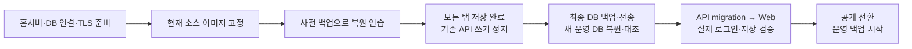

# 홈서버 배포·데이터 이전 실행 가이드

2026-10-05 · 대상 `https://plannet.mhd-mhd.duckdns.org` · **실행 안내이며 이번에 배포·데이터 이전을 수행하지는 않았다.** 이메일 저장(V4) 구현·관련 49개 검사는 완료했고 실제 서비스 반영은 남아 있다.



**1. 이전 대상과 아직 정할 값**

| 구분 | 현재 상태 / 실행 기준 |
|---|---|
| 데이터 | 로컬 PostgreSQL `plannet`, Google 계정 2개. 마지막 조회 기준 저장 레코드 18개·22개(플랜 16개·20개와 각 설정 2개). 최종 백업 직전에 다시 대조한다 |
| 보존 범위 | 두 계정 모두, 내부 UUID·플랜 JSON·삭제 표식·버전·저장 영수증·migration 이력. 계정을 합치거나 특정 계정만 골라 옮기지 않는다 |
| 브라우저 임시 저장 | DB가 확인한 변경만 백업에 들어간다. **사용 중인 모든 탭에서 저장 완료**를 확인한다. 미전송/충돌 초안이 있으면 해결하거나 파일로 별도 보관하고 이전을 시작한다 |
| 코드 | 원본 저장소 작업 트리와 `MyoungHaSong/services` 모노레포의 `apps/plannet` 사본이 같은 코드다([코드 통일 기록](../session-reports/code-unification.md), push·병합 대기). 이미지는 병합된 services `main`의 **고정 커밋**으로 만든다. 미커밋 변경은 단순 `git pull`로 오지 않는다. 모든 명령은 Plannet 프로젝트 루트(services 모노레포에서는 `apps/plannet`)에서 실행한다 |
| 홈서버 정보 | OS, CPU(`amd64`/`arm64`), SSH 주소, Kubernetes 사용 여부/context, 영구 디스크, 별도 장치 백업 위치 |
| 배포 방식 | 아래 앱 적용 명령은 레포의 **Kubernetes + Envoy Gateway** 구성 기준. Docker만 있는 서버에는 앱 전체 Compose 구성이 아직 없으므로 먼저 해당 구성을 준비해야 한다 |
| DB 연결 | 운영 overlay에는 DB가 포함되지 않는다. 홈서버 DB와 **API Pod에서 접근 가능한 사설 endpoint**를 먼저 준비한다 |

**DB 연결은 실행 전 필수 준비다.** 아래 `db.sh`는 홈서버의 PostgreSQL 생성·백업·복원에 사용할 수 있지만 기본 포트는 `127.0.0.1:15432`다. API Pod에서는 그 주소로 홈서버 DB에 접속할 수 없다. 대상에 맞춰 private 인터페이스/방화벽 또는 클러스터 DB Service·영구 볼륨을 구성해야 한다. 검증 전용 `local-verify/postgres.yaml`을 운영에 그대로 적용하지 않는다. 이하 DB 명령은 **홈서버에서도 저장소의 Compose DB를 관리하는 경우**다. 클러스터 내부 DB를 선택하면 같은 dump/새 DB 복원 절차를 유지하되 접속·실행 명령을 해당 배치에 맞춘다.

**2. 서버·공개 주소·이미지 준비**

| 준비 | 해야 할 일 |
|---|---|
| DB | 홈서버에 Docker/Compose·Python, 영구 저장 공간 준비. 처음에는 레포와 같은 PostgreSQL 18.6 사용 |
| Gateway | 선택한 클러스터에 Gateway API/Envoy Gateway와 실제 외부 진입점 준비. NetworkPolicy를 강제하는 CNI 확인 |
| DNS·TLS | DuckDNS를 홈서버 공인 IP로 연결. 공유기 80/443을 Gateway로 전달. `plannet.mhd-mhd.duckdns.org`의 유효한 인증서를 `plannet-tls`로 준비 |
| Google | 아래 callback은 기존 Google OAuth client(Plannet Local)의 승인된 redirect URI에 **등록 완료(2026-10-05)**. 기존 `plannet-lab.duckdns.org`·localhost URI도 유지. 다시 등록하지 않는다. 실제 홈서버 로그인은 아직 검증 전 |
| 설정 | `infra/deploy/k8s/overlays/production/public/public.env`의 host/origin/callback 확인, `PLANNET_TRUSTED_PROXIES`를 실제 프록시 대역에 맞춤 |
| 이미지 | production `kustomization.yaml`의 예제 레지스트리·태그를 실제 값으로 교체. 비공개 레지스트리면 클러스터의 image pull 인증도 준비 |
| 비밀값 | Google client·AI 키·홈서버 DB 앱 역할 자격 증명을 Secret으로 주입. `.local`·로컬 비밀번호 파일을 홈서버에 그대로 복사하지 않음 |

Google callback은 다음 문자열과 정확히 일치해야 한다. [Google 공식 안내](https://developers.google.com/identity/protocols/oauth2/web-server#redirect-uri)

```text
https://plannet.mhd-mhd.duckdns.org/login/oauth2/code/google
```

**빌드 컴퓨터, Plannet 프로젝트 루트(services 모노레포에서는 `apps/plannet`):** Java·Docker 등 빌드 도구가 준비된 곳에서 실행한다. 아래 태그와 CPU는 예시이며 릴리스마다 고정된 새 태그를 사용한다.

```bash
IMAGE_TAG=home-20261005-1 PLATFORM=linux/amd64   infra/deploy/scripts/build-images.sh
```

이 스크립트는 미커밋 소스를 포함하되 비밀 파일을 제외한 스냅샷에서 `plannet-web:<tag>`, `plannet-api:<tag>`를 만든다. 서버 CPU가 ARM이면 `linux/arm64`로 바꾼다. 산출물 `source-sha256.json`·`source-snapshot.txt`·`images.txt`를 보관하고, 이미지를 실제 레지스트리에 태그·push한 뒤 두 이미지의 고정 태그를 overlay에 넣는다. **이 문서 작성 과정에서는 push하지 않았다.** 기존 단위 검사를 반복할 필요는 없지만 새 릴리스 이미지·실제 공개 환경의 결합 검증은 별도로 수행한다.

**홈서버, Plannet 프로젝트 루트(services 모노레포에서는 `apps/plannet`) — 새 DB 설치 시 한 번만:**

```bash
./infra/storage/db.sh init
./infra/storage/db.sh up
./infra/storage/db.sh status
```

기존 설정/볼륨이 있으면 `init`을 다시 실행하지 않는다. DB의 5432/15432와 앱 개발 포트는 인터넷에 공개하지 않는다. Pod→DB 연결 준비를 완료한 뒤 다음 단계로 간다.

**3. 복원 연습 → 최종 백업 → 새 운영 DB**

먼저 서비스 실행 중 백업으로 새 DB `plannet_rehearsal_20261005`에 복원 연습을 한다. 아래 절차의 파일명·대상 DB명만 연습용으로 바꾸고, API·계정별 데이터·TLS 설정을 확인한다. 최종 이전에는 **새 백업 파일과 다른 새 DB명**을 사용한다.

**최종 이전 시작:** 모든 탭의 자동 저장 완료 → 로컬 API 및 다른 DB 쓰기 프로세스 중지 → 로컬 UI 접근 차단. PostgreSQL은 백업을 위해 켜 둔다. 실제 API 실행 방식이 확인되지 않았으므로 임의 PID나 광범위한 `pkill` 명령은 사용하지 않는다.

**현재 Mac, 기존 DB를 만든 원래 Plannet 체크아웃 루트** (DB 접속 설정 `infra/storage/.local/`이 그 체크아웃에만 있다. 새 `services/apps/plannet`에서 실행하지 않는다): `<...>`는 실제 경로·SSH 값으로 바꾼다. private 디렉터리를 먼저 만들고 접근 권한을 제한한다.

```bash
./infra/storage/db.sh backup --database plannet   --output /absolute/private/path/plannet-final-20261005.dump
scp /absolute/private/path/plannet-final-20261005.dump   <ssh-user>@<home-server>:/absolute/private/path/
```

백업은 PostgreSQL custom-format이며 다른 CPU 아키텍처로 옮길 수 있다. 역할·비밀번호는 DB dump에 포함되지 않으므로 홈서버에서 만든 앱 역할을 사용한다. [PostgreSQL pg_dump 문서](https://www.postgresql.org/docs/18/app-pgdump.html)

양쪽 컴퓨터에서 아래 SHA-256이 같은지 확인한다. 수신 디렉터리 700·파일 600을 적용하고 별도 장치에도 백업을 보관한다.

```bash
python3 -c 'import hashlib,sys; print(hashlib.sha256(open(sys.argv[1], "rb").read()).hexdigest())'   /absolute/private/path/plannet-final-20261005.dump
```

**홈서버, Plannet 프로젝트 루트(services 모노레포에서는 `apps/plannet`):**

```bash
./infra/storage/db.sh restore /absolute/private/path/plannet-final-20261005.dump   --target plannet_live_20261005
./infra/storage/db.sh api-env --database plannet_live_20261005
```

`restore`는 새 DB를 생성하고, 기존 대상이 있으면 거부한다. 실패한 DB도 자동 삭제하지 않으므로 재시도는 새 이름으로 한다. `api-env`는 private 설정 파일을 만들 뿐 API를 전환하지 않는다. Kubernetes Secret에는 생성된 호스트용 localhost URL 대신 **준비한 private endpoint + `/plannet_live_20261005`**를 넣는다. 실제 복원은 `pg_restore`로 이루어진다. [PostgreSQL 복원 문서](https://www.postgresql.org/docs/18/app-pgrestore.html)

API 기동 전에 원본/복원본의 `plannet_user`, `planner_record`, `planner_commit_receipt`, `flyway_schema_history` 건수와 행 내용을 대조한다. 단순 총건수뿐 아니라 소유자 UUID·삭제 표식·버전·JSON 내용도 동일해야 한다. 계정 2개와 마지막 조회의 18/22건은 참고값이며 **쓰기 중지 시점의 원본**이 기준이다.

**4. API·Web 적용과 이메일 채우기**

홈서버의 복원된 DB로 연결하는 Secret을 준비한다. `PLANNET_DB_USERNAME`은 `plannet_app`, 비밀번호는 홈서버에서 생성한 앱 비밀번호다. Google·AI·DB 비밀값은 아래 스크립트의 비표시 입력으로 전달한다. TLS를 직접 주입하면 `--tls-cert <fullchain.pem> --tls-key <privkey.pem>`도 사용한다.

```bash
# <home-context>를 실제 context로 교체. 기본 context에 의존하지 않는다.
infra/deploy/scripts/create-secrets.sh --context <home-context> --apply
infra/deploy/scripts/validate-manifests.sh --strict production
kubectl --context <home-context> apply -k infra/deploy/k8s/overlays/production
kubectl --context <home-context> -n plannet rollout status deployment/plannet-api
kubectl --context <home-context> -n plannet rollout status deployment/plannet-web
kubectl --context <home-context> -n plannet get gateway plannet
```

최초 기동은 아직 공개 쓰기를 허용하지 않은 상태에서 수행한다. 이미 운영 중인 환경의 업데이트라면 W6 지원 API를 먼저 올리고 준비 완료 뒤 Web을 전환한다. 위 첫 설치에서는 두 Deployment를 적용하되 둘 다 준비되고 migration 확인이 끝날 때까지 사용자 쓰기를 열지 않는다.

| 확인 | 기대 결과 |
|---|---|
| API Flyway | 소스 migration V1~V4 성공. 원본이 V3이면 복원 DB에서 V4 추가, 이미 V4이면 유지. 실패 이력 0 |
| V4 이메일 | 컬럼만 추가하고 기존 UUID·플랜 유지. 원본에 이메일이 없었다면 기존 두 행은 처음에는 NULL |
| 첫 로그인 | 기존에 사용하던 **같은 Google 계정**으로 로그인 → 같은 UUID·플랜 복원 → 검증된 이메일 저장 |
| 두 번째 계정 | 다른 브라우저/프로필에서 해당 Google 계정으로 로그인 → 자기 플랜만 표시, 두 계정 이메일 구분 가능 |
| 세션 | 기존 localhost 세션은 이전하지 않음. 공개 도메인에서 다시 로그인 |

**5. 공개 전환 성공 기준**

```bash
infra/deploy/scripts/check-public.sh https://plannet.mhd-mhd.duckdns.org
```

이 스크립트와 다음 실제 브라우저 검사를 통과한 뒤 홈서버를 유일한 쓰기 서버로 사용한다. 인증·데이터 검증 동안은 운영자만 접근하도록 제한한다.

| 검사 | 완료 기준 |
|---|---|
| 외부 HTTPS | 유효한 인증서, HTTP→HTTPS, 공개 callback 정상. Gateway 우회 접근 차단 |
| 계정·기록 | 두 계정 각각 기존 플랜·내용 확인, 상단 이메일과 DB 계정 식별 일치 |
| 저장·최신화 | 테스트 플랜 저장 → 같은 계정의 다른 브라우저에 반영. 다른 계정에는 보이지 않음 |
| W6 | 6주 월간 내용 편집·저장·재조회. 짧은 달로 이동 후 내용 보존 |
| 재시작 | API 재시작 후 재로그인·기록 유지. 재시작은 점검 중 한 번 수행 |
| AI·로그아웃 | 실제 AI 요청 한 번 성공, 저장 후 로그아웃, 비로그인 AI 거부 |
| 백업 | 홈서버 **운영 DB명**으로 백업, 별도 새 DB에 복원해 내용 확인 |

운영 백업은 복원한 DB명을 명시한다. 인자 없는 `backup`은 초기 빈 `plannet`을 백업할 수 있다.

```bash
./infra/storage/db.sh backup --database plannet_live_20261005
```

매일 한 번과 migration 직전 백업을 운영 일정에 등록하고 별도 장치에 사본을 둔다. 자동화는 아직 이 문서에서 설치하지 않았다. 허용할 데이터 손실 범위는 마지막 백업 이후임을 기준으로 백업 간격을 정한다.

**6. 실패 시 돌아가는 방법**

| 시점 | 복귀 방법 |
|---|---|
| 홈서버 쓰기를 열기 전 | 원본 로컬 DB를 보존한 상태에서 로컬 API 재시작·기존 접속 경로 재개. 실패한 복원 DB는 원본과 분리 |
| 홈서버에 새 수정이 생긴 뒤 | 양쪽 쓰기 중지 → 홈서버 최신 DB를 다시 백업·새 DB 복원·검증한 뒤 복귀. **옛 로컬 DB만 켜면 새 수정이 빠진다** |
| 앱 이미지 문제 | 현재 schema·W6 형식과 호환되는 이전 API/Web 조합으로 롤백. 이미지 롤백은 DB migration을 되돌리지 않음 |

원본 DB·최종 dump는 홈서버의 운영 백업·복원이 확인될 때까지 유지한다. DB volume 삭제, `down -v`, 계정 병합은 이전 절차에 포함하지 않는다.

기술 상세: [DB 운영](../postgresql-operations.md) · [배포 설정](../deployment-readiness.md) · [이메일 저장 검증](../session-reports/account-email.md) · [W6 저장·복원 검증](../session-reports/w6-postgres-final.md)
