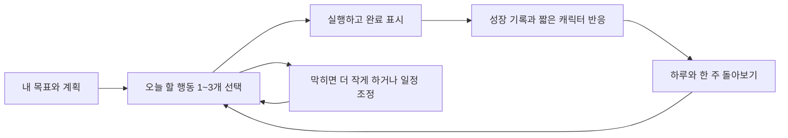
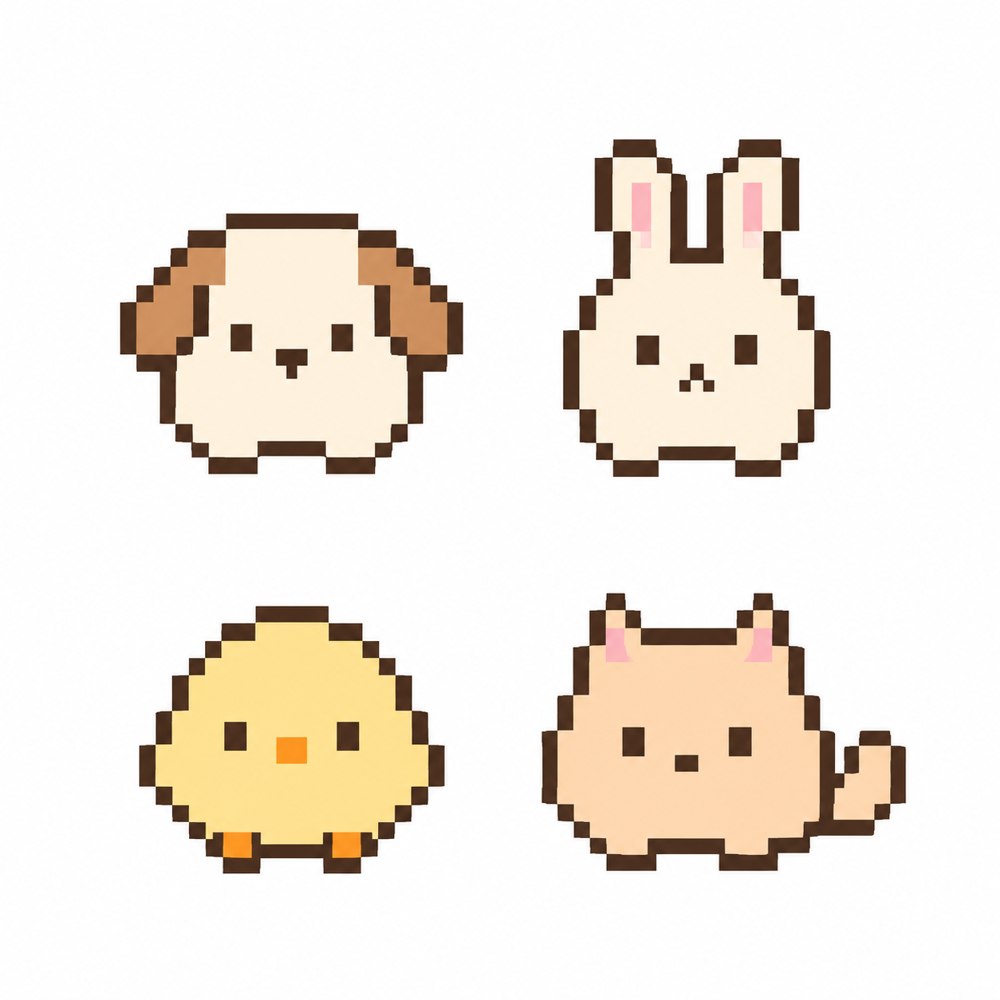
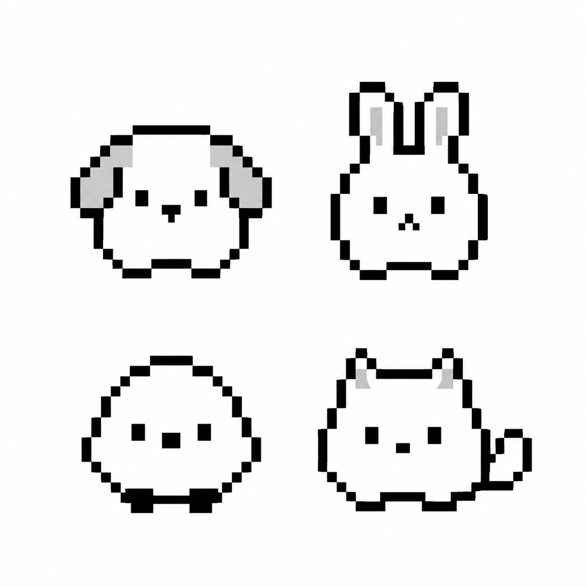
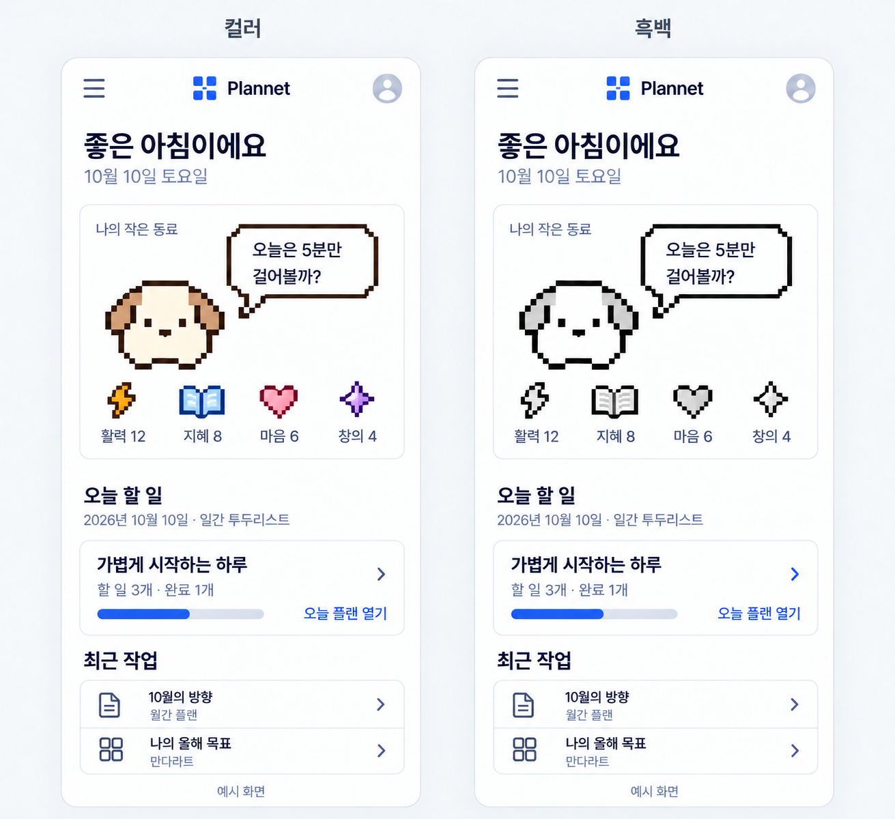
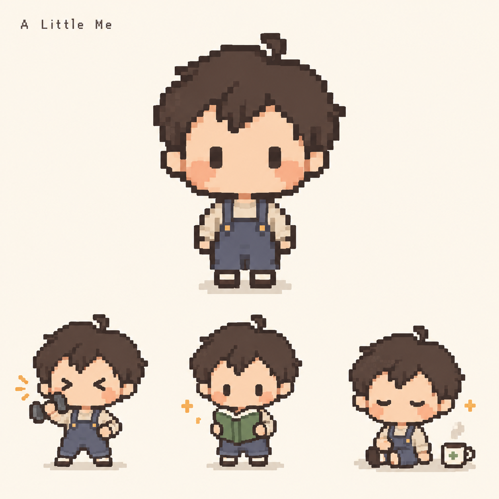
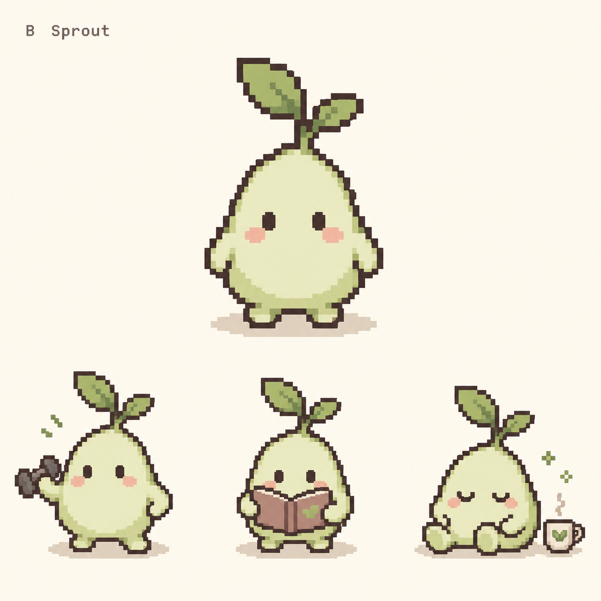
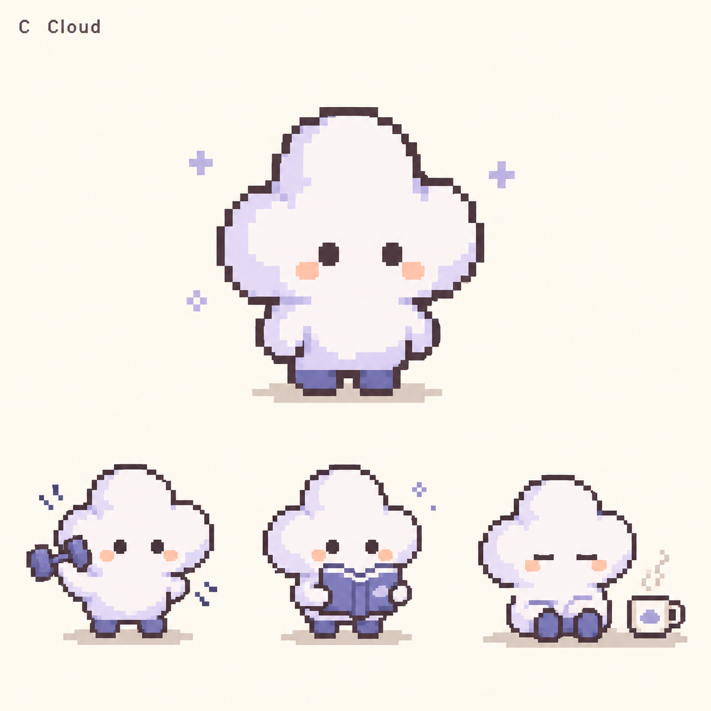
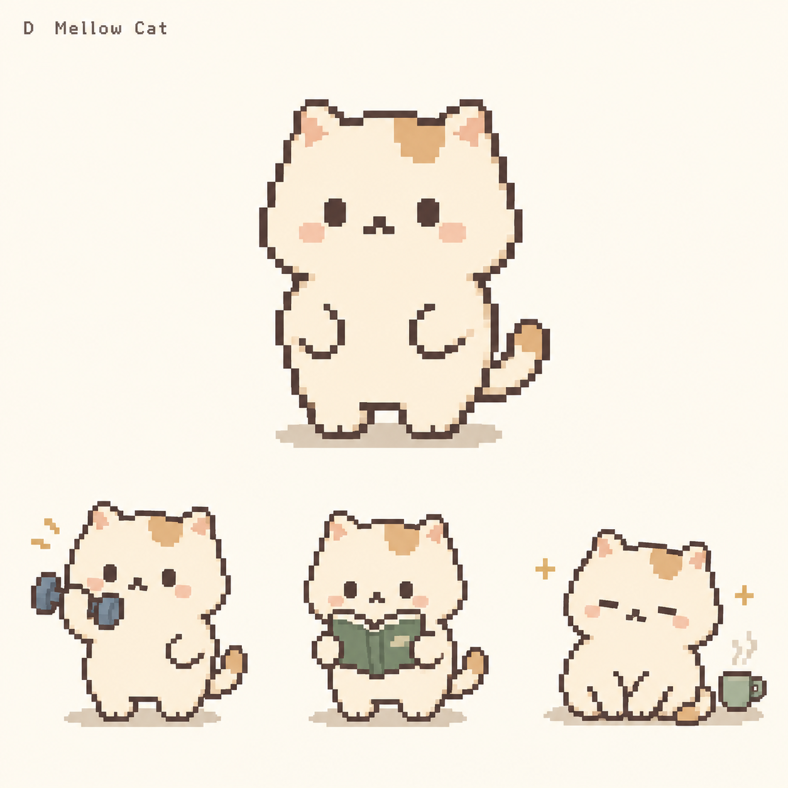

> **과거 기록 전용. 현재 규칙은 [기획 목록](../README.md)의 주제별 문서를 따른다.** 이전의 능력치 감소 금지·고정 4종 등의 문구는 최신 결정을 대체하지 않는다.

# Plannet 캐릭터 성장과 AI 실행 도우미 기획

2026-10-10 · v0.9 · **검토 중인 초안 — 구현 시작 전**

사용자가 계획을 실행하면 자신을 투영한 도트 캐릭터가 함께 성장하는 경험을 만든다. 귀여운 변화로 다시 방문할 이유를 만들고, AI는 오늘 시작할 수 있는 작은 행동을 제안한다. 이 문서를 계속 수정하며 제품 경험·성장 규칙·비용을 합의한 뒤 구현한다.

이 문서는 **동물 동료 모드**의 기획이다. 대안인 **꼬마 신의 행성 수집 모드·캐릭터와 집 성장 모드**는 [성장 모드 비교 기획](growth-modes-v0.12.md)에서 독립적으로 발전시킨다. 세 모드를 모두 구현하거나 동시에 서비스하기로 한 것은 아니며, 최종 모드는 나중에 선택한다.

## 1. 방향과 범위

**제품 경험:** 내가 하루를 살아갈수록 작은 나의 모습과 방에도 기록이 쌓인다.

- 캐릭터는 사용자의 분신이다. 말풍선은 짧은 혼잣말처럼 표현한다.
- 실행 후의 반응은 즉시 보여주고, 계획을 바꾸는 AI 제안은 사용자가 선택해 반영한다.
- 쉬거나 오래 접속하지 않아도 성장이 사라지지 않는다. 복귀를 환영한다.
- 캐릭터 기능을 숨겨도 기존 플래너를 독립적으로 사용할 수 있다.
- 초기 캐릭터는 강아지·토끼·병아리·고양이 4종이며, 사용자마다 하나를 선택한다. 새싹은 초기 구성에서 제외한다. 종류는 정했지만 외형·색상·도트 시안은 계속 수정할 수 있다. 작은 방 하나에서 시작하고, 숫자보다 표정·동작·소품 변화가 먼저 보이게 한다.

사용자가 제시한 방향은 저비용 AI, 개인별 캐릭터, 실행에 따른 능력치 성장, 독백형 동기부여, 귀엽고 감성적인 도트 아트다. 능력치 명칭은 **체력·지혜·평온·재주**로 정했다. 보상 수치·AI 호출 한도 등은 아래 결정 표에 따라 계속 검토한다.

## 2. 기본 사용 흐름

홈에는 작은 방·캐릭터·짧은 말풍선, 오늘 선택한 행동, 최근 작업을 배치한다. 기존 계획 편집 화면을 대화 UI로 대체하지 않는다. 모바일 편집 중에는 캐릭터가 입력·스크롤을 가리지 않도록 한다.

예를 들어 만다라트의 ‘건강한 몸 만들기 → 주 3회 운동’에서 ‘오늘 점심에 5분 걷기’를 제안한다. 수락하면 Daily에 출처를 보존해 추가하고, 완료하면 체력 경험치와 산책 동작을 보여준다. 각 템플릿은 캐릭터나 다른 템플릿 없이도 사용할 수 있어야 한다.

## 3. 캐릭터와 성장

적은 픽셀의 캐릭터와 미리 제작한 짧은 애니메이션을 조합한다. 실제 픽셀 규격은 작은 화면에서 검토한 뒤 정한다. 대기·기지개·걷기·읽기·축하·휴식 정도로 시작한다. 이름과 색상을 선택하고, 성장은 옷·화분·책·방 소품으로 표현한다. 매 실행마다 이미지를 생성하지 않는다.

| 확정 능력치 | 행동 예시 | 표현할 변화 | 도트 아이콘 제안 |
|---|---|---|---|
| 체력 | 운동, 산책, 스트레칭, 수면 습관 | 산책 동작, 운동 소품 | 번개 |
| 지혜 | 독서, 공부, 외국어 | 책, 안경, 책장 | 펼친 책 |
| 평온 | 휴식, 명상, 감정 기록, 주변 정리 | 차, 쿠션, 편안한 표정 | 초승달 |
| 재주 | 글쓰기, 개발, 그림, 요리, 만들기 | 작업대, 붓, 작은 컴퓨터 | 반짝임 |

명칭은 사용자 결정이며, 아이콘·활동 예시는 제안이다. 평온의 초승달은 이전 마음의 하트 아이콘을 대체하는 후보로 검토한다. 네 아이콘은 같은 도트 격자와 시각적 크기를 사용하고 이름을 함께 표시한다. 모든 활동을 억지로 네 종류에 맞추지 않으며, 분류 보류 상태에서도 계획 완료·저장은 가능해야 한다.

능력치는 실제 건강·지능·인격의 평가가 아니라 활동 영역을 나타내는 게임 기록이다. 균형 성장을 강요하지 않는다. 초기에는 행동당 주 능력치 하나를 사용자가 확인·변경할 수 있게 하고, AI 분류는 선택 가능한 추천으로만 사용한다.

성장 규칙 초안:

- 행동 완료를 서버가 저장한 뒤 경험치를 확정한다. 저장 대기 중 반응과 확정 보상을 구분한다.
- 같은 실행 건의 취소·재완료, 중복 전송, 여러 기기에서는 보상을 중복 지급하지 않는다.
- 동일한 실행을 템플릿 간에 공유할 때는 원본 목표 ID 외에 실행 건 식별자가 필요하다. 다른 날짜의 반복 실행은 별개다.
- 완료 취소는 그 실행에 대응하는 보상만 정정한다. 정정·재완료 규칙과 이미 열린 소품의 처리는 구현 전에 확정한다.
- 날짜가 다른 반복 실천, 일부만 실천하기, 휴식 기록의 보상 단위는 별도 결정한다.
- 미접속·미완료에 따른 능력치 감소, 죽음·굶주림, 연속 출석 초기화 벌칙은 넣지 않는다.

화면은 기존 읽기 쉬운 글꼴을 유지하고 캐릭터·소품에 도트를 사용한다. 소리·애니메이션을 줄이거나 끌 수 있어야 한다.

## 4. 독백과 AI 기능

말풍선은 관찰한 사실 하나와 작은 제안 하나를 중심으로 1~2문장으로 제한한다. 미완료 표시는 실제 미실행의 증거가 아니므로 ‘어제 운동을 안 했네’처럼 단정하지 않는다.

| 상황 | 말풍선 예시 | 가능한 다음 행동 |
|---|---|---|
| 오늘 첫 방문 | 오늘은 뭐부터 해볼까. 작은 것 하나면 충분할 것 같은데. | 오늘 행동 선택 |
| 계획이 미완료로 남음 | 어제 산책이 아직 남아 있네. 오늘은 5분만 걸어볼까? | 더 작게 하기·옮기기 |
| 첫 실천 완료 | 신발 신기까지가 제일 어려웠는데. 결국 나갔다 왔네. | 짧은 축하와 성장 |
| 계획이 많음 | 오늘 가방이 좀 무겁네. 꼭 할 것 세 개만 남겨볼까? | 우선순위 정하기 |
| 오랜만에 복귀 | 오랜만이다. 지난 건 잠깐 두고, 오늘부터 해볼까. | 오늘 새로 선택 |
| 사용자가 휴식 선택 | 오늘은 충전하는 날. 따뜻한 차 한 잔이면 좋겠다. | 휴식 기록 |

완료 축하의 대부분은 미리 작성한 문구를 사용한다. AI는 아래처럼 개인화가 도움이 되는 순간에만 호출한다.

| 기능 | 전달할 맥락 | 결과와 반영 방식 |
|---|---|---|
| 오늘 제안 | 관련 목표, 최근 실행 요약, 사용자가 정한 시간 | 행동 1~3개 제안 → 선택 시 추가 |
| 계획 쪼개기 | 사용자가 고른 목표·어려운 행동 | 작고 구체적인 대안 → 수락 시 변경 |
| 주간 회고 | 이번 주 실행 집계와 비교 가능한 기록 | 확인되는 변화와 다음 주 조정점 |

독백이 나타나고 바뀌는 시점은 AI 호출과 분리한다. 앱을 열었다는 이유만으로 매번 생성하지 않고, 같은 날짜·같은 맥락의 응답을 재사용한다. 첫 방문·의미 있는 완료·시간대 변화·일정 시간 머무름에 반응하되, 입력을 방해하지 않는다. 초기에는 푸시·상시 대화·음성·웹 검색을 제외한다. 구체적인 지속 동작 규칙은 아래 예산 배분 설계를 따른다.

## 5. 구현 기반의 초안

기존 계정별 DB 저장과 자동 저장을 유지한다. 브라우저 저장을 새 영구 저장소로 추가하지 않는다.

- **캐릭터 프로필:** 계정 소유자, 이름, 외형, 선택 소품, 표현 설정.
- **실행 기록:** 행동 식별자, 실제 실행일, 완료·취소 시각, 출처, 서버 저장 시각. 기록 입력 시점과 사용자가 지정한 실행일을 구분한다.
- **보상 내역:** 실행 건별 지급·정정 기록과 중복 방지 키. 능력치 집계는 이 내역에서 재계산할 수 있게 한다.
- **AI 사용 내역:** 계정, 기능, 요청 식별자, 입력·출력·추론 토큰, 예약 비용, 확정 비용, 처리 상태, 가격 버전.
- **제안 저장:** 계정과 맥락 버전별 응답 및 생성 시점. 이미 수정한 계획에 오래된 제안을 자동 적용하지 않는다.

현재 확인한 플랜 타입의 완료 여부만으로 과거 날짜별 실행을 복원할 수는 없다. 기존 완료 항목을 가져올 때 실행일을 임의로 추정하거나 과거 보상을 무제한 지급하지 않는다. 이관 시점의 기존 상태와 새 실행 기록을 구분하는 정책이 필요하다.

경험치·보상·애니메이션은 코드가 결정한다. AI는 제안과 문구만 생성하며, 저장된 기록 밖의 행동을 만들어 말하지 않게 한다. 전체 기록 대신 필요한 요약만 모델에 보내고 사용자에게 외부 AI 전송 범위를 알린다.

## 6. 모델 비용과 상한

### 계산 기준

후보는 **Gemini 3.1 Flash-Lite**다. 2026-10-10 확인한 표준 텍스트 단가는 100만 토큰당 입력 **$0.25**, 출력 **$1.50**이며 출력 과금에는 thinking 토큰이 포함된다. 모델 품질은 아직 확정하지 않았다. [Google 공식 가격표](https://ai.google.dev/gemini-api/docs/pricing#gemini-3.1-flash-lite)

아래 계산은 직접 API의 유료 표준 요금, 31일, 캐시 할인 없음, 웹 검색·음성·이미지 생성 없음 기준이다. 입력에는 시스템 지침과 대화 맥락을, 출력에는 과금되는 추론 토큰을 포함한다. OpenGateway 등 중간 제공자를 쓰면 실제 계약 단가·추가 요금으로 다시 계산한다.

`비용 = 입력 토큰 × 0.25 / 1,000,000 + 과금 출력 토큰 × 1.50 / 1,000,000`

### 많이 사용하는 사람의 월 사용 시나리오

아래는 호출·토큰 한도를 이렇게 설정한다는 가정이다. 문자 수 제한만으로 토큰 상한을 보장하지 않으며, 추론을 포함한 출력 제한의 실제 동작은 선택한 API에서 검증해야 한다.

| 기능 | 월 호출 한도 제안 | 1회 입력 / 과금 출력 | 월 비용 |
|---|---:|---:|---:|
| 오늘 제안·개인화 독백 | 하루 최대 3회 → 93회 | 2,000 / 300 토큰 | $0.08835 |
| 계획 쪼개기·짧은 도움 요청 | 하루 최대 5회 → 155회 | 4,000 / 600 토큰 | $0.29450 |
| 주간 회고 | 월 최대 5회 | 6,000 / 800 토큰 | $0.01350 |
| 합계 | 253회 | — | **$0.39635** |
| 재시도 예비비 $0.05까지 사용 | 실제 재시도는 가용분 내에서만 | — | **$0.44635** |

v0.3부터는 임의의 재시도 비율 대신 아래의 월 $0.05 예비비를 적용한다. 이 표의 호출 조합은 예시이며, 큰 입력·긴 추론·추가 호출은 별도 제한이 필요하다. 용도별 배분과 예약 비용을 통과한 요청만 실행하므로 표의 호출 횟수를 모두 사용할 수 있다고 보장하지 않는다.

**계정당 달력 월 $0.50의 AI 추론 비용 상한을 설계 기준으로 채택한다.** 사용자 요청에 따라 월 예산을 날짜별로 분배하고, AI 호출이 없더라도 독백과 기본 기능이 지속되도록 한다. 아래 배분 비율과 시간 간격은 조정 가능한 초안이다. 보통 사용하는 시나리오(하루 제안 2회, 월 도움 요청 10회, 회고 5회)는 약 $0.0914이고 20% 여유를 포함하면 약 $0.11이다. 이는 사용 행태 가정에 따른 추산이며 관측된 평균이 아니다.

앞선 대화의 월 약 $0.05는 입력 1,000·출력 200토큰의 짧은 호출을 하루 3회, 30일 사용하는 예시였다. 이번 표는 더 긴 계획 도움과 회고까지 포함해 예산을 확장했다.

### 상한을 지키는 서버 규칙

1. 계정별 사용·예약 비용을 DB에서 원자적으로 확인한다. 동시 요청도 같은 예산을 공유한다.
2. 호출 전에 입력량과 과금 출력 상한으로 최대 비용을 예약한다. 예약하면 $0.50을 넘는 요청은 외부 API로 보내지 않는다.
3. 재시도·중복 요청·백그라운드 요약 등 이 기능의 모든 유료 호출을 동일한 예산에 포함한다. 중복 요청은 요청 키로 방지한다.
4. 응답 사용량으로 정산한다. 타임아웃처럼 과금 여부가 불명확하면 예약을 즉시 반환하지 않고 보수적으로 유지·대사한다.
5. 한도 소진 시에도 아래의 동일한 독백 갱신 규칙과 기본 기능을 제공한다. 유료 모델로 자동 승급하지 않는다.
6. 가격표 버전, 월 경계(초안: Asia/Seoul 달력 월), 계정 전체 공용 제한을 함께 둔다. 월 경계를 걸친 호출은 예약된 월에 정산한다.

이 규칙을 구현·검증하기 전에는 최대 비용을 보장할 수 없다. 무제한 자유 대화에는 유한한 사용자당 최대액이 없다. 실제 제공자 과금 조건·단가 변경도 별도로 관리한다.

### 월 예산을 날짜별로 분배하는 규칙

**독백의 지속성은 규칙과 문구로 보장하고, AI 예산은 개인화의 깊이에 사용한다.** 월초에 한 달 예산을 모두 쓰거나 월말에 캐릭터가 멈추는 구조를 피한다.

| 용도 | 월 예산 초안 | 배분·소비 규칙 |
|---|---:|---|
| 자동 개인화 | $0.15 · 30% | 오늘 제안·독백 묶음과 주간 회고에만 사용 |
| 사용자 요청 | $0.30 · 60% | 계획 쪼개기·구체화 요청에 사용. 자동 생성이 이 예산을 가져가지 않음 |
| 재시도 예비비 | $0.05 · 10% | 일시적 실패의 재시도에만 사용. 일반 생성이나 월말 소진에 사용하지 않음 |

1. 각 용도의 월 예산을 해당 월의 일수로 나눠 매일 같은 금액을 배정한다. 31일 월이면 각각 하루 약 $0.00484 / $0.00968 / $0.00161이다. 오늘 몫은 날짜가 시작할 때 사용 가능하며, 미래 날짜의 몫은 당겨 쓰지 않는다.
2. 사용하지 않은 일일 몫은 같은 용도 안에서 최대 7일치까지 누적한다. 7일치를 넘는 가용분은 버리고, 다음 달에는 이월하지 않는다. 오래 쉬었다고 한 번에 과다 호출하지 않는다.
3. 새 계정의 배정은 가입일부터 시작한다. 자정마다 모든 계정을 깨우는 작업 대신, 요청 시 지난 날짜만큼 가용분을 계산해 DB에서 한 번 반영한다. 여러 탭·기기가 같은 배정분을 중복 받지 않게 한다.
4. 호출은 월 전체 잔액과 해당 용도의 현재 가용분을 모두 만족할 때만 허용한다. 상단 표의 하루 호출 수는 추가 상한이며, 그 횟수만큼 유료 호출을 보장한다는 의미는 아니다.
5. 자동 생성은 그날 첫 유효한 방문에 **독백 후보 몇 개와 오늘의 행동 제안을 한 묶음**으로 준비하는 것을 기본으로 한다. 앱을 열지 않은 날에는 생성하지 않는다. 주간 회고도 사용자가 볼 때 한 번만 생성한다.
6. 자동 개인화는 회고가 예정된 날에 회고의 최대 요청 비용을 먼저 남겨둔다. 남은 가용분이 부족하면 독백은 기본 문구를 사용한다. 회고 자체도 예산이 부족하면 실행 집계와 정형 회고를 제공한다.
7. 재시도는 일시적 실패에 한해 요청당 최대 1회, 예비비가 충분할 때만 허용한다. 첫 시도가 과금됐을 가능성도 남겨 둔다. 실패 응답을 받았다는 이유로 예산을 무제한 반환하지 않는다.
8. 월·용도별 확정 지출과 처리 중 예약은 별도로 유지한다. 정산 차액을 반환하더라도 현재 누적 한도까지만 가용분에 넣는다. 이전 월 요청의 정산으로 새 달 예산이 늘어나지 않는다.

큰 사용일에도 다음 날 몫은 남고, 월말에도 동일한 배분 규칙을 적용한다. 용도 간 자동 전용, 사용 패턴 예측, 비싼 모델로의 자동 전환은 첫 버전에 넣지 않는다. 가격이나 토큰 상한이 바뀌면 배분 비율과 품질을 다시 확인한다.

### AI 없이도 독백이 계속 바뀌는 규칙

말풍선을 보여주는 경로는 언제나 `현재 상태 확인 → 유효한 문구 선택 → 표시`다. AI 응답을 기다리는 로딩 화면으로 캐릭터를 멈추지 않는다. 먼저 표시한 문구를 늦게 도착한 AI 문구로 곧바로 덮어쓰지도 않는다.

| 계기 | 표시 동작 | AI 호출과의 관계 |
|---|---|---|
| 그날 첫 방문·시간대 전환 | 현재 날짜·시간대에 맞는 인사나 행동 제안 | 저장된 유효 문구 또는 기본 문구 즉시 표시 |
| 행동 완료·성장 확정 | 해당 사건의 짧은 반응과 애니메이션 | 기본 문구만으로 즉시 반응 가능 |
| 계획 선택·휴식 선택 | 사용자가 선택한 상태에 맞게 변경 | 사건당 호출하지 않음 |
| 화면에서 15분 동안 새 계기 없음 | 대기 독백을 다른 후보로 변경 | 화면이 보이고 편집·모달 조작 중이 아닐 때만. AI 호출 없음 |
| 숨긴 탭으로 복귀 | 날짜·맥락·표시 만료를 다시 확인 | 숨긴 동안의 변경을 몰아서 재생하지 않음 |

표시 직후에는 일반 독백을 최소 30초 유지하고, 새 완료·휴식 선택처럼 명시적 행동에 대한 반응은 우선한다. 입력 중 바꿀 필요가 생기면 편집 종료 뒤 한 번 반영한다. 주기적인 서버 조회 대신 화면 내 단발 타이머와 가시성 이벤트를 사용한다. 사용자가 독백·움직임을 끈 경우에는 갱신 연출을 강제하지 않는다.

문구 선택은 단순한 우선순위를 따른다.

1. **현재 사건·날짜·계획 버전과 맞는 저장된 AI 문구**가 있으면 후보에 넣는다. 다른 날짜의 ‘어제’, 변경된 목표, 취소된 완료를 언급하는 문구는 제외한다.
2. **현재 상태에 맞는 기본 문구**를 항상 후보에 넣는다. 기본 문구에도 확인된 목표명·오늘의 완료 개수 등을 안전하게 넣을 수 있다. 값이 없으면 일반 문구를 쓴다.
3. 최근 표시한 문구 ID 20개를 제외하고 후보를 고른다. 후보가 모두 소진되면 가장 오래전에 표시한 문구부터 재사용한다. 같은 사건의 여러 탭 알림은 사건 ID로 중복 억제한다.
4. 대기·첫 방문·완료·복귀·휴식 등 상황별로 충분한 문구를 준비한다. 시제품에서는 주요 상황당 20개 이상으로 시작하고 실제 반복감을 확인한다. 반복을 완전히 없앤다고 약속하지 않는다.
5. 날짜만 달라졌는데 사실이 그대로인 경우에도 같은 문구가 무기한 고정되지 않도록 표시 만료와 후보 순환을 적용한다. 과거 계획 데이터를 추측해 새로운 사실을 만들지는 않는다.

예: 29일 저녁에 AI 가용분이 부족해도 완료 버튼에는 즉시 반응하고, 밤 시간대로 넘어가면 인사가 바뀌며, 화면에 머무르면 대기 독백도 순환한다. 다음 날 배정분이 생기면 필요한 개인화만 다시 생성한다. 사용자가 ‘멈췄다’고 느끼는 상황을 AI 사용량으로 만들지 않는 것이 목표다.

### 예산 소진과 장애가 사용자 기능에 미치는 영향

- 말풍선 길이·말투·표시 시점·애니메이션은 AI 문구와 기본 문구에서 동일하다. 캐릭터에 예산 소진 오류나 무한 로딩을 띄우지 않는다.
- ‘오늘 행동 고르기’는 사용자가 정한 날짜·우선순위·진행 상태에서 후보를 제시하는 기본 규칙으로도 작동한다. 정확한 소요 시간을 모르면 아는 척하지 않는다.
- ‘더 작게 하기’는 AI가 없어도 `첫 단계만 하기 / 시간을 짧게 정하기 / 횟수 줄이기` 같은 편집 가능한 선택지를 제공한다. 주간 회고는 완료 집계와 사실에 기반한 기본 문장으로 제공한다.
- 기본 제안을 새 AI 분석인 것처럼 표시하지 않는다. 일반 캐릭터 말풍선에는 생성 출처를 매번 강조하지 않아도 되지만, 결과 상세에서는 기본 제안인지 AI 제안인지 확인할 수 있게 한다. 사용자가 명시적으로 요청한 AI 분석을 수행하지 못했으면 이를 사실대로 안내한다.
- 연결 실패·저장 실패·계정 확인 오류는 기존 상태 안내를 유지한다. 실제 데이터 오류까지 자연스러운 문구로 감추지는 않는다. 확인하지 못한 완료나 성장도 확정된 것처럼 축하하지 않는다.

이 설계가 보장하려는 것은 **반응·갱신·기본 기능의 연속성**이다. 예산 없는 상태에서 무제한 AI 개인화와 같은 품질을 제공한다는 뜻은 아니다. 예산 0인 상태도 정상 제품 모드로 디자인하고 검증한다.

### 총 서비스 비용과의 구분

| AI 기능 사용 계정 수 | 모두 월 $0.50 예산을 소진한 경우 |
|---:|---:|
| 100명 | $50 / 월 |
| 1,000명 | $500 / 월 |
| 10,000명 | $5,000 / 월 |

이 표는 **AI 추론료만**이다. DB·백업·트래픽·홈서버 전기·모니터링·세금·환전 수수료·에셋 제작비는 제외한다. 따라서 서비스 전체의 사용자당 최대 비용은 지금 확정할 수 없다. 계획용 환율을 $1 = 1,500원으로 가정하면 AI 예산 $0.50은 약 750원이며, 현재 환율을 조회한 값은 아니다.

## 7. 첫 버전과 검증

| 단계 | 범위 | 다음 단계로 넘어갈 기준 |
|---|---|---|
| 기획 구체화 | 대표 캐릭터·홈 시안, 하루 사용 시나리오, 보상 규칙 | 사용자와 아래 결정 항목 합의 |
| 성장 경험 | 4종 중 내 캐릭터 하나 선택, 방 하나, 실행 기록, 기본 반응·보상 | 완료·취소·중복·다기기에서 기록 일관성 |
| AI 실행 도움 | 오늘 제안, 더 작게 하기, 짧은 독백·회고 | 한국어 품질·기록 충실성·비용 제한 검증 |
| 후속 확장 | 외형과 방 꾸미기, 성향별 표현, 선택 알림 | 재방문과 실제 실행에 도움이 된다는 관찰 |

초기 모델 평가는 실제 제품 상황을 반영한 고정 사례 약 20개로 시작한다. 실행 가능한 구체성, 한국어 자연스러움, 압박감, 기록에 없는 사실 생성, 응답 시간, 실제 과금 토큰을 함께 본다. 토큰 예산 안에서 품질이 나오지 않으면 기능 범위·모델·예산 중 무엇을 바꿀지 결정한다.

예산·연속성의 구현 검증에는 다음을 포함한다.

- 28·29·30·31일 월, 월중 가입, 월 경계 처리 중 요청, 여러 기기 동시 요청에서 월 $0.50과 용도별 가용분을 넘지 않는다.
- 첫날 사용 폭증·7일 미접속·월말 예산 부족·재시도·응답 유실에도 미래 날짜 예산을 미리 소비하지 않는다.
- AI 예산 0 또는 제공자 장애 상태에서도 첫 방문·완료·시간대·15분 만료·다음 날 복귀 시 독백 선택과 기본 행동이 작동한다.
- 입력·모달·숨긴 탭에서는 독백 갱신이 방해하지 않으며, 복귀 시 오래된 ‘어제’나 취소된 완료 문구가 표시되지 않는다.
- 기본 문구만 사용하는 하루 시연과 AI가 섞인 하루 시연을 비교해 멈춤·반복감·불필요한 전환·오해를 점검한다.

성과는 체류 시간보다 제안 수락 후 실행률, 작은 행동으로 바꾼 뒤 실행률, 미완료 뒤 복귀율로 본다. AI 문구 숨김·불편 신고와 캐릭터 없이 쓰는 비율도 함께 확인한다.

## 8. 구현 전에 정할 것

| 결정 항목 | 현재 제안 | 상태 |
|---|---|---|
| 캐릭터 정체성 | 나를 투영한 작은 존재, 독백 말투 | 사용자 방향 반영 |
| 초기 캐릭터 구성 | 강아지·토끼·병아리·고양이 중 하나 선택, 새싹 제외 | 사용자 결정 반영 |
| 첫 비주얼 | 머리·몸을 한 덩어리로 단순화한 4종 도트, 방 하나 | 최소형 4종 방향 채택; 컬러·흑백 비교 후 선택, 실제 픽셀·동작 규격 미정 |
| 성장 방식 | 체력·지혜·평온·재주 4개 + 소품, 미접속 벌칙 없음 | 명칭 확정, 아이콘·경험치 수치 미정 |
| 완료 보상 | 실행 건별 한 번, 취소 시 정정 | 반복·부분 실행·소품 회수 정책 미정 |
| 템플릿 연결 | 선택적 출처 연결, 동일 실행 중복 방지 | 실행 식별·이관 설계 필요 |
| AI 범위 | 오늘 제안·쪼개기·회고, 상시 자유대화 제외 | 사용자 확인 필요 |
| 모델·비용 | 월 $0.50 상한, 날짜별 배분, 용도별 30/60/10% | 상한·분배 원칙 채택, 비율·모델 실측 필요 |
| 말풍선 빈도 | AI와 독립된 사건·시간대·15분 만료 갱신, 숨김 지원 | 연속 동작 원칙 채택, 간격·반복감 조정 |

**구현 시작 기준:** 대표 모바일 화면과 하루 사용 흐름, 최소 기능 범위, 보상 정정 규칙, 데이터 이관, AI 예산·한도 초과 동작을 합의한 뒤 사용자가 구현 시작을 요청한다. 현재는 문서와 시안을 발전시키는 단계다.

최종 모드는 [별도 비교 기획](growth-modes-v0.12.md) 검토 후 정한다. 아래 동물 시안 채택은 동물 모드 내부의 결정이다.

## 9. 캐릭터 시안

### 현재 선택: 초기 4종

**강아지·토끼·병아리·고양이의 최소형 도트 시안을 현재 디자인 기준으로 채택한다.** 새싹은 제외한다. 머리와 몸을 한 덩어리로 줄이고, 귀·부리·꼬리로 종류를 구분한다. 아래 이미지는 사용자가 선택한 기준 시안이며 외형·색상은 이후에도 수정할 수 있다. 캐릭터 종류와 시안 버전을 구분해, 외형을 바꾸더라도 사용자의 선택·성장 기록은 유지하도록 설계한다.

**색상 방식은 미정:** 아래 컬러·흑백 시안을 함께 비교한 뒤 선택한다. 두 시안 모두 왼쪽 위부터 강아지·토끼·병아리·고양이 순서다. 흑백은 귀 안쪽 등에 옅은 회색을 포함한다.

| 컬러 시안 | 흑백 시안 |
|---|---|
|  |  |
| 따뜻한 색감, 종류별 색상 구분 | 소박한 도트 감성, 윤곽·표정 중심 |

최종 선택 때는 모바일 실제 표시 크기에서 종류 구분·표정 가독성·기존 플래너 화면과의 조화를 비교한다. 아래 색상 설명은 컬러 시안 기준이다.

| 초기 캐릭터 | 시안 위치 | 구분하는 특징 |
|---|---|---|
| 강아지 | 왼쪽 위 | 크림색 몸, 갈색 처진 귀 |
| 토끼 | 오른쪽 위 | 크림색 몸, 긴 귀 |
| 병아리 | 왼쪽 아래 | 노란 몸, 작은 주황색 부리·발 |
| 고양이 | 오른쪽 아래 | 연한 살구색 몸, 뾰족한 귀·짧은 꼬리 |

네 종류는 작은 화면에서도 실루엣으로 구분되도록 한다. 이 이미지는 내장 이미지 생성 도구로 만든 비교용 콘셉트이며, 실제 12~16px 규격의 스프라이트로 검증한 결과는 아니다. 최종 제작 때 일정한 픽셀 격자·팔레트·투명 배경을 맞추고 작은 화면에서 확인한다. 동작은 깜빡임·작은 점프·표정 변화부터 검토한다. 종류 변경 허용 시점·방법은 추후 결정한다. [생성 프롬프트](../../assets/character-concepts/minimal-four-prompts.md)

### 강아지 턱선 — 현재 기준

사용자 요청으로 A 방향의 단순한 큰 얼굴을 유지하고, 짧은 웃음선 대신 양쪽 볼에서 이어지는 턱선으로 얼굴·몸의 경계를 구분한다. 아래 시안이 강아지의 현재 기준이며, 위 4종 비교판 속 강아지는 수정 전 모습이다. 턱선을 반영한 흑백 시안은 아직 별도 제작하지 않았다.

### 홈 카드 구성 — 게임기 프레임 제외

사용자 요청으로 게임기 본체·베젤 형태의 프레임은 채택하지 않는다. 기본 카드 안에 도트 캐릭터·계단형 말풍선·작은 능력치 아이콘을 배치한 구성으로 되돌린다. 컬러·흑백 선택은 계속 비교한다.

이 이미지는 내장 이미지 생성 도구로 만든 이전 시안으로, 카드 배치의 기준이다. 이미지 속 강아지는 턱선 수정 전 모습이며 능력치 명칭도 이전 안이다. 다음 홈 시안에는 턱선 개선과 **체력·지혜·평온·재주**를 반영한다. 프레임 철회가 이 결정을 되돌리는 것은 아니다. 앱 코드에 적용한 화면은 아니다.

### 이전 탐색 시안 A~D

2026-10-10 생성한 초기 탐색 기록이다. 각 이미지에는 기본 모습과 운동·독서·휴식 모습이 있다. 내장 이미지 생성 도구로 만든 비교용 콘셉트이며, 현재 초기 구성은 위 4종 표를 따른다. 작은 사람·새싹·구름 이미지는 탐색 기록으로만 보관한다.

| 후보 | 어울리는 경험 | 구체화할 점 |
|---|---|---|
| A 작은 사람 | 나의 분신, 옷·머리·피부색 꾸미기 | 다양성을 반영하는 외형 선택 범위 |
| B 새싹 요정 | 작은 생명체의 성장, 잎·꽃·방의 변화 | 외형 성장과 능력치 연결 방식 |
| C 구름 뭉치 | 조용하고 편안한 독백, 색·표정 변화 | 소품 없이도 구별되는 개성 |
| D 동글 고양이 | 친숙한 귀여움, 행동 애니메이션 | 사용자의 분신과 반려 캐릭터 중 정체성 |

초기에는 분신 표현과 생명체 성장 표현을 비교했으며, 이후 사용자 선택으로 위 동물 4종 방향을 채택했다.

### A 작은 사람

### B 새싹 요정

### C 구름 뭉치

### D 동글 고양이

생성에 사용한 전체 지시는 [시안 프롬프트](../../assets/character-concepts/prompts.md)에 보관한다. 이미지 파일은 저장소 안에 보관하며 제품 코드에는 아직 연결하지 않는다.

### 이전 탐색 시안 E~H와 단순화 방향

사용자 피드백: 앞선 시안보다 픽셀 수와 디테일을 줄이고, 제공한 참고 이미지처럼 큰 픽셀·굵은 윤곽선·적은 색상을 사용한다. 정확한 픽셀 규격은 최종 에셋 제작 시 정한다. 다음은 내장 이미지 생성 도구로 만든 이전 탐색 기록이다. E 강아지·G 토끼를 포함한 현재 디자인 기준은 위 최소형 4종 시안으로 교체했다. F 곰·H 새싹은 초기 구성에 포함하지 않는다.

| 후보 | 이미지 | 특징 |
|---|---|---|
| E 강아지 | [이미지](../../assets/character-concepts/e-simple-puppy-v1.png) | 처진 귀, 흰색·하늘색 |
| F 곰 | [이미지](../../assets/character-concepts/f-simple-bear-v1.png) | 짧은 귀, 베이지·갈색 |
| G 토끼 | [이미지](../../assets/character-concepts/g-simple-bunny-v1.png) | 높이가 다른 귀, 흰색·연보라 |
| H 새싹 | [이미지](../../assets/character-concepts/h-simple-sprout-v1.png) | 두 잎, 연두색, 단순한 미소 |

[추가 시안 생성 프롬프트](../../assets/character-concepts/simple-prompts.md)

## 변경 기록

- 2026-10-10 v0.1: 사용자 아이디어와 초기 제안을 통합. 월 비용 시나리오, $0.50 예산 제어, 결정 항목과 구현 시작 기준 추가.
- 2026-10-10 v0.2: 캐릭터 후보 네 가지와 기본·활동 모습 시안, 비교 기준, 생성 프롬프트 추가. 캐릭터 선택과 구현은 미확정.
- 2026-10-10 v0.3: 사용자당 월 예산 제한과 날짜별 배분 원칙 채택. 용도별 예산, 7일치 누적, AI와 독립된 독백 순환, 예산 0에서도 유지되는 기본 경험과 검증 기준 추가. 배분 비율·갱신 간격은 초안.
- 2026-10-10 v0.4: 큰 픽셀·적은 디테일 방향의 사용자 피드백과 추가 캐릭터 시안 E~H 반영.
- 2026-10-10 v0.5: 초기 캐릭터를 강아지·토끼·병아리·고양이 4종으로 채택하고 새싹 제외. 외형 시안은 변경 가능함을 명시하고, 이전 탐색 기록과 현재 구성을 구분. 병아리 신규 시안·고양이 단순화는 후속 기획 작업으로 남김.
- 2026-10-10 v0.6: 사용자가 선택한 최소형 4종 이미지를 현재 디자인 기준으로 채택. 병아리와 단순화한 고양이를 포함한 공통 시안 저장. 기존 시안은 탐색 기록으로 보존하며, 최종 에셋 규격과 동작은 후속 기획 대상으로 유지.
- 2026-10-10 v0.7: 흑백 시안을 컬러와 나란히 추가. 최소형 4종 방향은 유지하고 색상 방식은 비교 후 결정하도록 명시.
- 2026-10-10 v0.8: 게임기 프레임 철회. 기본 카드와 도트 말풍선·능력치 아이콘 구성으로 복귀하고 배치 참고 시안 보관. 캐릭터 턱선 수정과 능력치 명칭 논의는 유지.
- 2026-10-10 v0.9: 체력·지혜·평온·재주 명칭 확정, 강아지 턱선 개선 시안 보관. 동물 모드와 별도로 꼬마 신·집 성장 모드 비교 기획 연결. 최종 모드 선택과 구현은 보류.
