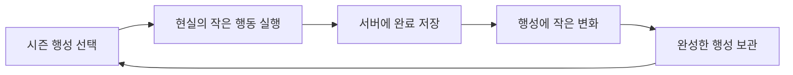
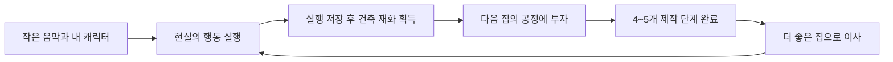
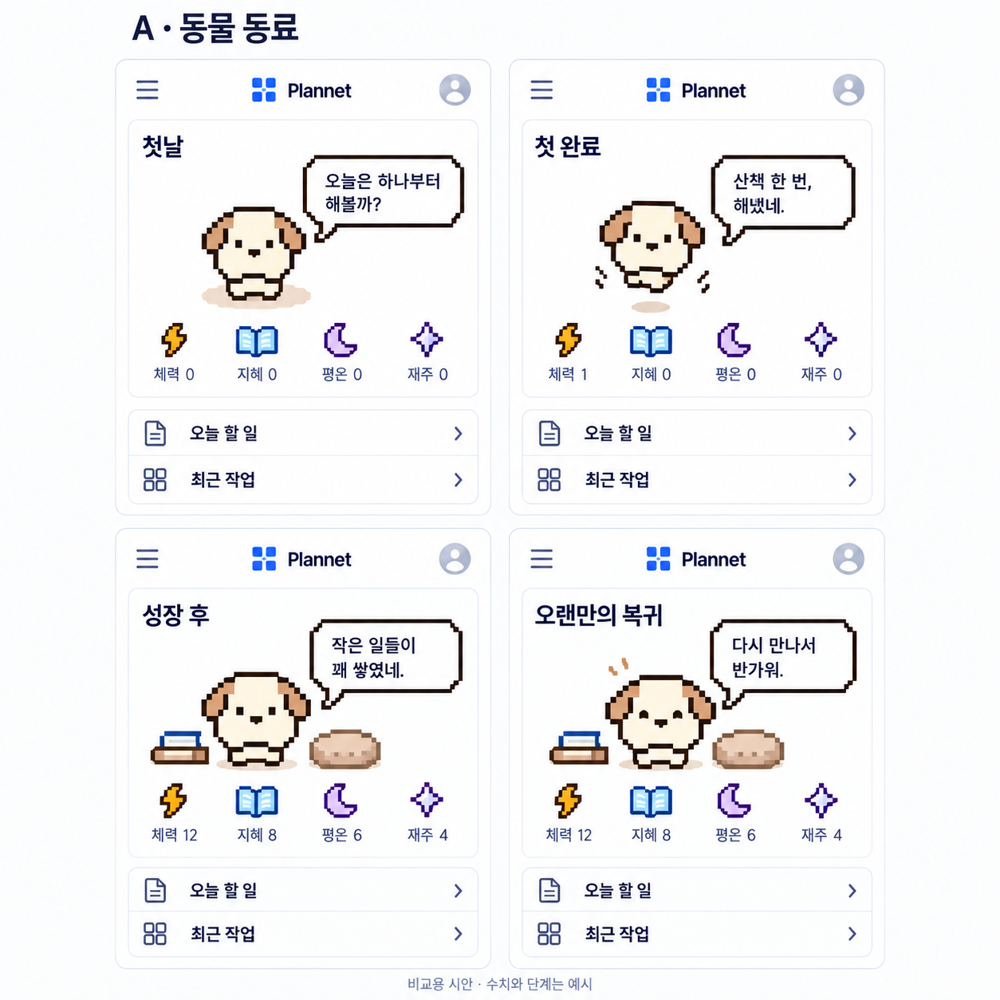
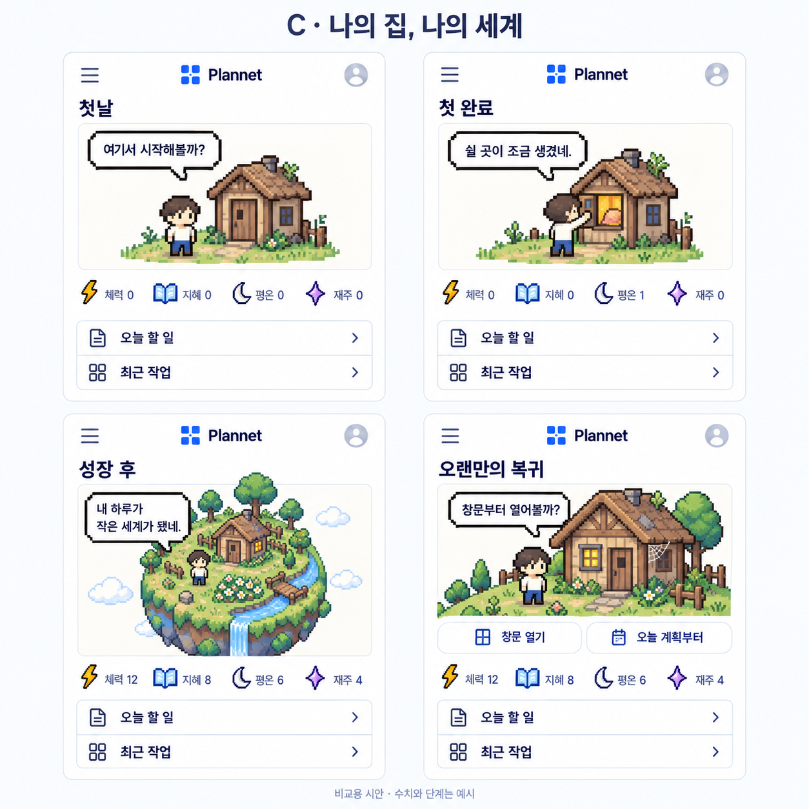
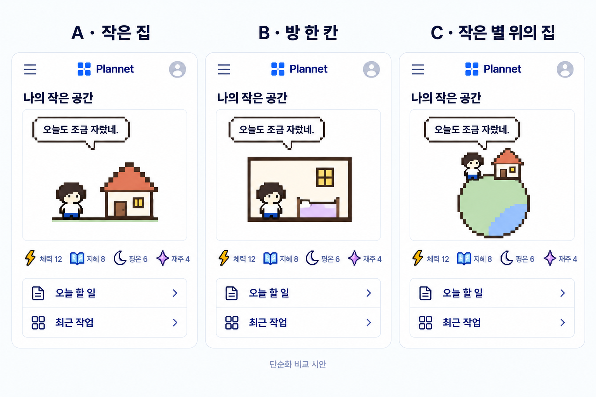
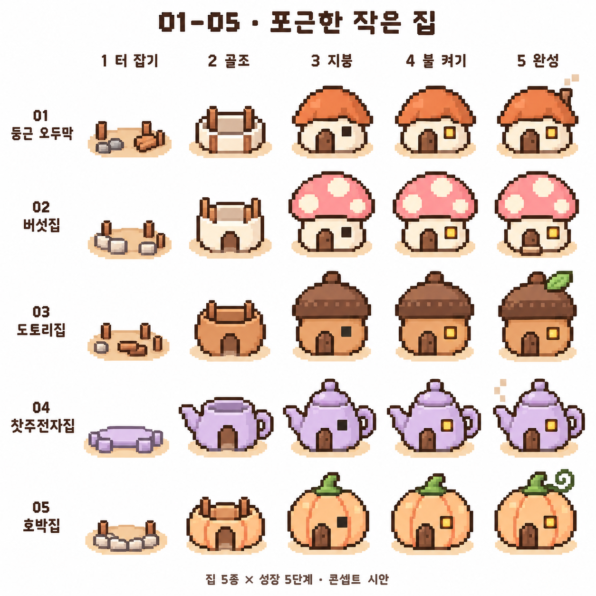
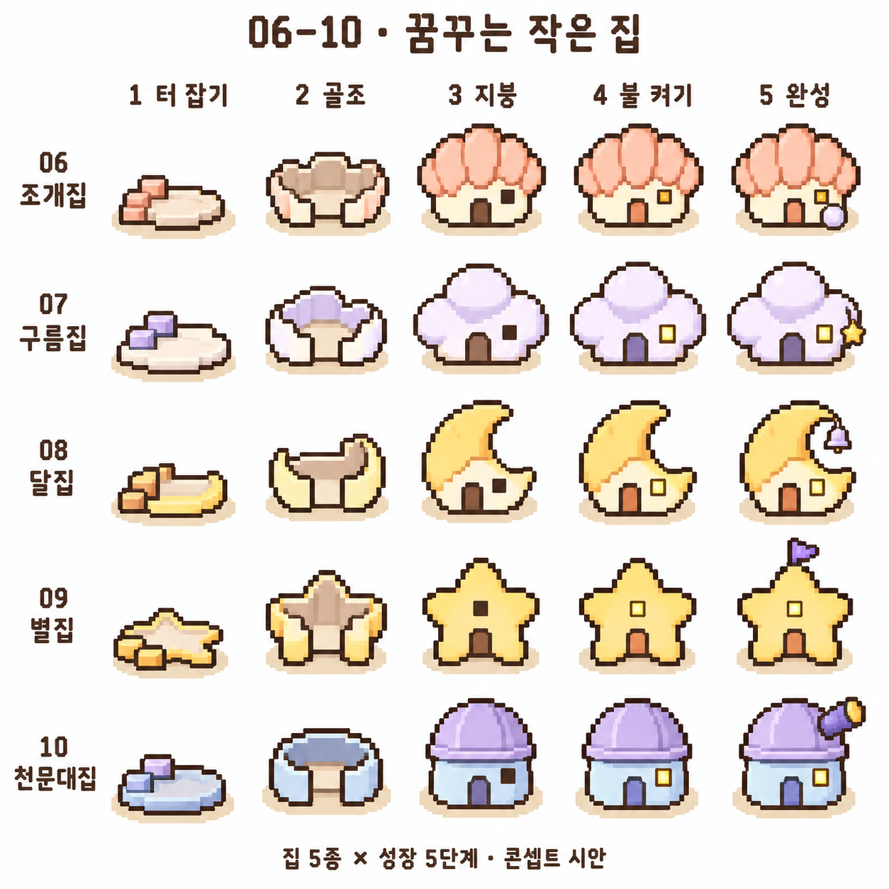
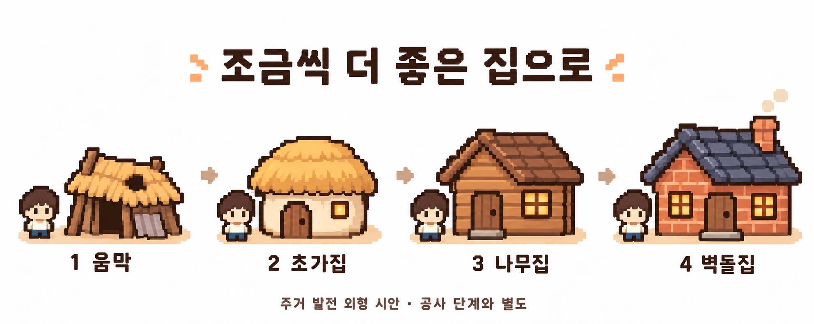
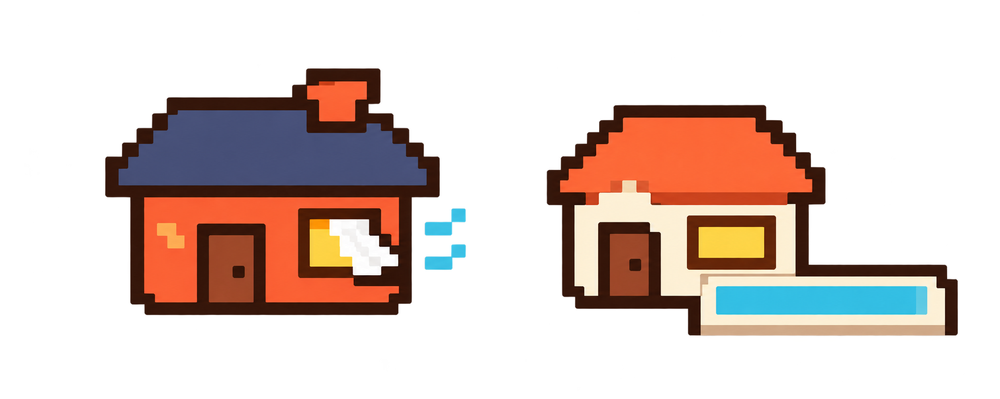
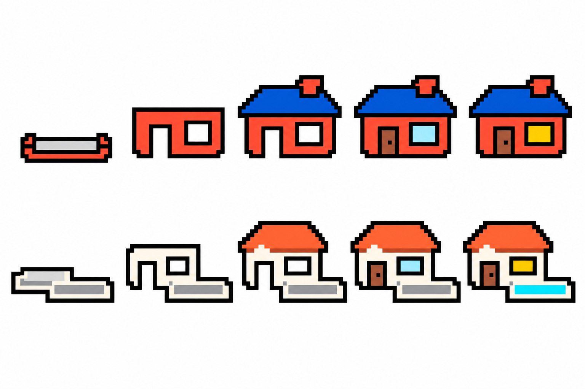

> **과거 기록 전용. 현재 규칙은 [기획 목록](../README.md)의 주제별 문서를 따른다.** 이전의 능력치 감소 금지·고정 4종 등의 문구는 최신 결정을 대체하지 않는다.

# Plannet 성장 모드 비교 기획

2026-10-11 · v0.12 · **독립적인 대안 탐색 — 최종 모드·구현 미정**

목표는 계획의 실행이 눈에 보이는 변화로 남아 다시 시작하고 싶어지는 경험이다. 아래 세 안을 따로 발전시킨 뒤 최종 모드를 고른다. 동시에 세 모드를 개발하는 계획이 아니다. 재미·유지율에 대한 설명은 검증 전 가설이며, 사용자 반응을 확인하지 않았다.

## 1. 결정한 것과 열어 둔 것

| 구분 | 현재 상태 |
|---|---|
| 동물 동료 모드 | 강아지·토끼·병아리·고양이, 체력·지혜·평온·재주, 강아지 턱선 개선 유지 |
| 시각 방향 | 단순한 도트, 도트 말풍선, 기본 홈 카드. 게임기 프레임 철회, 컬러·흑백 미정 |
| 집 시안의 최신 표현 | 캐릭터·배경·바닥·주변 장식 없이 집만 표시. 집의 특징인 커튼·수영장은 유지, 투명 배경 사용 |
| 꼬마 신 모드의 사용자 원안 | 캐릭터는 꼬마 신 하나, 능력치 카운팅 없음, 여러 행성 소유, 시즌별 새 행성 수집 |
| 집 성장 모드의 최신 방향 | 현실의 실천·성공을 쌓으며 낡은 움막 → 초가집 → 나무집 → 벽돌집처럼 더 좋은 집으로 계속 이사. 재료 또는 돈을 모아 다음 집을 완성 |
| 집 콘텐츠의 추가 요구 | 귀여움 유지, 집 개수는 미정. 집당 5단계 시안을 기준으로 검토하며 10종이면 50개 이미지. 테마가 다른 집 수집안은 철회 |
| 재화·능력치 | 초기 실천 완료당 1코인. 집 레벨이 높아질수록 공정 비용 증가. 체력·지혜·평온·재주는 건축에 소비하지 않음 |
| 주거 불변 원칙 | 주거 환경은 반드시 개선 또는 유지. 완성한 집·설비·완료 공정의 후퇴, 미접속에 따른 악화 없음 |
| 발견의 재미 | 다음 집 전체 또는 수식어를 숨기고 공사 중 드러내는 아이디어 검토. 숨기는 범위·시점 미정 |
| 최종 선택 | 세 모드를 따로 비교한 후 결정. 집 모드의 캐릭터가 동물인지 사람인지는 미정 |
| 이름 | 현재 표기 Plannet. 행성 테마를 연결하고 싶지만 서비스명 유지가 필수 조건은 아님 |

## 2. 한눈에 비교

| 항목 | A. 동물 동료 | B. 꼬마 신의 작은 우주 | C. 나의 집, 나의 세계 |
|---|---|---|---|
| 핵심 애착 | 나와 함께 자라는 존재 | 내가 돌보고 수집한 세계 | 내가 살아온 흔적이 쌓이는 장소 |
| 실행의 보상 | 능력치·표정·소품 | 행성의 변화·발견·수집 | 건축 재화·공사 진척·더 좋은 집으로 이사 |
| 매일 볼 변화 | 짧은 반응과 경험치 | 물·숲·불빛 등 작은 지형 변화 | 전등·창문·책상 등 작은 변화 |
| 장기 목표 | 내 캐릭터의 성장 | 시즌 행성 도감 | 움막에서 점점 좋은 집으로 주거 수준 상승 |
| 숫자 표시 | 네 능력치 | 능력치 없음, 현재 성장 단계만 | 네 능력치·선택한 건축 재화·다음 공정 진행 |
| 매력 가설 | 가장 쉽게 정이 붙음 | 발견과 수집의 기대감 | 노력과 결과의 연결이 구체적 |
| 약점 가설 | 숫자와 소품만 늘면 단조로움 | 행성이 색만 다르면 금방 소진됨 | 목표가 너무 멀거나 집 관리가 숙제처럼 느껴질 수 있음 |
| 운영 부담 | 동물별 동작·소품 | 시즌별 행성·변화 단계·짧은 이야기 | 건축 단계·가구·환경·복귀 모습 |

**현재 추천:** C를 먼저 장면 단위로 구체화하고, B는 수집 자체의 재미를 별도로 검토한다. 집은 오늘의 행동이 어디에 쌓였는지 설명하기 쉽다는 설계상 판단이다. 최종 선택이나 구현 순서를 확정하는 뜻은 아니다.

## 3. B안 — 꼬마 신의 작은 우주

### 핵심 경험

꼬마 신은 레벨을 올리는 대상보다 나의 일상을 지켜보며 세계를 돌보는 분신이다. 첫 화면에는 꼬마 신 하나와 **지금 돌보는 행성 하나**만 크게 보여주고, 모은 행성은 작은 궤도 목록으로 연다. 능력치 패널은 두지 않는다.

행성을 주기적으로 받기만 하는 구조보다, **내 행동으로 행성이 완성되는 과정**이 수집의 의미를 만들 수 있다는 가설이다. 다음은 이를 위한 제안이며 사용자 원안의 확정 규칙은 아니다.

| 상황 | 화면 변화 제안 | 꼬마 신의 한마디 예시 |
|---|---|---|
| 첫 시작 | 작은 행성의 씨앗을 받음 | 여기부터 작은 세계를 만들어볼까. |
| 행동 한 번 완료 | 작은 불빛·풀·구름 하나가 생김 | 오늘의 한 걸음이 여기 남았네. |
| 일정한 실천이 쌓임 | 물길 → 숲 → 작은 거처처럼 단계 변화 | 어느새 쉬어 갈 곳도 생겼어. |
| 한 행성 완성 | 이름 짓기, 그동안의 실행 기록 보관 | 이 별에는 어떤 이름이 어울릴까? |
| 새 시즌 | 새 테마 행성 발견, 키울 행성 선택 | 이번에는 비가 내리는 별이 보여. |

**능력치 숫자는 없애도 진행 기준은 필요하다.** 내부에는 중복 보상을 막는 실행 기록과 행성 단계가 있고, UI에는 ‘다음 변화: 작은 숲’처럼 결과 중심으로 알린다. 성장 조건은 조회할 수 있게 하되 별도 경험치·재료·화폐를 겹쳐 만들지 않는다.

### 시즌과 수집이 지루해지지 않으려면

- 시즌 행성은 색상뿐 아니라 실루엣·환경 움직임·소리 없는 작은 사건·완성 장면이 달라야 한다. 예: 밤바다 행성, 구름 정원, 작은 도서관 행성. 초안 예시이며 확정 콘텐츠가 아니다.
- 초기에는 한 가지 성장 경로와 마지막 풍경 선택 정도로 시작한다. 모든 행동 조합마다 다른 행성을 생성하는 방식은 에셋·검증 부담 때문에 제안하지 않는다.
- 시즌은 새 콘텐츠의 공개 주기로 사용한다. 기존 행성·진행은 초기화하지 않고, 지난 시즌은 보관함에서 다시 선택할 수 있는 방향을 추천한다. 기간 한정 박탈이나 확률 뽑기는 기본안에 넣지 않는다.
- 새 시즌을 선택해도 미완성 행성은 그대로 보관한다. 한 번의 완료는 현재 선택한 행성에 한 번만 반영한다. 시즌 길이·출시 간격은 제작량을 본 뒤 정한다.
- 끝나지 않은 플랜과 완료된 행성은 독립적이다. 행성 완성 때문에 플랜을 강제로 종료하거나 새로 만들지 않는다.

**먼저 확인할 질문:** 행성 외형 자체가 갖고 싶은가? 첫날에도 눈에 띄는 변화가 있는가? 한 개를 완성한 뒤 두 번째 행성을 시작할 이유가 있는가? 시즌마다 콘텐츠를 만들 수 있는가?

## 4. C안 — 나의 집, 나의 세계

### 핵심 경험

캐릭터는 나를, 집은 내가 실천하며 이룬 성장을 나타낸다. **테마별 집 수집이 아니라, 지금보다 좋은 집을 완성해서 이사하는 주거 발전**이 핵심이다. 사용자가 제시한 시작은 ‘다 쓰러져가는 움막 → 초가집 → 나무집 → 벽돌집’이다. 하루의 보상은 다음 집의 공사 진척, 긴 기간의 보상은 이사와 생활환경의 분명한 개선이다. 귀여운 도트 비율은 유지한다.

집 등급과 제작 단계는 서로 다르다. 예를 들어 나무집에 살면서 다음 벽돌집을 5단계로 만들고, 완성하면 벽돌집으로 이사한다. 건설 중에는 기존 집에 계속 산다. 10절의 10단계 주거 사다리는 예시이며 집 개수는 미정이다. 최신 재화 규칙은 14절을 기준으로 한다.

행성은 사용자에게 여전히 관심 있는 테마지만, 주거 발전의 중간에 급히 끼워 넣지 않는다. 고급 주거 이후의 확장으로 연결할지, 꼬마 신 모드에만 남길지 미정이다. 초기에 제안했던 집→섬→행성의 짧은 경로는 현재 진행안에서 보류한다.

### 능력치와 건축 재화의 역할

- **시작 움막은 첫날 제공**하는 안을 추천한다. 새 집을 만드는 중에도 현재 거처는 남는다.
- 네 능력치는 누적된 행동 경험이며 집을 살 때 깎지 않는다. 별도의 건축 재화만 공정에 사용한다. 능력치 합계를 또 다른 필수 관문으로 겹칠지는 보류하고, 초기 추천안에서는 제외한다.
- 행동 분야와 무관하게 다음 집을 지을 수 있게 한다. 특정 활동만 해야 희귀 재료를 얻는 방식은 초기안에 넣지 않는다.
- 초기 재화는 **코인 한 종류**로 한다. 재료를 들여와 공사가 진행되는 연출은 가능하지만 별도 재료 잔액·인벤토리는 두지 않는다.
- **실천 완료당 1코인, 집 레벨이 높을수록 공정 비용 증가**를 초기 규칙으로 정했다. 구체적인 비용표·증가 폭·완성까지의 기간은 미정이다.
- 초기에는 난이도 차등·일일 상한·보상 감소·추가 보너스를 두지 않는 단순안을 따른다. 항목 쪼개기를 통한 빠른 성장은 초기 한계로 수용하고, 동일 실천의 취소·재완료 중복 지급은 막는다. 상세 규칙은 14절 참조.

### 주거 환경은 개선하거나 유지하며, 후퇴하지 않는다

**사용자 확정 원칙:** 실천을 못 하거나 오래 접속하지 않아도 현재의 주거 환경을 그대로 유지한다. 집 등급뿐 아니라 이미 얻은 편의·설비와 완료한 공정도 되돌리지 않는다. 새 집은 현재보다 좋아지며, 더 높은 등급이라는 이유로 기존 편의를 잃게 하지 않는다.

- 현재 기본안에는 미접속 먼지·거미줄·강제 청소를 넣지 않는다. 다만 사용자가 거미줄·재착공을 향후 재검토하도록 요청했으므로 아래 별도 보류 아이디어로 남긴다.
- 건설이 멈추면 그 단계에서 기다린다. 완료한 벽이 무너지거나 공정이 초기화되지 않는다.
- 복귀 시 집·설비·공사 진척을 보존하고, 환영 문구와 다음 작은 행동을 제안한다. 복구 과제를 요구하지 않는다.
- 완료 취소·보상 정정이 필요해도 이미 획득한 주거를 회수하거나 악화시키는 수단으로 처리하지 않는다. 재화 정산·중복 보상 방지는 이 불변 원칙 안에서 별도 설계한다.
- 수식어·비밀 보상도 같은 원칙을 따른다. 새 집에 우풍·누수 등 새 단점을 붙이거나 좋은 설비를 빼는 결과는 허용하지 않는다.

### 향후 검토 — 미접속 후 거미줄·재착공

사용자 추가 아이디어: **미접속 시 거미줄이 생기고 다시 착공부터 시작하는 방식도 나중에 고려한다.** 지금 채택하거나 구현하는 규칙이 아니며, 현재의 주거 개선·유지 기본안과 구분한다.

재검토할 때 미접속 기간, 적용 대상이 건설 중인 집인지 이미 입주한 집인지, 어느 공정부터 다시 시작하는지, 기존에 투입한 재화의 처리, 복귀 부담을 함께 정한다. 현재 후퇴 금지 원칙의 예외를 허용할지도 그때 명시적으로 결정한다. 이 항목을 기록한 것만으로 집·공정·재화를 초기화하도록 설계하지 않는다.

## 5. 실행과 운영의 공통 원칙

- 기존 플래너·계정별 저장은 독립적으로 유지한다. 성장 연출이 로딩되거나 실패해도 계획을 읽고 수정할 수 있어야 한다.
- 성장의 근거는 서버가 확인한 실행 기록이며, 중복·취소·다기기 정합성은 공통으로 필요하다. 집 모드의 보상 정정은 주거 후퇴 없이 처리한다. 꼬마 신 모드의 행성 보상 정정 세부 정책은 별도 결정한다.
- 상태 변화·해금·시즌 공개는 단순한 규칙으로 처리한다. AI는 기록에 맞는 짧은 독백과 실행 도움만 제공한다. 행성·집을 매번 이미지 생성하지 않고 제작한 에셋을 조합한다.
- 기존 사용자당 월 AI $0.50 상한과 날짜별 배분·기본 문구 대체 원칙을 유지한다. 행성·집 콘텐츠 제작, 저장·호스팅 비용은 이 예산과 별개다. B안의 시즌 운영 비용은 모델 호출료만으로 설명할 수 없다.
- 기획 단계에서 세 모드용 범용 엔진을 먼저 만들지 않는다. 최종 모드를 고른 뒤 공통 실행 기록과 선택한 성장 규칙의 최소 범위를 구현한다.

## 6. 구현 전에 비교할 최소 시안

세 안을 같은 모바일 홈 카드 크기로 그려 **첫날 → 첫 완료 → 충분히 성장한 모습 → 오래 비운 뒤 복귀** 네 장면을 비교한다. 홈의 오늘 할 일·최근 작업은 동일하게 둔다. 별도의 실제 시즌·DB·AI 연동 없이 화면과 짧은 연출만으로 먼저 판단한다.

| 검토 질문 | 확인할 것 |
|---|---|
| 무엇을 키우는지 바로 이해되는가? | 캐릭터·행성·집 중 성장 대상 설명 |
| 오늘 한 행동과 변화가 연결되는가? | 단순 클릭 보상과 현실 실행 보상의 구분 |
| 다시 열어 보고 싶은가? | 큰 최종 보상 전에도 작은 변화가 매력적인지 |
| 오랜만에 돌아와도 편한가? | 죄책감·추가 숙제·강제 동선 여부 |
| 작은 화면에서 계획이 먼저 보이는가? | 장식이 오늘 할 일 접근을 가리지 않는지 |
| 계속 제작·운영할 수 있는가? | 시즌 콘텐츠와 모든 상태의 제작 범위 |

측정 전에는 유지율 개선을 확정하지 않는다. 집 모드의 미접속 시 주거 유지 원칙은 확정했다. 최종 모드와 첫 버전 성장 범위 등 나머지 항목이 정해진 뒤 구현을 요청받는다.

관련 문서: [동물 동료·AI 예산·저장 설계](character-companion-v0.9.md)

## 7. 네 장면 비교 시안

2026-10-10 제작. 각 이미지의 순서는 **왼쪽 위 첫날 → 오른쪽 위 첫 완료 → 왼쪽 아래 성장 후 → 오른쪽 아래 오랜만의 복귀**다. 같은 홈 구성의 카드로 비교하며, 생성 이미지 사이의 정확한 치수·여백은 아직 통일된 제품 규격이 아니다. 이번에는 모드별 경험에 집중하기 위해 컬러로 통일했으며 최종 컬러·흑백 선택을 확정하지 않는다.

### A. 동물 동료

- 강아지 턱선과 체력·지혜·평온·재주를 반영했다. 평온의 초승달은 아이콘 제안이다.
- 첫 완료는 산책 후 작은 반응, 성장은 책·쿠션과 경험치로 표현한다. 복귀해도 수치·소품은 유지한다.
- 검토 포인트: 캐릭터와 소품만으로 다음 성장을 기대하게 되는지. 수치는 예시이며 첫날의 실제 보상 속도를 정한 것이 아니다.

### B. 꼬마 신의 작은 우주

- 동물과 구분되는 꼬마 신 한 명을 임시 디자인했다. 캐릭터 외형은 미확정이며 능력치 표시는 없다.
- 작은 행성에 물과 싹이 생기고, 성장 후에는 완성된 세계와 행성 모음을 보여준다. 복귀 시 기존 행성은 보존하고 새 발견 후보를 살짝 드러낸다.
- 검토 포인트: 행성 도감이 갖고 싶은 수집품처럼 느껴지는지. 첫 완료 한 번에 행성을 지급하거나 여러 행성을 동시에 완성한다는 뜻은 아니다.

### C. 나의 집, 나의 세계

**이전 방향의 탐색 시안:** 집에서 섬으로 빠르게 확장하는 이 그림은 최신 주거 발전 사다리를 표현하지 않는다. 현재 규칙은 4절·10절을 따른다.

- 사람 캐릭터는 분신 표현을 비교하기 위한 임시 시안이다. 동물 모드의 강아지를 교체하는 결정은 아니다.
- 첫 거처에서 불이 켜지는 작은 변화, 집이 있는 둥근 세계로의 시야 확장을 표현했다. 이 그림은 떠 있는 섬에 가까운 중간 표현이며 최종 행성 형태는 더 검토한다.
- 복귀 장면의 거미줄과 정리 동작은 **철회된 이전 제안**이다. 최신 원칙에서는 미접속에도 집이 악화되지 않고 그대로 유지된다. 이미지는 탐색 기록으로만 남긴다.
- 검토 포인트: 공간 변화가 동물 성장·행성 수집보다 내 활동과 연결되는지. 다른 안보다 환경 디테일이 많으므로 최종 선택 전 도트 밀도와 제작량을 줄여 볼 필요가 있다.

### 비교 후 남은 결정

| 공통으로 유지 | 아직 선택할 것 |
|---|---|
| 기존 홈의 오늘 할 일·최근 작업 접근 | 최종 성장 모드 |
| 기본 카드와 도트 말풍선, 게임기 프레임 제외 | 컬러·흑백, 각 캐릭터 최종 외형 |
| 실행 저장을 근거로 한 변화, 사례 수치만 표시 | 보상량·단계 간격·시즌 콘텐츠 범위 |
| 집 모드의 주거 환경 후퇴 금지, 최종 모드 선택 전 구현하지 않음 | 환경 악화 없는 복귀 환영 연출 |

세 시안은 내장 이미지 생성 도구로 만들고 시각적으로 확인했다. 실제 앱 기동·상호작용·모바일 가독성 테스트를 완료한 결과는 아니다. [전체 생성·수정 프롬프트](../../assets/character-concepts/mode-storyboard-prompts.md)

## 8. 집 성장안의 단순화 비교

**보류된 탐색 시안:** 사용자는 단순화 과정에서 이전의 귀여움이 사라졌다고 평가했다. 현재 방향은 아래 9절의 둥글고 포근한 집 10종으로 다시 탐색한다. 아래 A/B/C는 **집 모드 내부의 표현 후보**였으며, 위 세 성장 모드 구분과 다르다. 순차 성장 단계나 확정 디자인은 아니다.

| 표현 후보 | 장점 | 성장 표현 예시 | 검토점 |
|---|---|---|---|
| A 작은 집 | 집과 캐릭터의 관계가 바로 보임 | 창문 불빛·지붕·문 변화 | 단순한 실루엣 안에서 변화가 충분히 보이는지 |
| B 방 한 칸 | 생활과 꾸미기에 애착을 주기 좋음 | 침대·책상·작은 소품 추가 | 가구가 늘어도 작은 화면에서 복잡해지지 않는지 |
| C 작은 별 위의 집 | 적은 요소로 집과 행성을 함께 표현 | 표면 색·물가·집 변화 | 집과 캐릭터가 작아져 표정이 묻히지 않는지 |

당시 제안은 A를 기본 장면으로, C를 멀리서 보는 성장 장면 후보로 비교하는 것이었다. 사용자 피드백 이후 이 외형 추천은 보류했다. 세 화면을 모두 구현하기로 한 것은 아니다. 동일 능력치·예시 수치를 사용했고, 사람 캐릭터·배색·실제 픽셀 규격은 아직 미정이다. [추가 생성 프롬프트](../../assets/character-concepts/home-simplified-prompts.md)

## 9. 이전 탐색 기록 — 테마별 집 수집안 철회

**아래 도감과 설명은 당시 탐색 기록이다.** 사용자가 원한 ‘더 좋은 집으로 계속 이사하기’와 달라 현재 안에서는 채택하지 않는다. 버섯집·도토리집 등 10종을 선택·수집하는 규칙도 철회한다. 기존 이미지·프롬프트는 참고 기록으로 보관하며, 최신 주거 등급과 공정은 10절을 따른다.

**사용자 요구:** 집 형태는 최소 10개이고, 집 하나를 만드는 과정에도 4~5개 단계가 있어야 한다. 단순함은 평범한 집 아이콘이 아니라, 적은 요소로도 애착이 가는 실루엣·비율을 뜻한다. 이 요구는 집 모드의 기획 기준이며 최종 모드 선택·전체 구현 착수 지시는 아니다.

이번에는 **10종 × 각 5단계 = 50개 장면**으로 비교한다. 낮고 통통한 몸체, 큰 지붕, 작은 문, 따뜻한 창문 하나를 중심으로 한다. 숫자 증가뿐 아니라 집이 눈앞에서 만들어지는 과정이 있어야 한다. 캐릭터·UI·게임기 프레임을 붙이지 않고 집 자체의 매력을 먼저 본다.

### 공통 단계 초안

| 단계 | 눈에 보이는 변화 | 사용자가 느끼기를 기대하는 것 |
|---|---|---|
| 1 터 잡기 | 작은 바닥·기초·가지런한 재료 | 내 집이 생길 자리 |
| 2 골조 | 벽이나 속이 열린 몸체 | 내가 고른 집이 드러남 |
| 3 지붕 | 집 고유의 실루엣 완성, 아직 어두운 창문 | 집의 형태가 갖춰짐 |
| 4 불 켜기 | 문·창문 완성, 따뜻한 불빛 | 들어가 살 수 있는 곳 |
| 5 완성 | 집마다 다른 작은 특징 추가 | 완성해서 보관하고 싶은 집 |

단계 이름과 보상량은 제안이다. 기본 거처는 처음부터 제공하고 새 집을 만드는 동안에도 기존 집을 사용할 수 있는 안을 추천한다. 기초만 남은 공사장이 기본 생활 화면을 계속 대체할 필요는 없다.

### 집 후보 도감

| 번호 | 집 형태 후보 | 알아보는 실루엣 | 마지막 단계의 특징 |
|---|---|---|---|
| 01 | 둥근 오두막 | 통통한 벽·둥근 주황 지붕 | 작은 굴뚝과 연기 |
| 02 | 버섯집 | 낮은 줄기·큰 분홍 갓 | 작은 현관 디딤돌 |
| 03 | 도토리집 | 둥근 열매·갈색 모자 | 잎 하나 |
| 04 | 찻주전자집 | 둥근 주전자·손잡이·주둥이 | 따뜻한 김 |
| 05 | 호박집 | 통통한 호박·작은 꼭지 | 말린 덩굴 |
| 06 | 조개집 | 부채꼴 지붕·작은 둥근 몸체 | 문 앞 진주 |
| 07 | 구름집 | 세 덩이의 푹신한 구름 | 별 모빌 |
| 08 | 달집 | 초승달이 감싼 작은 방 | 작은 종 |
| 09 | 별집 | 짧고 둥근 다섯 꼭짓점 | 꼭대기 깃발 |
| 10 | 천문대집 | 둥근 몸체·반구형 돔 | 작은 망원경 |

01–10은 집을 찾기 위한 번호이며 희귀도·해금 순서·성능 서열이 아니다. 10종의 구체적인 형태는 제안이며 사용자 선택 전이다.

### 집과 행성의 관계 및 후속 결정

- **집의 종류**, **한 집의 제작 단계**, **집 바깥 세계의 확장**을 구분한다. 오두막이 버섯집으로 바뀌는 10단계 진화로 취급하지 않는다.
- 제안: 완성한 집은 보관하고 대표 집을 선택한다. 다음 집을 만들면서 이전 집을 잃지 않는다. 동시에 여러 집을 짓는 기능과 실제 해금 방식은 미정이다.
- 행성은 모든 집을 거쳐야 받는 최종 집 종류보다, 내가 만든 집을 놓거나 멀리서 바라보는 공간 후보로 검토한다. 배치 수·공개 시점은 아직 정하지 않는다.
- 최소 10종·종당 4~5단계는 기획 요구로 유지한다. 최종 집 모드를 고르면 최소 40~50개 기본 상태에 추가 동작·복귀 표현이 필요한 제작 범위다. 첫 출시 배포 순서를 확정하거나 10종을 임의로 축소한 것은 아니다.
- 현재 도감은 생성형 콘셉트 시안이다. 각 단계의 변화, 특히 4→5가 모바일에서 충분히 보이는지 확인해야 한다. 실루엣·픽셀 크기·정렬·색수는 제품 에셋 제작 때 맞춘다. 실제 50개 스프라이트 제작·검증 완료를 뜻하지 않는다.
- 이번 선택 대상은 집의 귀여움과 종류별 개성이다. 성장 비용·단계별 기간·보상 정정·미접속 청소 정책은 계속 미확정으로 둔다.

내장 이미지 생성 도구 사용. [전체 프롬프트](../../assets/character-concepts/house-catalog-prompts.md)

## 10. 현재 집 성장안 — 더 좋은 집으로 이사하기

### 주거 발전 10단계 초안

최소 10개 집 형태와 집마다 4~5개 제작 단계 요구를 **10단계 주거 사다리 + 각 집의 공사 과정**으로 반영한다. 앞의 4단계는 사용자 예시, 이후는 제안이다. 장난감처럼 귀여운 비율을 유지하면서 재료·내구성·공간·편의가 좋아졌음을 보여준다. 단순히 같은 그림을 크게 확대하거나 색만 바꾸지 않는다.

| 등급 | 다음 거처 | 눈에 보이는 발전 |
|---|---|---|
| 1 | 다 쓰러져가는 움막 | 기운 기둥·빈틈 있는 지붕·작은 잠자리 |
| 2 | 초가집 | 온전한 초가지붕·닫히는 문 |
| 3 | 나무집 | 반듯한 목재 벽·바닥·창문 |
| 4 | 벽돌집 | 튼튼한 벽·기와 지붕·따뜻한 굴뚝 |
| 5 | 2층집 | 층과 방이 늘어나고 계단이 생김 |
| 6 | 정원 주택 | 울타리·앞마당·작은 정원 |
| 7 | 테라스 주택 | 넓은 창·쉴 수 있는 테라스 |
| 8 | 수영장 주택 | 독립된 여가 공간·작은 수영장 |
| 9 | 저택 | 더 넓은 건물·대문·정돈된 뜰 |
| 10 | 나만의 성 | 작은 탑·넓은 거처·도착감을 주는 모습 |

명칭과 후반 외형은 아직 확정하지 않았다. 성 대신 고급 현대 주택·하늘 위 거처 등으로 조정할 수 있다. 첫 움막은 시작 상태로 제공하며, 그 이후 각 이사 대상에 4~5개의 공사 단계를 둔다. 시작 움막의 제작 장면이 튜토리얼에 필요한지는 따로 정한다.

### 한 번의 이사에 포함되는 5단계

| 공정 | 변화 | 재화를 사용하는 목적 |
|---|---|---|
| 1 부지·기초 | 다음 집의 터와 바닥이 보임 | 부지 준비·기초 공사 |
| 2 벽체 | 새 집의 크기와 방 구획이 보임 | 벽·골조 공사 |
| 3 지붕·외장 | 이전 집과 다른 전체 모습이 드러남 | 지붕·외부 마감 |
| 4 내부·설비 | 창문·문·실내 불빛·생활 공간이 생김 | 사람이 살 수 있게 완성 |
| 5 입주 | 캐릭터가 짐을 들고 새 집으로 이동 | 최종 정리와 입주 연출 |

입주 자체에 별도 비용을 붙일지, 마지막 공정 완료 뒤 무료 축하로 처리할지는 미정이다. 첫 추천은 마지막 공정까지 낸 뒤 이사에 추가 요금을 요구하지 않는 방식이다. 고급 집도 공정마다 변화를 보여줘 ‘돈만 오래 모으는 화면’이 되지 않도록 한다.

### 재료와 돈 비교

| 방식 | 진행 예시 | 장점 | 부담 |
|---|---|---|---|
| 재료 수집 | 목재·돌·벽돌을 모아 해당 공정에 투입 | 직접 짓는 느낌 | 재고·재료별 부족·교환 규칙 관리 |
| 돈 한 종류 | 실천으로 코인을 얻고 공정 비용 지급 | 가장 간단하고 다음 목표가 분명함 | 숫자만 보이면 저금 게임처럼 느껴질 수 있음 |
| 돈 한 종류 + 재료 연출 — 추천 | 코인으로 벽 공정 완성 → 벽돌이 쌓이는 연출 | 단순한 경제와 공사하는 재미를 함께 표현 | 재료가 실제 수집품인 것처럼 오해시키지 않아야 함 |

위 표는 방식 비교 기록이며 최신 초기안은 단일 코인이다(14절). 실물 결제·환전·거래는 이번 기획에 포함하지 않는다. 재료 아이콘은 공정 설명에만 사용하고 목재·돌 수량이나 별도 획득 알림을 표시하지 않는다.

### 홈에서 보는 흐름

- 큰 장면: 지금 사는 집만 투명 배경으로 표시한다. 캐릭터·풍경·바닥은 그리지 않는다. 네 능력치와 짧은 문구는 UI로 분리하며, 말풍선의 화자와 배치는 후속 검토한다.
- 작은 진행 카드: 다음 집의 공개된 정보, 현재 공정, 모은 코인과 해당 공정 비용. 집 이름의 일부를 숨기는 후보는 12절에서 검토한다. 공사 조건은 숨기지 않는다.
- 실천을 완료하고 서버가 저장하면 코인·능력치 보상을 확정한다. 코인이 충분하면 명시적인 ‘공사 진행’으로 소비하고 집의 다음 공정을 보여준다.
- 완성 후 ‘이사하기’를 누르면 짐을 옮기고 새 집에 불을 켠다. 이전 집은 선택형 수집품보다 이사 기록·회고 장면으로 보관하는 안을 추천한다.
- 순서는 다음 주거 단계로 올라가는 한 갈래부터 검토한다. 테마집 상점·임대·시세·복수 동시 건설은 초기안에 넣지 않는다.

보상 중복 방지·이미 쓴 코인의 보상 취소·다기기 동시 소비는 구현 전에 설계한다. 이미 완료한 공정과 주거 환경은 되돌리지 않는다. 동일 실천의 완료 체크를 반복해 코인을 추가 획득할 수 없게 한다. 보상은 실천당 1코인이며, 공정 비용·기간은 미확정이다.

### 다음 시안의 기준

먼저 초기 4개 거처의 **완성 모습**을 같은 캐릭터·시점·도트 스타일로 비교해 ‘더 좋은 집으로 이사한다’는 느낌이 전달되는지 확인한다. 그다음 대표 한 집의 5공정을 그린다. 방향 확인 전 또 다른 테마집 50장을 생성하지 않는다.

2026-10-10 제작한 첫 4개 주거 등급 비교 시안이다. 지붕의 완전성·벽의 재료·창문·굴뚝으로 생활환경의 개선을 표현한다. 각 그림은 서로 다른 거처의 완성 외형이며 한 집의 공사 단계가 아니다. 캐릭터는 임시 사람형이고, 집 외형·색상·픽셀 규격은 사용자 검토 전이다. 기존 강아지 기준을 바꾸지 않는다. 내장 이미지 생성 도구로 만든 콘셉트이며 실제 앱 화면은 아니다. [생성 프롬프트](../../assets/character-concepts/housing-tiers-prompts.md)

## 11. 보류 아이디어 — 집에 특징을 붙여 변주하기

사용자 아이디어: ‘우풍이 심한 벽돌집’, ‘수영장이 있는 전원주택’처럼 집에 특징을 붙이면 같은 주거 등급에서도 다른 집을 표현할 수 있다. **현재는 아이디어로만 기록한다.** 초기 구현 범위에 속성 조합·추가 집 종류·능력치 효과·등장 확률을 넣지 않는다. 더 좋은 집으로 이사하는 기본 흐름은 유지한다.

아래 두 예시는 이전 분위기 탐색 기록이다. 벽돌집과 전원주택을 같은 등급으로 확정한 비교는 아니다. **최신 주거 후퇴 금지 원칙에 따라 ‘우풍이 심한’처럼 새 단점을 주는 수식어는 현재 후보에서 제외한다.** 앞으로는 기존 편의를 유지하며 장점을 더하거나 환경을 그대로 두는 변주만 검토한다.

사용자 요청으로 [최초 시안](../../assets/character-concepts/house-descriptor-examples-v1.png)의 벽돌·기와 무늬와 명암을 줄이고, 큰 픽셀과 커튼·바람·수영장으로 특징을 표현했다. 이 단순화안도 최종 픽셀 규격·스타일 승인 전이며, 실제 제품 에셋이 아니다. 내장 이미지 생성 도구 사용. [생성·수정 프롬프트](../../assets/character-concepts/house-descriptor-prompts.md)

### 최신 표현: 집만 남기기

사용자 피드백으로 캐릭터와 배경을 제거했다. 집만 투명 배경에 놓고 부속 설비를 표현하는 스타일을 유지한다. 바람 표시는 이전 수식어 탐색의 흔적이며 현재의 주거 악화 규칙을 뜻하지 않는다. 그림 안의 제목과 장식용 튜브도 제거했다. 다음 시안은 집만 표현하는 기준과 주거 후퇴 금지 원칙을 함께 따른다. 캐릭터 시스템 자체를 삭제하는 결정이나 동물 동료 모드 변경은 아니다.

## 12. 보류 아이디어 — 다음 집을 조금씩 발견하기

사용자 제안: 더 좋은 집이 된다는 사실은 알지만 완성할 집의 정체는 모르게 하거나, `???? 벽돌집`처럼 수식어만 가려 기대감을 만든다. **후퇴하지 않는다는 원칙은 확정, 공개 방식은 검토 중**이다. 수식어 조합을 초기 범위로 확정하지 않는다.

| 공개 방식 | 기대할 수 있는 경험 — 가설 | 검토점 |
|---|---|---|
| 집 전체 비공개 | 공사하며 형태를 추측하고 완성 때 발견 | 원하는 다음 목표를 상상하기 어렵고 공사 중 실루엣으로 일찍 알 수 있음 |
| 집 종류 공개·수식어 비공개 — 추천 | 벽돌집이라는 성장 목표와 숨은 장점에 대한 궁금증을 함께 가짐 | 수식어가 이름만 바꾸는 장식이면 공개 순간이 약함 |
| 집과 특징 모두 공개 | 원하는 집을 향해 계획하기 쉬움 | 발견의 놀라움은 작음 |

### 공개 흐름 예시

현재 나무집에서 다음 벽돌집으로 이사하는 상황을 가정한다. 각 단계의 비용·소요 실천량은 아직 미정이다.

| 시점 | 공개하는 정보 | 계속 보여주는 것 |
|---|---|---|
| 착공 전 | `???? 벽돌집` · 지금보다 튼튼하고 편안한 집이라는 안내 | 필요한 재화·총 공정·공사 비용 |
| 골조 | 벽돌 벽과 창문 자리 등 일부 외형 | 공정 진행과 다음 비용 |
| 지붕·설비 | ‘큰 창이 들어갈 자리’처럼 실제 설계와 맞는 힌트 | 남은 공정과 이미 달성한 변화 |
| 완성 | `햇살 가득한 벽돌집`과 넓은 창의 최종 모습 | 추가 비용 없는 공개, 입주 동작 |

보장된 주거 개선 위에 작은 발견을 얹는 안이다. 위 햇살·큰 창은 장점 예시이며 기존 창·단열·설비 등을 희생하는 교환 조건이 아니다.

- 숨길 대상은 이름·최종 외형의 일부다. 실제 건축 비용·진행 조건·남은 공정은 명확히 알리고, 공개 시점에 가격을 올리지 않는다.
- 비공개는 결과를 보여주는 시점의 문제다. 확률 뽑기·재추첨·희귀도·유료 공개를 도입한다는 뜻이 아니다. 초기에는 정해진 성장 순서를 뒤늦게 보여주는 방식만으로도 시험할 수 있다.
- 공정마다 일부가 자연스럽게 보이는 것을 허용한다. 완성까지 억지로 검은 실루엣만 보여줘 공사하는 재미를 없애지 않는다.
- 이전에 숨겨둔 단점이 완성 후 드러나는 결과는 없다. 우풍 없는 집에서 우풍 있는 집으로 이동하거나 기존 설비를 잃는 방식은 금지한다.
- 숨은 장점의 종류·조합·이미지 수를 지금 늘리지 않는다. 한 가지 정해진 집으로 공개/부분공개 시안부터 비교한 뒤 채택 여부를 정한다.

## 13. 두 집의 건설 과정 — 5단계 비교 시안

위는 벽돌집, 아래는 수영장 주택이며 왼쪽부터 오른쪽으로 진행한다. 캐릭터·풍경 없이 집만 표현했다. 비교용 흰 바탕의 콘셉트이며, 실제 앱용 투명 스프라이트는 아니다. 내장 이미지 생성 도구 사용. [생성·수정 프롬프트](../../assets/character-concepts/house-construction-prompts.md)

| 단계 | 벽돌집 | 수영장 주택 |
|---|---|---|
| 1 · 기초 | 바닥·기초 벽돌 | 집과 수영장 터 |
| 2 · 벽체 | 벽과 문·창문 자리 | 벽과 문·창문 자리 |
| 3 · 지붕 | 지붕·굴뚝 | 주황 지붕 |
| 4 · 설비 | 문·유리창 설치 | 문·유리창 설치, 빈 수영장 |
| 5 · 완성 | 창문에 불이 켜진 입주 모습 | 조명과 물이 채워진 수영장 |

**추천은 초기 모든 집을 5단계로 맞추는 것. 아직 사용자 확정 전이다.** 1~9단계로 폭넓게 달라지면 진행 리듬과 제작량을 예측하기 어렵다. 집 등급 차이는 우선 공정별 필요 재화·목표 기간으로 표현하되, 상위 집의 한 공정이 지나치게 길어지지 않도록 설계한다. 비용과 기간은 아직 정하지 않았다.

5단계는 완성 포함 다섯 시각 상태다. 착공 전 상태는 별도이며, 공정 비용을 다섯 번 받는다는 뜻은 아니다. 착공 비용·첫 기초의 무료 제공 여부는 경제 설계에서 정한다. 구현 시 단계 목록을 데이터로 두어 향후 예외를 허용할 수 있지만, 1~9단계를 무작위로 정하는 규칙은 제안하지 않는다. 특별한 집의 단계 추가는 각 단계에 뚜렷한 외형 변화가 있을 때만 검토한다.

벽돌집의 4→5단계는 현재 시안에서 창 색 변화가 중심이라 구분이 약하다. 제품 에셋 제작 때 커튼 등 작은 입주 요소를 더해 보완할 후보로 남긴다. 현재 사는 집은 다음 집 완성 전까지 유지한다.

## 14. 초기 경제 규칙 — 실천당 1코인

변칙을 최소화하고 이해하기 쉬운 규칙으로 시작한다. **사용자 확정: 실천 완료당 1코인, 집 레벨이 높아질수록 공정별 비용 증가.**

| 항목 | 초기 규칙 |
|---|---|
| 지급 단위 | 서버에 저장된 실제 실천 완료 하나당 1코인 |
| 차등·추가 규칙 | 난이도·시간 차등, 하루 상한, 횟수별 감소, 일일·연속 보너스 없음 |
| 중복 완료 | 같은 실천의 완료 취소·재체크로 추가 지급하지 않음 |
| 상위 목표 | 같은 실행을 중복 보상하지 않고 별도 축하로 표현 |
| 건축 비용 | 집 레벨이 높아질수록 공정별 비용 증가. 구체적인 금액과 증가식은 미정 |
| 콘텐츠 규모 | 집 개수 미정. 10종 × 완성 포함 5단계라면 이미지 50개 |

집의 성장 속도는 공정 비용으로 조정한다. 같은 집 안에서 모든 공정의 비용이 같을지 또는 뒤 공정이 더 비쌀지는 아직 정하지 않았다. 단계마다 별도 대기 시간이나 능력치 조건을 추가로 확정한 것은 아니다.

쉬운 할 일을 잘게 나누면 더 빨리 성장할 수 있다는 한계는 초기에는 수용한다. 난이도 판정이나 항목 의미 분석을 추가하지 않는다. 실제 완료량과 공정 도달 속도를 관찰한 뒤 문제가 확인되면 재검토한다. 반복 일정의 회차 식별, 연동된 동일 실천의 식별, 완료 취소 시 잔액 정산은 구현 전 설계하되 이미 완성한 주거를 후퇴시키지 않는다.

## 15. 미확정 후보 — 이지·하드 모드와 수면 보상

**아이디어 보관용이며 채택·구현 결정이 아니다.** 14절의 초기 규칙인 실천당 1코인과 집 레벨별 공정 비용 증가는 유지한다. 아래의 모드·상한·시간 계산·수면 보상을 기존 규칙에 함께 적용하지 않는다.

### 사용자 원안: 횟수 기반 이지 / 시간 기반 하드

| 항목 | 이지 모드 후보 | 하드 모드 후보 |
|---|---|---|
| 계획 작성 | 단순 투두 리스트 | 계획마다 예상 소요 시간 입력 |
| 실천 보상 | 완료당 가상 1만원 | 완료한 계획의 예상 시간 × 시간당 가상 1만원 |
| 하루 상한 | 10만원, 첫 10개까지만 지급 | `(24시간 − 설정 수면시간) × 1만원` |
| 예시 | 5개 완료 → 5만원 | 수면 7시간 설정 → 실천으로 최대 17만원 획득 기회 |
| 수면 설정 원안 | 해당 없음 | 하루 평균 수면시간 지정, 최소 5시간, 변경은 매달 1회 |

사용자의 `10,0000원` 표기는 대화에서 10만원으로 해석했다. 원 단위는 게임 안의 가상 금액이며 실물 지급·환전·실제 부동산 가격 연동을 확정한 것이 아니다. 실제 집값을 반영하면 진행이 지나치게 어려워질 수 있다는 사용자 우려도 함께 보관한다.

사용자는 하드 모드에서 평균 7시간 이상 수면을 권장하는 안내를 제안했다. 이는 미확정 제품 아이디어의 기록이며 의학적 권장 기준을 확정한 문구가 아니다. 실제 수면 측정이나 타이머 검증은 제안 범위에 포함되지 않았다.

### 추가 사용자 후보: 설정 수면시간만큼 기본 보상

수면시간을 **최소 5시간~최대 10시간**으로 설정하고, 설정한 시간만큼 기본 코인을 지급하는 변형이다. 코인과 원 표기의 환산은 미정이다. 아래는 시간당 1코인으로 단순화하여 기존 하드 모드와 결합했을 때의 예시다.

| 설정 수면 | 기본 보상 | 남은 시간의 실천 보상 기회 | 합계 최대 |
|---|---|---|---|
| 5시간 | 5코인 | 19코인 | 24코인 |
| 7시간 | 7코인 | 17코인 | 24코인 |
| 10시간 | 10코인 | 14코인 | 24코인 |

수면을 적게 설정해야 최대 수익이 커지는 구조는 없어지지만, 길게 설정할수록 실천 없이 받는 기본 보상 비중이 커진다. 실제 수면을 확인하지 않으면 설정값에 대한 지급이다. 월 1회 변경 제한의 유지 여부, 지급 시점, 미접속일 지급 여부는 이 변형에서 아직 결정하지 않았다.

### 이후 비교할 쟁점 — 결론 아님

- 이지 모드의 10개 이후 무보상이 추가 실천 의욕을 줄일 가능성.
- 하드 모드에서 예상 시간을 과장하거나 겹치는 계획을 작성할 때의 처리, 시간 단위·반올림 규칙.
- 수면 보상 없는 원안은 짧은 수면 설정이, 수면 보상 변형은 긴 수면 설정이 재화 획득에 유리한 점.
- 깨어 있는 모든 시간을 수익 기회로 표시할 때 휴식·식사가 손실처럼 느껴질 가능성.
- 같은 집값을 쓸 경우 두 모드의 성장 속도 차이와 모드 변경 처리.

대화에서 나온 **별도 대안**으로, 수면과 무관하게 모두에게 같은 기본 보상을 지급하고 수면 설정은 계획 가능한 시간을 보여주는 데만 사용하는 방식도 남긴다. ‘간편 모드 / 시간 계획 모드’라는 이름 역시 제안일 뿐 확정하지 않는다. 현재는 후보 간 장단점을 보관하며 세부 규칙을 추가하거나 구현하지 않는다.

## 변경 기록

- v0.1: 세 모드의 독립적인 방향, 시즌 수집·집 성장·복귀 정책 비교.
- v0.2: 모드별 네 장면 시안과 검토 포인트 추가. 꼬마 신의 동물 형태 혼입 수정. 비교 시안과 미확정 제품 정책 구분.
- v0.3: 집 성장안의 디테일을 줄인 작은 집·방 한 칸·작은 별 위의 집 비교 시안 추가.
- v0.4: 단순화 시안의 귀여움 부족 피드백 반영. 최소 10종·종당 4~5단계 요구 기록, 10종 × 5단계 도감 시안 추가. 집 종류·제작 단계·세계 확장 구분.
- v0.5: 사용자 정정 반영. 테마별 집 수집안을 철회하고 움막부터 더 좋은 집으로 이사하는 10단계 초안으로 재정리. 집마다 4~5공정 유지, 재료·코인 비교와 단일 코인+공사 연출 추천 추가. 신규 외형·경제 규칙은 미확정.
- v0.6: 집의 특징 수식어를 향후 확장 아이디어로만 기록. 벽돌집·수영장 주택 예시 및 큰 픽셀로 단순화한 수정 시안 보관.
- v0.7: 집 시안에서 캐릭터·배경·바닥을 제거하고 집만 투명 배경으로 표현. 수식어 확장은 보류 유지.
- v0.8: 주거 환경의 개선·유지 및 후퇴 금지 원칙 확정. 미접속 악화·청소안 철회, 부정 수식어 재검토. 다음 집 전체 또는 수식어를 숨기는 발견 연출을 미확정 아이디어로 추가.
- v0.9: 사용자 요청으로 미접속 후 거미줄·재착공을 향후 재검토 아이디어로 보관. 현재 기본안 변경 없이 적용 범위·조건·후퇴 금지 원칙의 예외 여부는 보류.
- v0.10: 벽돌집·수영장 주택의 5단계 시안 추가. 초기 5단계 고정·향후 데이터 확장 추천과 완성 포함 단계의 의미 기록. 사용자 확정 전.
- v0.11: 실천 완료당 1코인·집 레벨별 공정 비용 증가 확정. 보상 규칙 단순화와 중복 지급 방지 원칙 기록. 집 개수 미정으로 최신 상태 정정.
- v0.12: 이지·하드 모드, 수면시간 5~10시간에 따른 기본 보상, 동일 기본 지급 대안을 미확정 후보로 보관. 기존 초기 경제 규칙 유지.
