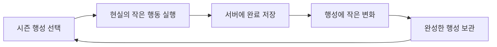
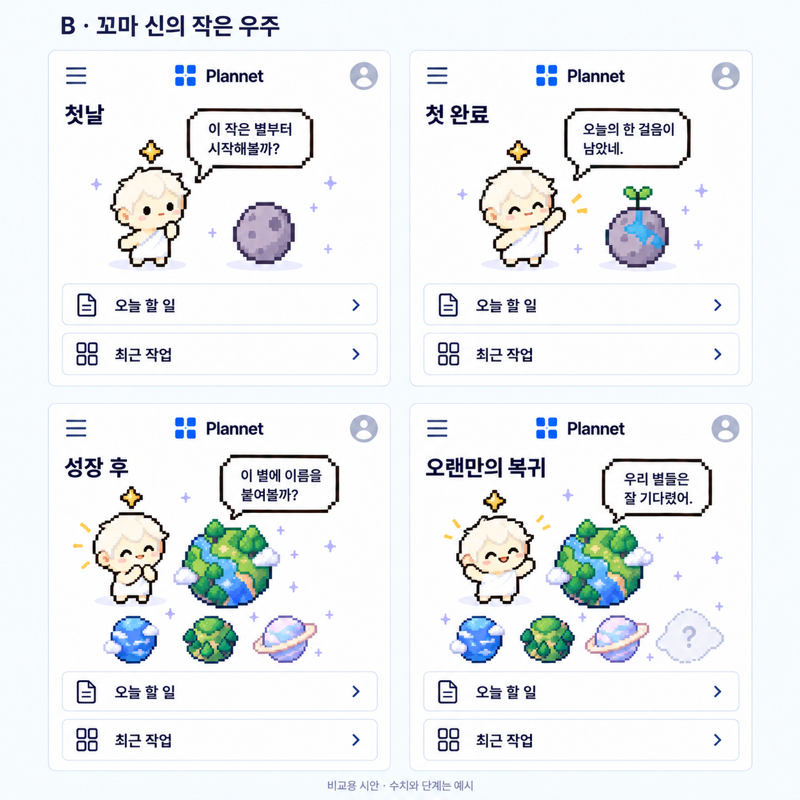

# 꼬마 신과 행성 수집

2026-10-11 · 기획 초안 · [기획 목록](../README.md)

미확정 독립 대안이다. 동물·집 성장과 동시에 구현하는 결정이 아니며, 이 모드에는 사용자 정의 능력치·주간 감소를 자동 적용하지 않는다.

### 핵심 경험

꼬마 신은 레벨을 올리는 대상보다 나의 일상을 지켜보며 세계를 돌보는 분신이다. 첫 화면에는 꼬마 신 하나와 **지금 돌보는 행성 하나**만 크게 보여주고, 모은 행성은 작은 궤도 목록으로 연다. 능력치 패널은 두지 않는다.

행성을 주기적으로 받기만 하는 구조보다, **내 행동으로 행성이 완성되는 과정**이 수집의 의미를 만들 수 있다는 가설이다. 다음은 이를 위한 제안이며 사용자 원안의 확정 규칙은 아니다.

| 상황 | 화면 변화 제안 | 꼬마 신의 한마디 예시 |
|---|---|---|
| 첫 시작 | 작은 행성의 씨앗을 받음 | 여기부터 작은 세계를 만들어볼까. |
| 행동 한 번 완료 | 작은 불빛·풀·구름 하나가 생김 | 오늘의 한 걸음이 여기 남았네. |
| 일정한 실천이 쌓임 | 물길 → 숲 → 작은 거처처럼 단계 변화 | 어느새 쉬어 갈 곳도 생겼어. |
| 한 행성 완성 | 이름 짓기, 그동안의 실행 기록 보관 | 이 별에는 어떤 이름이 어울릴까? |
| 새 시즌 | 새 테마 행성 발견, 키울 행성 선택 | 이번에는 비가 내리는 별이 보여. |

**능력치 숫자는 없애도 진행 기준은 필요하다.** 내부에는 중복 보상을 막는 실행 기록과 행성 단계가 있고, UI에는 ‘다음 변화: 작은 숲’처럼 결과 중심으로 알린다. 성장 조건은 조회할 수 있게 하되 별도 경험치·재료·화폐를 겹쳐 만들지 않는다.

### 시즌과 수집이 지루해지지 않으려면

- 시즌 행성은 색상뿐 아니라 실루엣·환경 움직임·소리 없는 작은 사건·완성 장면이 달라야 한다. 예: 밤바다 행성, 구름 정원, 작은 도서관 행성. 초안 예시이며 확정 콘텐츠가 아니다.
- 초기에는 한 가지 성장 경로와 마지막 풍경 선택 정도로 시작한다. 모든 행동 조합마다 다른 행성을 생성하는 방식은 에셋·검증 부담 때문에 제안하지 않는다.
- 시즌은 새 콘텐츠의 공개 주기로 사용한다. 기존 행성·진행은 초기화하지 않고, 지난 시즌은 보관함에서 다시 선택할 수 있는 방향을 추천한다. 기간 한정 박탈이나 확률 뽑기는 기본안에 넣지 않는다.
- 새 시즌을 선택해도 미완성 행성은 그대로 보관한다. 한 번의 완료는 현재 선택한 행성에 한 번만 반영한다. 시즌 길이·출시 간격은 제작량을 본 뒤 정한다.
- 끝나지 않은 플랜과 완료된 행성은 독립적이다. 행성 완성 때문에 플랜을 강제로 종료하거나 새로 만들지 않는다.

**먼저 확인할 질문:** 행성 외형 자체가 갖고 싶은가? 첫날에도 눈에 띄는 변화가 있는가? 한 개를 완성한 뒤 두 번째 행성을 시작할 이유가 있는가? 시즌마다 콘텐츠를 만들 수 있는가?

## 비교 시안

[생성 프롬프트](../../assets/character-concepts/mode-storyboard-prompts.md). 최종 스타일과 시즌 규모는 미정이다.
