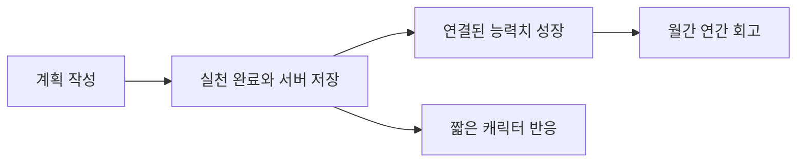

# 공통 방향과 실행 기록

2026-10-11 · 공통 원칙과 설계 초안 · [기획 목록](README.md)

실천한 일이 눈에 보이는 성장으로 남아 다시 시작할 이유를 만든다. 게임 요소는 기존 플래너를 보조하며 계획 작성·저장을 방해하지 않는다. 규칙의 변칙과 설정 부담을 줄이는 것이 현재 우선순위다.

## 단계별 방향

| 단계 | 집중할 경험 | 범위 |
|---|---|---|
| 먼저 시작 | 캐릭터 + 능력치 | 실천 기록, 캐릭터 반응, 사용자 능력치 관리·성장 |
| 안정화 | 기본 흐름이 편하고 일관되게 동작 | 저장·중복 반영·감소 옵션의 정합성과 실제 사용 경험 확인 |
| 이후 확장 | 집 등 새로운 성장 컨셉 | 기존 기획을 비교해 선택. 집·우주 모두 추가하기로 확정한 것은 아님 |

안정화의 구체적인 완료 기준과 기간은 미정이다. AI 독백·도움의 초기 포함 범위도 별도 결정하며, 첫 캐릭터 반응을 AI 호출에 의존시키지 않는다.

## 첫 단계 경험의 흐름

능력치 연결과 증가량은 [능력치 기획](growth/stats.md)을 따른다. 회고의 초기 화면 범위는 별도 결정한다. [경제 기획](growth/economy.md)과 [집 기획](growth/housing.md)은 안정화 후 확장 후보로 남긴다. 건축 재화를 첫 단계부터 쌓거나 이후 소급 지급하는 정책은 확정하지 않았다.

## 공통 원칙

- 기존 플래너와 계정별 DB 저장은 독립적으로 유지한다. 게임 연출의 실패가 편집·저장을 막지 않아야 한다.
- 보상은 서버에 저장된 실행을 근거로 확정한다. 저장 대기 중 반응을 확정 보상으로 표시하지 않는다.
- 같은 실행의 중복 전송·취소 후 재완료·다기기 처리는 중복 지급하지 않는다. 반복 일정의 다른 회차와 템플릿에 연결된 같은 실행을 식별해야 한다.
- AI는 제안과 문구만 만든다. 성장·재화·해금은 코드의 규칙으로 결정한다. 제안으로 계획을 바꾸는 일은 사용자가 선택한다.
- 이미지와 애니메이션은 미리 제작해 사용한다. 실천마다 새 이미지를 생성하지 않는다.
- 꼬마 신·집·동물 세 모드를 모두 구현하거나 범용 엔진부터 만들기로 한 것은 아니다.

## 저장 구조 초안

기존 계정별 DB 저장과 자동 저장을 유지한다. 브라우저 저장을 새 영구 저장소로 추가하지 않는다.

- **캐릭터 프로필:** 계정 소유자, 이름, 외형, 선택 소품, 표현 설정.
- **실행 기록:** 행동 식별자, 실제 실행일, 완료·취소 시각, 출처, 서버 저장 시각. 기록 입력 시점과 사용자가 지정한 실행일을 구분한다.
- **보상 내역:** 실행 건별 지급·정정 기록과 중복 방지 키. 능력치 집계는 이 내역에서 재계산할 수 있게 한다.
- **AI 사용 내역:** 계정, 기능, 요청 식별자, 입력·출력·추론 토큰, 예약 비용, 확정 비용, 처리 상태, 가격 버전.
- **제안 저장:** 계정과 맥락 버전별 응답 및 생성 시점. 이미 수정한 계획에 오래된 제안을 자동 적용하지 않는다.

현재 확인한 플랜 타입의 완료 여부만으로 과거 날짜별 실행을 복원할 수는 없다. 기존 완료 항목을 가져올 때 실행일을 임의로 추정하거나 과거 보상을 무제한 지급하지 않는다. 이관 시점의 기존 상태와 새 실행 기록을 구분하는 정책이 필요하다.

경험치·보상·애니메이션은 코드가 결정한다. AI는 제안과 문구만 생성하며, 저장된 기록 밖의 행동을 만들어 말하지 않게 한다. 전체 기록 대신 필요한 요약만 모델에 보내고 사용자에게 외부 AI 전송 범위를 알린다.

## 장기 비전과의 관계

[SpaceX 공식 협업](vision.md)을 장기 목표로 남긴다. 이 비전이 현재의 집·캐릭터 기획을 우주 테마로 변경하거나 초기 구현 범위를 늘리는 근거는 아니다.

## 구현 전에 정할 것

할 일 하나에 능력치 하나를 연결하고 완료당 +1로 정했다. 첫 단계에서는 적용 템플릿 범위·선택 UI, 주간 감소 시점·토글 처리, 실행 취소 시 능력치 정정, 기존 기록 이관, 대표 모바일 홈 배치와 최소 기능 범위를 합의한다. 집 목록·건축 비용은 첫 단계의 선행 조건이 아니다. AI를 포함할 때는 [AI 예산](ai/budget.md)의 상한과 기본 동작을 검증한다. 사용자가 구현 시작을 요청하기 전까지 문서와 시안을 발전시킨다.
