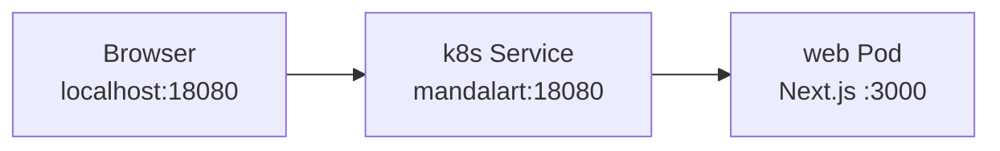
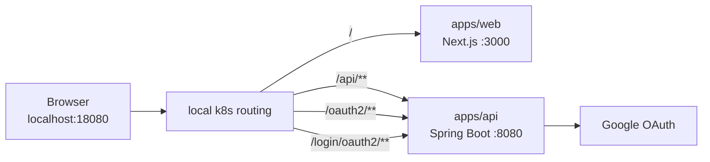

# API-Owned Auth Phase 1-2 Research

이 문서는 `mandalart`에 인증을 붙이기 전에, 인증 책임을 `apps/api`가 갖는 방향으로 Phase 1/2 범위를 정리한 초안이다.

핵심 결정은 단순하다. 지금은 DB와 회원 관리를 만들지 않고, API를 로컬 k8s에 올린 뒤 Spring Security 기본 OAuth2 흐름으로 Google 로그인만 먼저 붙인다.

## 결론 요약

요약:

| 항목 | 결정 |
| --- | --- |
| 인증 책임 | `apps/api`가 소유한다. |
| 엔드포인트 정책 | Spring Security 기본값인 `/oauth2/authorization/google`, `/login/oauth2/code/google`을 우선 사용한다. |
| 프론트 연동 | web은 `/api/v1/me`, `/api/v1/logout` 같은 API 공개 엔드포인트만 호출한다. |
| 회원 관리 | 내부 `userId`, 회원 테이블, provider account 매핑은 다음 Phase로 미룬다. |

Phase 계획:

| Phase | 범위 | 완료 기준 |
| --- | --- | --- |
| Phase 1 | API k8s Deployment Foundation | API 컨테이너를 만들고 로컬 k8s에서 web/api를 함께 띄운다. |
| Phase 2 | API-Owned Google Auth Without DB | DB 없이 Spring Security OAuth2 Login으로 Google 인증만 붙인다. |

## 목표

- 백엔드가 인증 책임을 갖는 구조를 만든다.
- 로컬 k8s에서 `apps/web`과 `apps/api`를 함께 띄운다.
- 브라우저 기준 같은 origin에서 web과 api에 접근할 수 있게 라우팅한다.
- Google 로그인 후 API session cookie로 로그인 상태를 유지한다.
- 현재 사용자 확인용 API를 만든다.
- 기존 LocalStorage 기반 플래너 기능은 그대로 둔다.

## 현재 상태

| 영역 | 상태 |
| --- | --- |
| web | `apps/web`의 Next.js 앱이 로컬 k8s에서 실행된다. |
| api | `apps/api` Spring Boot/Kotlin 앱과 `/api/v1/health`가 있다. |
| k8s | `k8s/local/deployment.yaml`, `service.yaml`은 현재 web 컨테이너 중심이다. |
| DB | 아직 없다. |
| 인증 | 아직 제품 흐름에 붙어 있지 않다. |

현재 로컬 k8s 흐름은 대략 다음과 같다.



Phase 1 이후에는 web과 api가 같은 로컬 진입점 뒤에 놓인다.



## 선택지 비교

| 선택지 | 장점 | 단점 | 판단 |
| --- | --- | --- | --- |
| web-only Auth.js | web 컨테이너만으로 빠르게 붙일 수 있다. | 인증 책임이 web에 생기고, 나중에 API/DB identity로 옮길 때 재작업이 크다. | 제외 |
| API-owned Spring Security 기본 흐름 | Spring/Kopring 책임 배치와 잘 맞고, 후속 DB identity phase로 이어가기 쉽다. | API를 k8s에 올리고 라우팅을 먼저 정해야 한다. | 채택 |
| API-owned custom `/api/auth/*` | 프론트에서 URL이 더 일관돼 보인다. | Spring Security 기본값을 감싸는 설정이 늘어나고, 초기에 배울 것이 많아진다. | 보류 |

## Phase 1. API k8s Deployment Foundation

목표는 인증 구현 전에 API가 실제 로컬 실행 경로에 들어오는 것이다.

작업:

- `apps/api`용 Dockerfile을 추가한다.
- API 이미지를 로컬 k8s에서 사용할 수 있게 빌드한다.
- web Deployment/Service와 api Deployment/Service를 분리한다.
- 브라우저 진입점에서 `/`는 web으로, `/api/**`는 api로 라우팅한다.
- OAuth2 기본 흐름을 위해 `/oauth2/**`, `/login/oauth2/**`도 api로 라우팅할 수 있게 준비한다.
- `/api/v1/health`로 API 라우팅을 smoke test한다.

완료 기준:

- `http://localhost:18080`에서 기존 web 화면이 열린다.
- `http://localhost:18080/api/v1/health`가 API 응답을 반환한다.
- web 컨테이너와 api 컨테이너를 독립적으로 재시작할 수 있다.
- 기존 LocalStorage 기반 기능 동작은 바뀌지 않는다.

## Phase 2. API-Owned Google Auth Without DB

목표는 회원 관리 없이 “Google 계정으로 인증된 현재 요청”만 확인하는 것이다.

작업:

- `apps/api`에 Spring Security OAuth2 Client 의존성을 추가한다.
- Google OAuth client id/secret을 local secret 또는 환경변수로 주입한다.
- Spring Security 기본 OAuth2 Login을 활성화한다.
- `/api/v1/me`를 추가해 현재 인증된 Google profile을 반환한다.
- `/api/v1/logout`을 추가해 API session을 종료한다.
- web에서 로그인 상태 표시는 API의 `/api/v1/me`만 사용하게 한다.
- 로그인 버튼은 `/oauth2/authorization/google`로 이동시킨다.

완료 기준:

- 로그인 버튼을 누르면 Google 로그인 화면으로 이동한다.
- Google callback URL은 `http://localhost:18080/login/oauth2/code/google`을 사용한다.
- 로그인 후 `GET /api/v1/me`가 Google profile을 반환한다.
- 로그아웃 후 `GET /api/v1/me`는 인증되지 않은 상태를 반환한다.
- DB 없이도 새로고침 후 로그인 상태가 유지된다.

## Spring/Kopring 기준

Spring을 처음 다루는 관점에서는 기본값을 최대한 활용하는 편이 좋다. 특히 OAuth2 Login은 Spring Security가 이미 표준 엔드포인트와 callback 처리를 제공하므로, 인증 구현 단계에서는 그 흐름을 먼저 쓰는 것이 학습 비용과 구현 위험을 줄인다.

권장 패키지 시작점:

```text
apps/api/src/main/kotlin/com/hadam/plannet/
  auth/
    config/
      SecurityConfig.kt
    adapter/
      in/web/
        MeController.kt
        LogoutController.kt
    domain/
      AuthenticatedUser.kt
  health/
    HealthController.kt
```

기준:

- controller는 HTTP 요청/응답 변환에 집중한다.
- 인증 설정은 `auth/config`에 둔다.
- Phase 2까지는 persistence 패키지를 만들지 않는다.
- Google의 `sub`는 외부 provider identifier로만 보고, 내부 `userId`처럼 사용하지 않는다.
- web은 Spring Security 내부 구현을 알지 않고 공개 API와 로그인 시작 URL만 안다.

## 엔드포인트 정책

| 엔드포인트 | 소유 | 설명 |
| --- | --- | --- |
| `GET /oauth2/authorization/google` | Spring Security | Google 로그인 시작 기본 엔드포인트 |
| `GET /login/oauth2/code/google` | Spring Security | Google redirect callback 기본 엔드포인트 |
| `GET /api/v1/me` | API | 현재 인증된 사용자 profile 조회 |
| `POST /api/v1/logout` | API 또는 Spring Security | 현재 session 종료 |
| `GET /api/v1/health` | API | API routing smoke test |

`/api/login` 같은 custom URL은 당장 만들지 않는다. Spring Security 기본값을 쓰면 문서와 예제가 많고, callback URL도 예측 가능하다. 나중에 제품 URL을 더 다듬고 싶으면 `/api/auth/login/google` 같은 facade를 추가할 수 있다.

## k8s 라우팅 기준

가능하면 web과 api를 같은 origin으로 노출한다.

이유:

- session cookie를 단순하게 다룰 수 있다.
- CORS 설정을 줄일 수 있다.
- 브라우저에서 `localhost:18080` 하나만 열면 된다.
- Google OAuth redirect URL도 하나의 host 기준으로 관리할 수 있다.

라우팅 예시:

| Path | Target |
| --- | --- |
| `/` | web service |
| `/_next/**` | web service |
| `/api/**` | api service |
| `/oauth2/**` | api service |
| `/login/oauth2/**` | api service |

## 예상 파일 구조

API:

```text
apps/api/
  Dockerfile
  build.gradle.kts
  src/main/kotlin/com/hadam/plannet/
    auth/
      config/
      adapter/in/web/
      domain/
    health/
```

k8s:

```text
k8s/local/
  namespace.yaml
  web-deployment.yaml
  web-service.yaml
  api-deployment.yaml
  api-service.yaml
  ingress.yaml
  configmap.yaml
  secret.local.yaml
```

현재 `deployment.yaml`, `service.yaml`을 바로 크게 수정하기보다, web/api 책임이 드러나도록 파일을 분리하는 편이 이후 변경을 읽기 쉽다.

## 검증 계획

Phase 1:

- web 화면이 `http://localhost:18080`에서 열린다.
- `GET http://localhost:18080/api/v1/health`가 성공한다.
- web pod만 재시작해도 api pod가 유지된다.
- api pod만 재시작해도 web pod가 유지된다.

Phase 2:

- `GET /api/v1/me`는 로그인 전 인증되지 않은 응답을 반환한다.
- `GET /oauth2/authorization/google`은 Google 인증 화면으로 redirect한다.
- Google 로그인 후 `/api/v1/me`는 email, name, picture 같은 profile을 반환한다.
- `POST /api/v1/logout` 후 `/api/v1/me`는 다시 인증되지 않은 응답을 반환한다.
- 기존 플래너 데이터는 LocalStorage에 그대로 남아 있다.

## 리스크와 열린 질문

| 항목 | 내용 | 대응 |
| --- | --- | --- |
| Ingress 사용 여부 | 현재 local k8s가 LoadBalancer Service 중심이면 path routing을 어디서 할지 정해야 한다. | Ingress controller가 준비되어 있는지 먼저 확인한다. |
| 세션 저장소 | DB 없이 Spring session을 쓰면 기본적으로 API pod 메모리에 session이 저장된다. | Phase 2는 replica 1로 제한하고, 후속 DB identity phase에서 Redis/DB session 여부를 결정한다. |
| OAuth callback | Google Console에 local callback URL을 정확히 등록해야 한다. | `http://localhost:18080/login/oauth2/code/google`을 기준값으로 둔다. |
| HTTPS | 운영에서는 Secure cookie와 HTTPS가 필요하다. | local은 HTTP 기준으로 검증하고, 운영 배포 전 별도 점검한다. |
| 기존 web auth 흔적 | web-only Auth.js 실험 변경이 브랜치에 남아 있다면 방향과 충돌한다. | API-owned 구현 전에 제거 또는 별도 커밋 여부를 확인한다. |

## 후속 Phase 연결

Phase 1/2에서는 인증 진입점과 실행 구조를 먼저 만든다. 다음 항목은 API-owned auth가 동작한 뒤 별도 리서치와 구현 단위로 다룬다.

예상 추가:

- `identity_users`, `identity_provider_accounts` 같은 identity 테이블 추가
- 최초 로그인 시 내부 user row 생성
- 재로그인 시 provider account로 기존 user 조회
- `/api/v1/me` 응답에 내부 `userId` 추가
- planner 데이터를 내부 `userId`에 연결하는 마이그레이션
- 자체 아이디/비밀번호 로그인 검토
- refresh token 저장소 또는 server-side session 저장소 검토
- 제품 URL에 맞춘 custom OAuth facade 검토
- 독립 배포 가치가 생긴 모듈의 MSA 분리 검토

이때도 `planner`가 `identity` DB 테이블이나 repository를 직접 참조하지 않는 규칙은 유지한다. `planner`는 `identity`가 공개한 service/interface 또는 인증 컨텍스트의 내부 user id만 사용한다.
