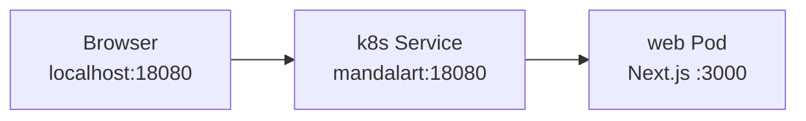
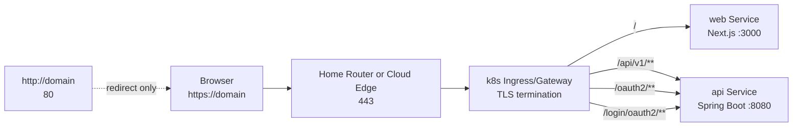

# Public Exposure & Standard Port Policy Research

이 문서는 `mandalart`를 로컬 k8s 밖으로 노출할 때 포트 정책을 어떻게 가져갈지 정리한 초안이다. 특히 현재 `18080`을 쓰는 이유와, 인증 이후 `80` 또는 `443`으로 옮길 때의 기준을 분리해서 다룬다.

핵심 결론은 단순하다. `18080`은 개발용 진입점으로 유지하고, 외부 공개는 `80` 직접 서비스가 아니라 `443 HTTPS`를 기준으로 설계한다. `80`은 필요하면 HTTPS redirect 용도로만 사용한다.

2026-09-23 코드 대조: 공개 전에는 로그인뿐 아니라 기존 Web API의 접근 정책도 검증해야 한다. `/api/backup`의 공용 파일 저장과 `/api/chat`의 사용 제한은 [roadmap-status.md](../roadmap-status.md)의 단계별 실행 계획과 공개 기준에서 추적한다. Spring 라우팅은 `/api/v1/**`로 한정하고 기존 Web API는 별도로 유지하거나 비활성화한다.

## 결론 요약

요약:

| 항목 | 결정 |
| --- | --- |
| 현재 `18080` | local k8s 개발 진입점으로 유지한다. |
| `80`의 의미 | 표준 HTTP 포트라 접근성은 좋지만, 보안 경계는 아니다. |
| 외부 공개 기준 | `443 HTTPS`를 우선하고, `80`은 redirect 전용으로 둔다. |
| 인증 전 공개 | 공유기 포트포워딩으로 외부 공개하지 않는다. |
| k8s 구조 | 앱 컨테이너가 직접 80을 듣기보다 Ingress/Gateway가 80/443을 받고 내부 service로 라우팅한다. |

Phase 계획:

| Phase | 범위 | 완료 기준 |
| --- | --- | --- |
| Phase 3 | Public Exposure & Standard Port Policy | 인증 이후 외부 공개 기준, 80/443 라우팅, HTTPS, cookie 보안 설정을 정리한다. |

## 배경

현재 로컬 k8s는 web 컨테이너만 외부에 노출한다.

`18080`을 둔 이유는 합리적이다. 인증이 없는 상태에서 공유기 80 포트를 열면 인터넷에서 더 쉽게 발견되고, 브라우저 기본 HTTP 포트로 접근 가능한 공개 서비스처럼 보인다. 다만 보안 관점에서 중요한 점은 포트 번호 자체가 방어선은 아니라는 것이다. `18080`도 공유기에서 외부로 열면 스캔 대상이 된다.

따라서 Phase 3의 핵심은 “80으로 바꿀지”가 아니라 “외부 공개를 어떤 조건에서 허용할지”다.

## 목표

- 로컬 개발용 포트와 외부 공개용 포트를 분리해서 생각한다.
- 인증 이후에만 외부 공개를 검토한다.
- 외부 공개 시 HTTP 평문 로그인을 피한다.
- k8s 내부 포트와 사용자-facing 포트를 분리한다.
- Google OAuth redirect URL, session cookie, 라우팅 정책을 함께 정리한다.

## 선택지 비교

| 선택지 | 장점 | 단점 | 판단 |
| --- | --- | --- | --- |
| `18080` 유지 | 개발 중 실수로 표준 포트를 여는 위험이 낮고, 현재 설정과 맞다. | 외부 공개용 URL로는 어색하다. | local 개발 기본값으로 유지 |
| `80` 직접 공개 | 주소가 단순하고 HTTP 기본 포트라 접근성이 좋다. | 평문 통신이고 인증/session cookie에 부적합하다. 스캔도 많다. | 제외 |
| `443` 공개, `80` redirect | 일반적인 웹 서비스 운영 방식이다. 로그인과 session cookie를 안전하게 다루기 쉽다. | TLS 인증서와 Ingress 설정이 필요하다. | 채택 |
| 비공개 터널/Tailscale류 | 공유기 포트포워딩 없이 개인 접근이 가능하다. | 일반 사용자 공개 서비스에는 별도 검토가 필요하다. | 대안으로 검토 |

## 권장 목표 흐름

Phase 3 이후 공개 흐름은 다음처럼 잡는다.

중요한 점:

- web pod는 계속 `3000`을 들어도 된다.
- api pod는 계속 `8080`을 들어도 된다.
- 사용자에게 보이는 포트만 `443`이 된다.
- `80`은 실제 서비스를 제공하지 않고 `https://`로 넘기는 역할만 한다.

## 포트 책임 분리

| 계층 | 권장 포트 | 설명 |
| --- | --- | --- |
| Browser | `443` | 사용자가 접근하는 공개 HTTPS 포트 |
| Router | `443`, 선택적으로 `80` | `443`은 Ingress로 전달, `80`은 redirect 용도 |
| k8s Ingress/Gateway | `80`, `443` | 외부 요청을 받고 web/api service로 path routing |
| web Service | cluster 내부 포트 | Ingress 뒤에서만 접근 |
| web Pod | `3000` | Next.js 컨테이너 내부 포트 |
| api Service | cluster 내부 포트 | Ingress 뒤에서만 접근 |
| api Pod | `8080` | Spring Boot 컨테이너 내부 포트 |

## Phase 3 작업 범위

작업:

- local 개발 진입점 `18080`은 유지한다.
- 공개용 host 또는 domain을 정한다.
- Ingress/Gateway에서 `443` TLS termination을 설정한다.
- `80` 요청은 `443`으로 redirect한다.
- `/`, `/_next/**`는 web service로 라우팅한다.
- `/api/v1/**`, `/oauth2/**`, `/login/oauth2/**`는 api service로 라우팅한다.
- `/api/chat`, `/api/backup`은 web 소유로 유지하거나 서버 측 정책으로 비활성화한다. 전환 전 `/api/auth/**`도 web이 처리한다.
- Google OAuth redirect URI에 공개 HTTPS callback을 추가한다.
- 운영 profile에서는 session cookie에 `Secure`, `HttpOnly`, `SameSite` 정책을 명확히 둔다.
- health endpoint와 actuator/admin 계열 endpoint의 공개 범위를 점검한다.
- 공유기 포트포워딩은 필요한 포트만 연다.

완료 기준:

- local 개발은 기존처럼 `http://localhost:18080`으로 가능하다.
- 공개 URL은 `https://{domain}`으로 접근한다.
- `http://{domain}`은 `https://{domain}`으로 redirect된다.
- Google OAuth callback이 `https://{domain}/login/oauth2/code/google`로 동작한다.
- 로그인 후 session cookie가 HTTPS 기준으로 설정된다.
- API health check 외에 민감한 내부 endpoint가 공개되지 않는다.

## 보안 기준

포트 번호:

- `18080`은 외부 노출을 피하기 위한 개발용 완충 장치로는 의미가 있다.
- 하지만 외부로 열면 `18080`도 공개 서비스다.
- `80`을 열지 않는 것만으로 인증이나 접근 제어를 대신할 수 없다.

HTTPS:

- 로그인과 session cookie가 들어가면 `443`을 기본값으로 둔다.
- `80`에서 로그인하거나 API session을 주고받지 않는다.
- `80`은 가능하면 redirect만 처리한다.

Cookie:

- 운영에서는 session cookie에 `Secure`를 사용한다.
- JavaScript에서 session cookie를 읽을 필요가 없으면 `HttpOnly`를 사용한다.
- 같은 사이트 web/api 구조라면 `SameSite=Lax`부터 시작한다.

라우팅:

- web과 api는 같은 origin 뒤에 두는 편이 단순하다.
- CORS를 넓게 열어 문제를 해결하지 않는다.
- `/api/v1/**`와 OAuth 로그인 시작·callback path만 API로 보낸다. `/api/**` 전체를 넘기지 않는다.

## 리스크와 열린 질문

| 항목 | 내용 | 확인할 것 |
| --- | --- | --- |
| 도메인 | 공개 HTTPS를 쓰려면 domain 또는 DDNS가 필요하다. | 개인 도메인을 쓸지, DDNS를 쓸지 결정 |
| TLS 인증서 | 로컬 k8s에서 인증서 자동 발급이 가능한지 확인해야 한다. | Ingress controller, cert-manager 사용 여부 |
| 공유기 설정 | 포트포워딩, 고정 IP, hairpin NAT 지원 여부가 환경마다 다르다. | 내부망에서 공개 domain 접근이 되는지 확인 |
| Google OAuth | redirect URI가 host와 scheme에 민감하다. | local callback과 공개 HTTPS callback을 모두 등록 |
| 세션 저장소 | API replica를 늘리면 메모리 session만으로는 부족할 수 있다. | sticky session 또는 외부 session store 검토 |
| 로그/관측 | 외부 공개 후에는 실패 로그인, 4xx/5xx, redirect loop를 봐야 한다. | 최소 접근 로그와 에러 로그 확인 |

## 후속으로 다룰 것

Phase 3 이후에는 “공개 서비스 운영” 관점의 별도 리서치가 필요하다.

예상 주제:

- 운영 배포 환경 선택
- 도메인과 TLS 자동 갱신
- 백업과 장애 복구
- rate limit 또는 abuse 방어
- session store 외부화
- DB가 붙은 뒤 개인정보/계정 삭제 정책
- MSA 분리 시 public gateway와 internal service 경계
