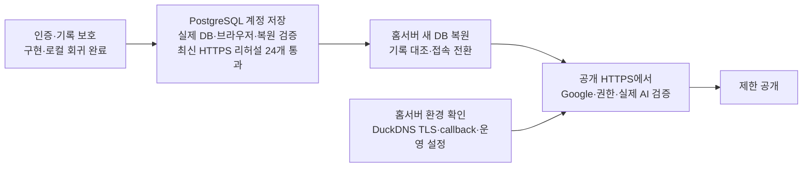
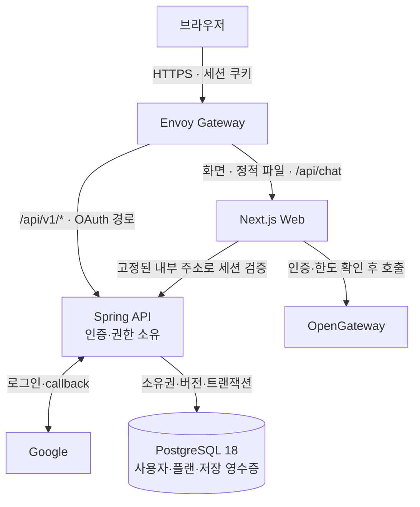

**Plannet 서비스 공개 로드맵·설계안**

작성일: 2026-09-23 · 최근 반영: 2026-10-05 · 커밋된 구현 기준: `3e08caa` · 추가 배포 리허설·로그인 랜딩·DB 중심 자동 저장·저장 비용 개선은 미커밋 변경이다. 목표는 **Google 인증과 사용자별 접근 통제를 갖춘 플래너 서비스 공개**다.

**현재 결론:** 인증·접근 통제·기록 보호와 **PostgreSQL 계정별 서버 저장을 구현했다.** 로그인한 서비스의 플랜은 DB에만 영구 저장하며, 미저장 수정만 탭별 임시 보관(sessionStorage)으로 새로고침에 대비하고 DB 저장 확인 후 지운다. 현재 컴퓨터의 Docker DB를 사용하고 이후 홈서버로 이전한다. 4개 템플릿·반복 할 일·휴일, 명시적 이전, 충돌 처리, 중복 없는 재시도를 지원한다. 실제 API·DB·브라우저 통합과 새 DB 복원을 검증했으며, 9/28 소스의 로컬 HTTPS 리허설(Google·AI 대역) **24개와 실제 PostgreSQL API 56개가 통과했다.** V2→V3 데이터 보존도 확인했다. 공개 주소는 `plannet-lab.duckdns.org`이며 **홈서버 배포·공인 TLS·공개 origin 검증은 남아 있다.**

**10/5 계정 이메일 보완:** 검증된 Google 이메일을 계정 메타데이터로 저장하는 V4 migration·API 갱신을 구현하고 관련 검사 49개를 통과했다. 소유권은 기존 Google 식별자·UUID를 유지한다. **미배포**이며 기존 계정 이메일은 API 반영 후 다음 로그인 시 채워진다. [이메일 저장 보고](session-reports/account-email.md)

**실행 가이드:** [홈서버 배포·데이터 이전](guides/home-server-migration.md) — 준비값·백업/새 DB 복원·공개 전환·이메일 채우기·실패 시 복귀 순서. 실제 이전은 아직 수행하지 않았다.

**10/5 이메일 커밋·푸시:** `feat/web-spring-auth`에 API 선행 변경 `f67c931`과 이메일 저장 `32c6c8e`를 푸시했다. API 코드는 원격과 일치하며 실제 배포는 하지 않았다. Web/UI·배포 인프라의 후속 변경과 이 로드맵·홈서버 가이드는 아직 로컬 미커밋 상태다.

**1. 효과·시급도에 따른 실행 순서**

**10/5 최종 인수:** 작업 복귀·W6·기기 간 안전한 최신화·편집 헤더/확인 창·로딩 최적화의 코드 검토와 후속 수정을 마쳤다. W6는 실제 격리 PostgreSQL 저장·재조회·새 DB 복원까지 검증했다. **모두 미배포**이며 실제 실행 서비스 갱신은 별도다. [최종 코드 검토](session-reports/final-code-review.md) · [W6 실제 DB 검증](session-reports/w6-postgres-final.md). 후속 UI 작업은 [지정 레포를 반영한 방향](ui-ux-direction.md)을 따른다.

| 순서 | 상태 | 구현된 것 | 남은 일·완료 기준 |
|---|---|---|---|
| **0. 공개 경로 보호** | 구현·로컬 HTTPS 검증 완료 | 공용 백업 차단, 비밀 파일 빌드 제외, API non-root, Web 보안 헤더·Gateway 접근 제한 | 홈서버 공개 Gateway에서 직접 접근/설정 누락 차단 최종 확인 |
| **1. Google 인증** | 구현·로컬 실인증 완료 | Spring OAuth2·me/csrf/logout, 로그인 랜딩·인증/서버 저장 확인 후 입장, 미저장 수정의 로그아웃 보호 | 공개 HTTPS origin에서 callback·로그인·새로고침·로그아웃 확인 |
| **2. AI 접근 통제** | 구현·모의 통합 검증 완료 | 서버 세션 검증, CSRF, 요청 한도, 인증 장애 시 차단 | 공급자 금액 예산 설정·실제 AI 요청 확인 |
| **3. 기록 보호** | **수정·회귀 완료** | 초기화 후 지연 AI 차단, 날짜 탐색/재지정 분리, 복수 원본 출처, JSON 검증·원본 보호, 전체 PNG | 공개 배포에서 핵심 사용자 흐름 최종 확인 |
| **4. 계정별 서버 저장** | **DB 영구 저장·임시 복구 검증 완료** | PostgreSQL·소유권·버전/삭제·재시도·6종 저장, 변경분 자동 저장·새로고침 복구·이탈 보호, 조건부 조회·영수증 본문 중복 제거, 명시적 이전 | 홈서버 실제 데이터·공개 환경 재확인 |
| **4.5. 이전 대기 중 제품 개선** | **첫 묶음 구현·검증·최종 인수 완료, 미배포** | 기본 조작·키보드, Next.js 16.3.8 갱신, URL 작업 복귀·오늘/최근, W6, 안전한 최신화, 헤더·확인 창, 로딩·입력 최적화. 검토 지적 3건 수정 인수. W6 실제 DB 저장·새 DB 복원 확인 | 운영 반영은 별도. Turbopack 로딩 실패의 같은 탭 재시도는 보장하지 않으며 저장 후 새로고침 안내. 나머지 모달·백업 확대는 후속 |
| **5. 홈서버 이전·제한 공개** | **실행 환경 대기** | DuckDNS 호스트·DB 백업/복원 도구·운영 Secret 설정·같은 origin 라우팅 | 홈서버 디스크/사설 DB 연결/백업 위치 → 복원·TLS·callback → 공개 검증 |
| **6. 제품 확장** | 목록·검색 완료, 나머지 후속 | 최근 5개 밖의 플랜 검색·선택, 계정별 목록 | 계정 전체 백업·삭제 복구 → 캘린더 연동 → Monthly→Daily → 색상 피드백. 업적·새 템플릿·MSA 분리는 이후 |

**2. 목표 구조와 책임**

- **인증 경계:** `/api/v1/**`, `/oauth2/**`, `/login/oauth2/**`는 API로 보낸다. `/api/**` 전체를 넘기지 않는다. 로그인 전·확인 중·인증 장애에는 랜딩만 표시하며 로컬 기록을 열지 않는다. AI는 서버가 검증한 세션만 신뢰하며 실패 시 거부한다.
- **저장 경계:** Google 계정을 내부 UUID로 매핑하고 모든 DB 요청을 해당 소유자에 한정한다. 플랜의 영구 저장소는 DB다. 변경 후 650ms 동안 추가 입력이 없으면 자동 저장한다. 미저장 변경분과 전송 중 요청만 계정별 sessionStorage에 임시 보관하고, DB 확인 후 지운다. 로그인·DB 조회 뒤 같은 계정의 초안을 복구하며 같은 요청 ID로 재시도한다. 전체 사본·브라우저 캐시를 만들지 않고 충돌은 DB 버전으로 판정한다. 임시 보관이 막혀도 DB 저장·이탈/로그아웃 보호·파일 내보내기는 유지한다. 탭을 닫은 뒤 복구는 보장하지 않는다. 기존 브라우저 원본은 읽기 전용으로 보존한다. 인증을 끈 개발 모드만 LocalStorage를 사용한다.
- **기록 보존:** 날짜 화살표는 조회만 하고, 빈 기간 생성과 날짜 재지정은 명시적 동작으로 분리한다. 가져온 목표는 원본 플랜 ID+셀 ID로 식별한다. JSON 전체 교체는 검증·사용자 확인·현재 문맥 확인 후 원자적으로 적용하고 이전 AI 요청을 무효화한다.
- **운영 제약:** API·Web 각 1 replica, 세션·호출 한도는 메모리다. 재시작 시 재로그인·한도 초기화와 짧은 배포 중단을 허용한다. 다중 replica 전에 공유 저장소가 필요하고 금액 상한은 공급자 측에서 설정한다.

**3. 공개 전 통과 기준**

| 대상 | 확인한 것 | 공개 전에 남은 확인 |
|---|---|---|
| 인증·권한 | 로컬 실제 Google 흐름 기록, 미인증·위조·만료·CSRF·인증 장애·한도·공용 백업 차단 자동 검증 | 실제 origin의 callback·Secure/HttpOnly/SameSite 쿠키·로그아웃 후 거부. Gateway 우회 차단 |
| 기록·복원 | 9/28 실제 PostgreSQL API 56개 통과·V2→V3 보존. 10/5 W6 저장·복원 3개와 기존 DB 회귀 17개 통과. 두 브라우저 복원·계정 격리·충돌·중복 이전·응답 유실·재시작 검증, 기존 42개 회귀 통과 | 홈서버에서 실제 데이터로 백업/복원·재접속 확인 |
| 빌드·배포·비용 | lint·표준 타입 검사·standalone Web 빌드 통과. API test task 성공. 9/28 `3e08caa`+미커밋 소스 스냅샷·이미지 ID를 고정한 HTTPS+PostgreSQL E2E 24개 통과(대역 인증·AI) | 홈서버 운영 결합, 실제 외부 AI·공급자 예산·공인 TLS·운영 설정·롤백 경로 확인 |

**데이터 이전 원칙:** 사본 확보 → 형식·버전 검증 → 계정 선택 → 가져오기 → 건수·출처 대조. 익명 데이터를 로그인 계정에 자동 귀속하지 않는다. 서버 저장의 이전은 재실행 중복과 충돌을 처리하고 실패 시 원본을 유지한다. 과거 오류로 잘못 저장된 출처는 근거 없이 자동 교정하지 않는다.

**4. 인수·검증 근거**

이번 저장 구현은 API·Web·DB 운영을 3개 에이전트에 분담하고 총괄이 실제 시스템 결합을 검증했다. **실제 PostgreSQL API 47개**, **저장 상태/모의 브라우저 22개**, **실제 Spring·PostgreSQL·브라우저 6개**, **기존 인증/템플릿 회귀 42개**가 통과했다. 실제 통합에는 사용자·레코드·삭제 표식·저장 영수증·Flyway 이력을 새 DB에 복원하고 API를 다시 연결해 동일 내용과 재시도 응답을 대조한 검증이 포함된다. lint·타입·production Web 빌드도 통과했다.

저장 통합 당시 DB 운영 도구 8항목과 production 15개/local-verify 23개 매니페스트 정책·스키마를 확인했다. 일회성 검증 DB는 정리하고 `127.0.0.1:15432`의 PostgreSQL은 개발용으로 유지했다. 이번 Google/AI는 모의 제공자다. 이전 기록 보호·목록 검증 **136개** 및 과거 HTTPS 배포 결과는 상세 보고에 보존하며 이번 수치와 합산하지 않는다. 최신 소스의 로컬 HTTPS 재검증은 아래 9/28 결과로 갱신했다. 홈서버·실제 공개 Google/AI 검증은 남아 있다.

**추가 리허설 완료(로컬·모의 제공자):** `3e08caa` Web/API 이미지를 kind의 자체 서명 HTTPS Gateway 뒤에 두고 PostgreSQL 18.6/PVC와 서버 저장을 연결했다. 기존 진입점·인증 흐름 12개와 추가 5개(DB 접근 제한·비superuser 역할, 기기 간 복원·계정 격리, 충돌 초안, 응답 유실 재전송, DB/API 재시작 후 데이터 유지)가 **첫 전체 실행에서 17개 모두 통과**했다(재실행 없음). Docker VM 장애는 사용자의 Docker 재시작으로 해소됐다. 실제 공인 TLS·Google·AI·홈서버 검증은 아니다. 인프라와 테스트 구현은 Claude Opus 두 세션에 분담하고 총괄이 결과를 검토했다. [리허설 결과](./session-reports/release-rehearsal.md)

[서버 저장 통합 보고](./session-reports/storage-integration.md) · [기록 보호 총괄 검토](./session-reports/coordinator-review.md) · [AI 초기화](./session-reports/ai-reset-followup.md) · [날짜·출처](./session-reports/period-and-import.md) · [JSON·PNG](./session-reports/mandalart-io.md) · [배포 준비](./deployment-readiness.md) · [인증 계약](./contracts/auth-v1.md) · [저장 설계](./account-storage-design.md) · [DB 운영·이전](./postgresql-operations.md) · [저장 API](./contracts/planner-storage-v1.md)

**9/28 선행 검증(DB 전용 전환 시점):** 로그인 랜딩 뒤 DB 전용 저장으로 전환했다. 기본 65개·동기화 26개·AI 안전성 34개·목록 15개·날짜/가져오기 9개·JSON/PNG 46개·실제 Spring/일회용 DB 6개가 통과했다. 로컬 3000번에 반영했으며, 배포 빌드의 브라우저 쓰기 0회·저장소 차단 시 DB 저장·실제 브라우저 원본 보존을 확인했다. [랜딩 보고](./session-reports/login-landing.md) · [DB 전용 저장 보고](./session-reports/db-only-storage.md)

**9/28 후속 반영(현재 정책):** DB 저장 전 변경분만 탭별 sessionStorage에 즉시 보관하고, 650ms 디바운스로 자동 저장한 뒤 지운다. 새로고침 복구·응답 유실 재전송·후속 수정 보존·계정 격리·충돌·임시 저장 차단을 포함한 관련 검사 **172개**가 통과했다. 검증 빌드를 로컬 3000번에 반영하고, 실제 브라우저 원본 16개 항목 보존을 확인했다. 탭 닫기 이후의 복구는 보장하지 않는다. [자동 저장 임시 보관 보고](./session-reports/autosave-journal.md)

**계정 표시 보완:** 브라우저별 기록 차이는 표시 이름이 같은 서로 다른 Google 계정 로그인으로 확인했다. PC·모바일 로그인 배지에 이메일을 추가하고 인증 회귀 13개 및 화면 4개 조합을 확인해 로컬에 반영했다. [계정 확인 보고](./session-reports/account-identity.md)

**다음 단계:** 홈서버 이전은 사용자 일정에 따라 대기한다. 이전 전 제품 개선 첫 묶음은 [최종 검토](session-reports/final-code-review.md)까지 완료했다. 나머지 공통 모달·계정 전체 내보내기·삭제 복구·Monthly→Daily 연동은 후속 제품 작업이다. 홈서버에서는 사설 DB·영속 디스크·백업 위치 확정 → 새 DB 복원·기록 대조 → 공인 TLS·실제 Google callback·실제 AI 검증 → 제한 공개 순서다. W6 API는 Web보다 먼저 또는 함께 반영해야 한다. 기존 요청으로 `3e08caa`까지 커밋·push했으며 이후 변경은 미커밋·미배포다. 실행 서비스의 현재 버전은 이번 검토에서 변경하거나 재확인하지 않았다.

**9/28 JSONB 최소 개선:** 조건부 조회·영수증 본문 중복 제거(V3)를 로컬에 반영했다. 계정/플랜 원본 해시 일치, 관련 검증 167개 통과. 첫 조회 전체 로딩과 작은 영수증 행의 누적은 후속 과제다. [검증·반영 기록](session-reports/jsonb-minimum.md).

**9/28 최신 HTTPS 리허설 완료:** 로그인 랜딩·DB 자동 저장·임시 복구·조건부 조회·V3 영수증 축소를 포함한 최종 24개가 통과했다. 첫 실행의 테스트 대기 실패 1건을 수정하고 전체 재검증했으며, 별도 실제 PostgreSQL API 56개도 건너뜀 없이 통과했다. V2→V3 가상 사용자·플랜·영수증 메타데이터 보존, 최종 이미지 일치, 장애 복구를 확인했다. 기존 로컬 서비스는 그대로 유지했다. [검증 결과](session-reports/https-rehearsal-current.md).
