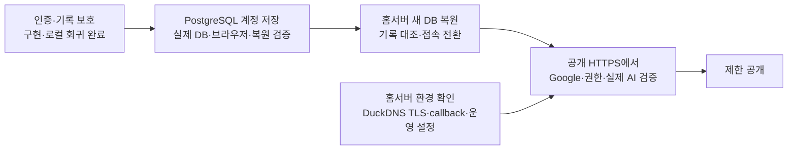
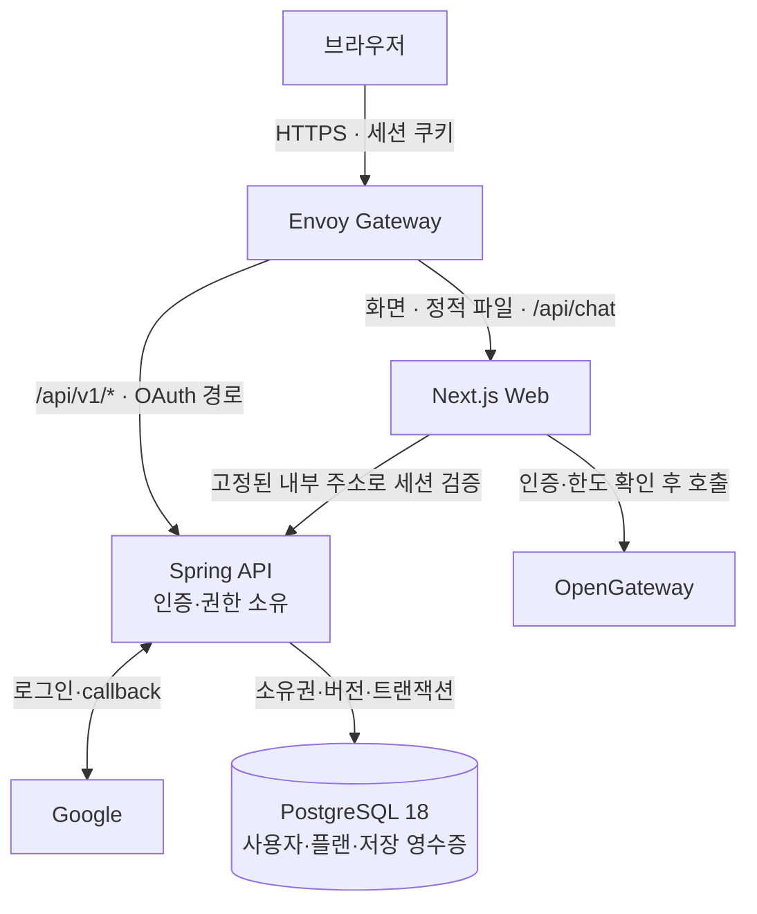

**Plannet 서비스 공개 로드맵·설계안**

작성일: 2026-09-23 · 최종 코드·검증 대조: 2026-09-26 23:00 KST · 기준: `031e124` + 현재 미커밋 작업 트리. 목표는 **Google 인증과 사용자별 접근 통제를 갖춘 플래너 서비스 공개**다.

**현재 결론:** 인증·접근 통제·기록 보호와 **PostgreSQL 계정별 서버 저장을 구현했다.** 현재 컴퓨터의 Docker DB를 사용하고 이후 홈서버로 이전한다. 서버 저장에는 4개 템플릿·반복 할 일·휴일, 명시적 로컬 이전, 충돌 시 초안 보존, 중복 없는 재시도가 포함된다. 실제 API·DB·브라우저 통합, 기존 기능 회귀, 새 DB 복원 후 재접속까지 검증했다. 공개 주소는 `plannet-lab.duckdns.org`이며 **홈서버 배포·공인 TLS·공개 origin 검증은 남아 있다.**

**1. 효과·시급도에 따른 실행 순서**

| 순서 | 상태 | 구현된 것 | 남은 일·완료 기준 |
|---|---|---|---|
| **0. 공개 경로 보호** | 구현 완료 | 공용 백업 차단, 비밀 파일 빌드 제외, API non-root, Web 보안 헤더 | 최신 이미지·실제 Gateway에서 직접 접근/설정 누락 차단 확인 |
| **1. Google 인증** | 구현·로컬 실인증 완료 | Spring OAuth2·me/csrf/logout, Web 연동, 계정별 로컬 분리 | 공개 HTTPS origin에서 callback·로그인·새로고침·로그아웃 확인 |
| **2. AI 접근 통제** | 구현·모의 통합 검증 완료 | 서버 세션 검증, CSRF, 요청 한도, 인증 장애 시 차단 | 공급자 금액 예산 설정·실제 AI 요청 확인 |
| **3. 기록 보호** | **수정·회귀 완료** | 초기화 후 지연 AI 차단, 날짜 탐색/재지정 분리, 복수 원본 출처, JSON 검증·원본 보호, 전체 PNG | 공개 배포에서 핵심 사용자 흐름 최종 확인 |
| **4. 계정별 서버 저장** | **구현·로컬 검증 완료** | PostgreSQL·내부 사용자·소유권·버전/삭제·재시도·6종 저장·초안·명시적 이전 | 홈서버의 실제 데이터·공개 환경에서 재확인 |
| **5. 홈서버 이전·제한 공개** | **실행 환경 대기** | DuckDNS 호스트·DB 백업/복원 도구·운영 Secret 설정·같은 origin 라우팅 | 홈서버 디스크/사설 DB 연결/백업 위치 → 복원·TLS·callback → 공개 검증 |
| **6. 제품 확장** | 목록·검색 완료, 나머지 후속 | 최근 5개 밖의 플랜 검색·선택, 계정별 목록 | 백업 확대·주차 정합성 → 캘린더/URL → Monthly→Daily → 색상 피드백. 업적·새 템플릿·MSA 분리는 이후 |

**2. 목표 구조와 책임**

- **인증 경계:** `/api/v1/**`, `/oauth2/**`, `/login/oauth2/**`는 API로 보낸다. `/api/**` 전체를 넘기지 않는다. AI는 서버가 검증한 세션만 신뢰하며 실패 시 거부한다.
- **저장 경계:** 서버가 검증한 Google 계정을 내부 UUID로 매핑하고 모든 DB 요청을 해당 소유자에 한정한다. 브라우저에는 계정별 캐시·초안을 보관한다. 오래된 버전은 충돌로 거부하며 저장 응답 유실은 같은 요청 ID로 재시도한다. 로컬 키는 같은 브라우저 사용자에 대한 보안 경계가 아니다.
- **기록 보존:** 날짜 화살표는 조회만 하고, 빈 기간 생성과 날짜 재지정은 명시적 동작으로 분리한다. 가져온 목표는 원본 플랜 ID+셀 ID로 식별한다. JSON 전체 교체는 검증·사용자 확인·현재 문맥 확인 후 원자적으로 적용하고 이전 AI 요청을 무효화한다.
- **운영 제약:** API·Web 각 1 replica, 세션·호출 한도는 메모리다. 재시작 시 재로그인·한도 초기화와 짧은 배포 중단을 허용한다. 다중 replica 전에 공유 저장소가 필요하고 금액 상한은 공급자 측에서 설정한다.

**3. 공개 전 통과 기준**

| 대상 | 확인한 것 | 공개 전에 남은 확인 |
|---|---|---|
| 인증·권한 | 로컬 실제 Google 흐름 기록, 미인증·위조·만료·CSRF·인증 장애·한도·공용 백업 차단 자동 검증 | 실제 origin의 callback·Secure/HttpOnly/SameSite 쿠키·로그아웃 후 거부. Gateway 우회 차단 |
| 기록·복원 | 실제 PostgreSQL API 47개 통과. 두 브라우저 복원·계정 격리·충돌·중복 이전·응답 유실·재시작 검증, 기존 42개 회귀 통과 | 홈서버에서 실제 데이터로 백업/복원·재접속 확인 |
| 빌드·배포·비용 | lint·표준 타입 검사·standalone Web 빌드 통과. API test task 성공. 로컬 HTTPS 배포 검증 기록 | 최신 이미지의 운영 결합 검증, 실제 외부 AI·공급자 예산·공인 TLS·운영 설정·롤백 경로 확인 |

**데이터 이전 원칙:** 사본 확보 → 형식·버전 검증 → 계정 선택 → 가져오기 → 건수·출처 대조. 익명 데이터를 로그인 계정에 자동 귀속하지 않는다. 서버 저장의 이전은 재실행 중복과 충돌을 처리하고 실패 시 원본을 유지한다. 과거 오류로 잘못 저장된 출처는 근거 없이 자동 교정하지 않는다.

**4. 인수·검증 근거**

이번 저장 구현은 API·Web·DB 운영을 3개 에이전트에 분담하고 총괄이 실제 시스템 결합을 검증했다. **실제 PostgreSQL API 47개**, **저장 상태/모의 브라우저 22개**, **실제 Spring·PostgreSQL·브라우저 6개**, **기존 인증/템플릿 회귀 42개**가 통과했다. 실제 통합에는 사용자·레코드·삭제 표식·저장 영수증·Flyway 이력을 새 DB에 복원하고 API를 다시 연결해 동일 내용과 재시도 응답을 대조한 검증이 포함된다. lint·타입·production Web 빌드도 통과했다.

DB 운영 도구 8항목과 production 15개/local-verify 23개 매니페스트 정책·스키마를 확인했다. 현재 컴퓨터에는 `127.0.0.1:15432`의 PostgreSQL만 개발용으로 남겼고 일회성 검증 DB는 정리했다. 이번 Google/AI는 모의 제공자다. 이전 기록 보호·목록 검증 **136개** 및 과거 HTTPS 배포 결과는 상세 보고에 보존하며 이번 수치와 합산하지 않는다. 최신 공개 이미지·홈서버·실제 Google/AI 검증은 아직 남아 있다.

[서버 저장 통합 보고](./session-reports/storage-integration.md) · [기록 보호 총괄 검토](./session-reports/coordinator-review.md) · [AI 초기화](./session-reports/ai-reset-followup.md) · [날짜·출처](./session-reports/period-and-import.md) · [JSON·PNG](./session-reports/mandalart-io.md) · [배포 준비](./deployment-readiness.md) · [인증 계약](./contracts/auth-v1.md) · [저장 설계](./account-storage-design.md) · [DB 운영·이전](./postgresql-operations.md) · [저장 API](./contracts/planner-storage-v1.md)

**다음 단계:** 홈서버 이전 준비. PostgreSQL과 로컬→홈서버 운영 방식은 확정됐으며 추가 DB 선택은 필요 없다. 홈서버 접근 권한·영속 디스크·공개 TLS/Google 설정이 필요한 배포 시점에 사용자와 확인한다. 커밋·push·공개 배포는 하지 않았다.
