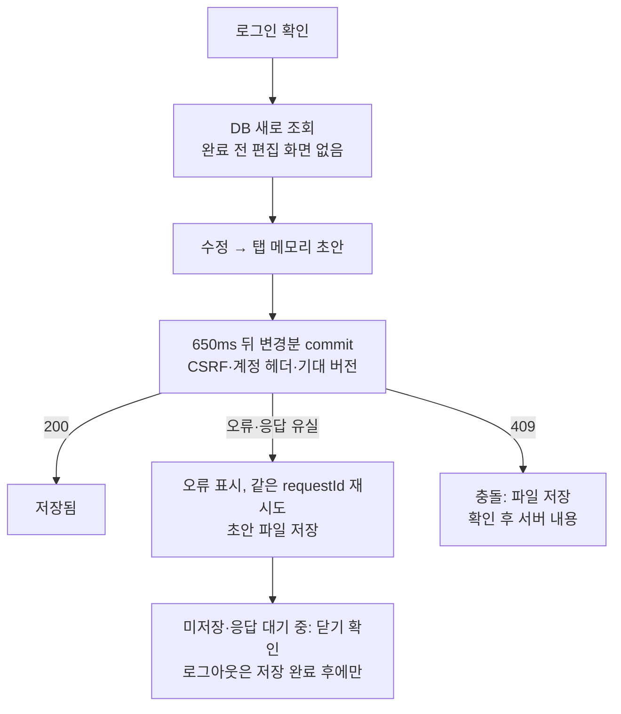

# DB 전용 플래너 저장 (이전 기록)

> **대체됨(2026-09-28):** 이후 사용자 요청으로 미확인 변경분만 sessionStorage에 임시 보관하도록 바뀌었다. 현재 설계는 [자동 저장 임시 보관](./autosave-journal.md)을 본다. 아래 내용과 검증 수치는 당시 기록으로 그대로 둔다.

2026-09-28 · 기준 `3e08caa` + 미커밋 변경(로그인 랜딩 포함). 사용자 요청 "앞으로는 브라우저 저장은 지양"에 따라 로그인한 서비스의 플래너 내용을 브라우저에 저장하지 않도록 바꿨다.

## 저장 모드

| 모드 | 조건 | 저장 |
|---|---|---|
| 서비스 | 로그인 + `storageEnabled` + 유효한 `userId` | PostgreSQL만. store 범위 `server:<UUID>`는 브라우저에 읽기·쓰기 없음. 미전송 수정은 탭 메모리 |
| 저장소 없음 | 로그인했지만 서버 저장이 없음 | 플래너를 열지 않고 "계정 저장소에 연결할 수 없어요" + 다시 시도·로그아웃. 계정 LocalStorage 대체 없음 |
| 로컬 개발 | 유효한 runtime-config `authEnabled:false` | 기존 LocalStorage(`plannet-*`) |
| 랜딩 | 확인 중·미로그인·확인 실패 | 저장 범위 없음 |

## 동작

- `PlannerSync`에서 브라우저 저장 의존성을 없앴다. 기준 버전·초안·응답 대기 요청은 탭 메모리에만 있다. 새 탭은 이전 탭의 요청을 재전송하지 않고 DB를 읽는다. CSRF, 계정 헤더, 버전 검사, 같은 requestId 재시도, 650ms 디바운스, 100개·7MiB 묶음, 응답 대기 중 수정 보존, 가져오기 충돌 규칙은 그대로다.
- 미저장·응답 대기 상태(`dirty`)일 때만 `beforeunload` 확인을 등록한다. 로그아웃은 `settle()`로 저장을 끝낸 뒤 진행한다. 저장·CSRF·로그아웃이 실패하면 작업 공간과 메모리를 그대로 두고 안내한다. 로그아웃 요청 중 새 수정이 생기면 이동하지 않고 파일 저장을 안내한다.
- 충돌 시 서버 내용 적용은 버리기 확인을 거친다. 확인 뒤나 조회 중에 새 수정이 생기면 적용하지 않는다. "초안 보관" 같은 표현을 없앴다.
- 탭 간 storage event 조정을 없앴다. 동시 수정은 DB 버전 충돌로 판정한다.
- 예전 키는 읽기만 한다: `@acct:`·비로그인 키는 명시적 가져오기로, 같은 계정의 예전 미전송 봉투(`plannet-server-sync@<UUID>`, `:backup:*`)는 "예전 초안 파일로 저장"으로(원문 그대로, `@cloud:` 캐시 포함). 자동 재전송·가져오기·삭제는 없다.

## 실행한 검증 (합성 인프라만)

| 대상 | 결과 |
|---|---|
| `tsc --noEmit`(web), `eslint src e2e`, infra e2e strict 타입 검사 | 통과 |
| 기본 E2E (local 10 + auth 55, 모의 Spring에 메모리 DB 추가) | **65 passed**. 새 `auth-db-only.spec.ts` 9개: 저장 흐름 전체의 브라우저 저장 없음, 오래된 캐시 대신 DB, 저장소 차단 시 저장, 응답 유실·전송 중 수정, 닫기 확인, 로그아웃 실패·저장 후 로그아웃, 두 브라우저 충돌·재진입, 예전 봉투 복구, 계정 격리 |
| storage-sync (logic 18 + browser 8) | **26 passed** |
| ai-response-safety (logic 17 + desktop 14 + mobile 3) | **34 passed**. 첫 실행은 mobile 3개가 하네스 문제로 실패: 선택 복원이 없어 플랜을 직접 열어야 하는데, 접힌 사이드바에서 키보드로 선택하면 사이드바가 열린다. 배경을 닫도록 하네스를 고친 뒤 통과 |
| plan-library 15, period-and-import 9, mandalart-io 46 | passed. period-and-import는 계정별 LocalStorage 커서를 검증하던 1개를 DB 전용 동작으로 바꿨다. mandalart-io는 첫 시작 때 하네스 임시 `node_modules` 복제본이 손상되어 있어 그 임시 복제본만 지우고 재실행 |
| server-storage (실제 Spring + 일회용 PostgreSQL) | **6 passed**. 첫 시작은 알려진 PostgreSQL 초기화 경합으로 실패해 1회 재실행 |

가벼운 수정 과정: `auth-db-only`의 로그아웃 테스트는 처음에 `/csrf`를 변조해 저장 commit까지 막아 'unsaved'가 나왔다. 테스트가 잘못된 것이라 로그아웃 응답만 거부하도록 고쳤다. 제목에 '로그아웃'이 들어가 버튼 선택이 겹친 것도 이름을 바꿔 해결했다.

`infra/deploy/verify/e2e/storage.spec.ts`의 충돌·응답 유실 단계도 새 모델에 맞췄지만 **kind 클러스터에서 실행하지 않았다.**

## 총괄 검토·로컬 반영

- 초기 DB 응답의 문서 검증이 실패하면 편집을 열지 않으며, 서버 내용 적용 중 검증 실패 시 미저장 내용을 복구하도록 보완했다. 브라우저 저장소 접근 자체가 차단된 경우도 복구 확인 화면을 중단시키지 않는다. 관련 로직 3개는 storage-sync 검증에 포함됐다.
- DB의 첫 조회가 실패해도 미저장 수정이 없으면 로그아웃할 수 있다. 이 검증은 기본 E2E 65개에 포함됐다.
- 최종 앱 소스와 일치하는 standalone 빌드를 별도 디렉터리에 보관한 뒤 3000번 서비스의 Web만 교체했다. API·DB·프록시는 재시작하지 않았다.
- 배포 빌드의 별도 브라우저 검증에서 가상 DB 조회·수정·재조회가 성공했고 브라우저 저장 쓰기 시도는 0회였다. 저장소 접근을 강제로 차단한 경우에도 동일하게 성공했다. 오래된 캐시 제목은 노출되지 않았고 원본 문자열은 유지됐다.
- 실제 브라우저 탭의 랜딩과 기존 저장 항목 16개의 값 불변을 확인했다. 실제 사용자 DB에 쓰기 요청은 보내지 않았다. 실제 Google 재로그인·외부 AI·공개 HTTPS 검증은 이번에 수행하지 않았다.
- 구현·회귀는 Claude Opus에 위임하고 총괄이 경계 조건 보완·검토·로컬 반영을 맡았다. 커밋·push하지 않았다.

## 한계

- 저장 전 수정은 탭 메모리에만 있다. 브라우저 강제 종료·충돌·OS 종료에는 `beforeunload`가 보호하지 못한다. 마지막 입력 뒤 650ms를 기다려 저장하며, 실제 완료까지의 시간은 연결 상태에 따라 달라진다.
- 응답을 받기 전에 탭을 닫으면 그 요청이 반영됐는지는 다음 DB 조회로만 알 수 있다(이중 반영은 없다).
- 선택한 플랜·조회 기간은 서비스 모드에서 새로 들어오면 초기화된다.
- 예전 `@cloud:` 캐시와 봉투는 기기에 그대로 남는다(삭제 안 함). 정리 기능은 없다.
- 예전 봉투 안내는 같은 내부 UUID의 `plannet-server-sync@` 키와 `:backup:` 키에 초안이 있을 때만 뜬다. 봉투 없이 `@cloud:` 캐시에만 남은 미전송 편집은 감지하지 않는다(이전 설계에서는 봉투가 먼저 기록됐다).
- 같은 계정의 두 탭은 실시간으로 갱신되지 않으며 충돌로만 알 수 있다.
