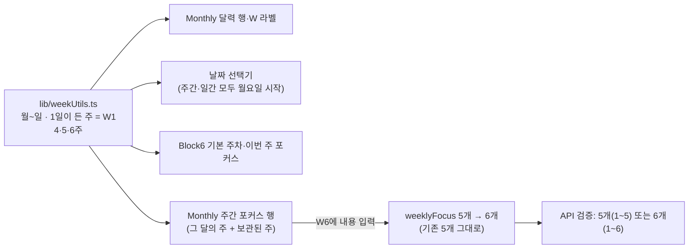

# 6주인 달의 주차 정합성 (UI·UX 3순위, W6)

> **10/5 총괄 인수 완료·미배포.** 코드·실제 격리 PostgreSQL 저장/재조회·새 DB 복원 근거를 검토했다. 아래 구현 당시 검토 대기·실제 DB 미검증 상태는 이번 판정으로 갱신한다. [최종 코드 검토](final-code-review.md)

2026-10-04 · 기준 `3e08caa` + 기존 미커밋 변경. [UI·UX 검토](../ui-ux-review.md) 3순위. **Claude Opus 구현·작업자 검증 완료, Codex 총괄 검토 대기.** 커밋·push·배포·서비스 재시작·DB 스키마/데이터 변경 없음.

## 무엇을 했나

주차 계산을 하나로 맞추고 Monthly에 W6을 넣었다. 이전 W1~W5 저장본은 그대로 읽고 저장하며, W6에 내용을 적을 때만 6개가 된다. API 검증은 5개 또는 6개를 받는다.

## 동작 변화

| 영역 | 이전 | 이후 |
|---|---|---|
| Monthly 달력 | 일요일 시작 행, W 번호는 행 순서 → 공통 주차와 어긋남(2026-03-30이 W5 행) | 월~일 행을 공통 helper로 만든다. 2026년 3월은 W1(3/1 하루)~W6(30·31일). 토 파랑·일 빨강, W 라벨·안내 `text-xs` |
| 주간 포커스 | 항상 W1~W5 | 그 달의 주 수(4·5·6)만큼. 6주인 달은 W6 입력 칸 |
| 이전 5개 플랜 | — | 읽기·주소 이동·새로고침·날짜 변경만으로 바뀌지 않는다(저장 0). W6에 내용을 적으면 `{6, text}`만 끝에 추가 |
| 날짜 변경·복제 | 포커스 배열 유지, 화면은 W1~W5 고정 | 배열 그대로. 새 달에 없는 주에 내용이 있으면 `이 달에 없는 주 · 보관된 내용` 안내와 함께 편집 가능한 행으로 표시. 원래 달로 돌아오면 일반 행 |
| 날짜 선택기 | 주간: 일요일 시작 행 + 월요일 기준 선택 → 선택한 주가 두 행에 걸침. 일간: 일요일 시작 | 주간·일간 모두 월요일 시작. 한 행 = 한 주, 앞뒤 달 날짜도 그 주로 강조. 연도를 바꿔 선택한 주가 없는 달이 되면 확인 시 마지막 주로 맞춤 |
| Block6 | 3/30 플랜은 W6이지만 Monthly에 W6 입력 경로 없음 | `3월 W6 포커스가 비어있어요` → `월간 플래너에서 작성` → Monthly W6 입력 → Block6에 표시 |
| 저장 검증 | API·Web 모두 정확히 5개(1~5) | 5개(1~5) 또는 6개(1~6), 빠짐·중복 없이(순서 무관). 개수·범위·중복·형식 오류는 거부 |
| 같은 내용 저장 | 포커스 칸을 열었다 닫기만 해도 저장 요청 | 내용이 같으면 쓰지 않는다 |
| 주간 포커스 Enter | `isComposing`만 확인, 행은 `div` 클릭 | 공통 `isImeComposing`, 행은 키보드로 여는 버튼(`FOCUS_RING`) |

## 설계 판단

| 결정 | 이유 |
|---|---|
| 표현은 기존 배열 그대로, 개수만 5 또는 6 | 스키마·마이그레이션 없이 기존 5개 클라이언트·저장본이 계속 유효하다 |
| 새 플랜은 처음부터 W1~W6 | 생성 경로를 단순하게. 4·5주 달에서는 빈 W5·W6을 숨긴다 |
| 이전 플랜은 W6 내용을 적을 때만 6개 | 읽기·이동으로 버전이 오르지 않게(요구사항). 빈 W6은 만들지 않는다 |
| 그 달에 없는 주의 내용은 보관 표시 | 날짜를 옮겨도 내용을 지우거나 숨기지 않는다. 빈 행은 숨겨 화면을 늘리지 않는다 |
| 순서 무관·연속 번호 | 기존 검증(5개가 1~5 각각 한 번)과 같은 규칙을 6까지 확장 |
| 사용 없는 일요일 기준 `getWeeksInMonth`·`getFirstDayOfMonth` 삭제 | 호출처 0. 규칙이 두 개로 보이는 원인 제거 |
| 배포 순서: API를 Web과 같이(또는 먼저) | 6개를 보내는 Web이 이전 API에 저장하면 400. 이전 Web은 6개를 받아도 그대로 표시·저장(정수 번호만 검사) |

## 변경 파일 (이번 작업분, baseline 해시 대비)

- Web: `src/lib/weekUtils.ts`, `src/types/monthly.ts`, `src/hooks/useMonthly.ts`, `src/lib/plannerSyncStores.ts`, `src/components/Monthly/{CompactCalendar,WeeklyFocus,MonthlyGrid}.tsx`, `src/components/DatePicker.tsx`
- API: `PlannerValidator.kt`, `PlannerValidatorTests.kt`
- 테스트 새 파일: `e2e/monthly-weeks/{logic,browser}.spec.ts`, `playwright.monthly-weeks.config.ts`(3670)
- 작업 복귀 후속(A): `src/components/Header.tsx`, `src/components/WorkspaceHome.tsx`, `e2e/work-resumption/work-resumption.spec.ts` — [작업 복귀 보고](work-resumption.md#총괄-검토-후속-수정-104-저녁-수정-내용은-총괄-재검토-대기)
- 문서: 이 보고서, `contracts/planner-storage-v1.md`, `templates/{monthly,block6,daily}.md`, `AGENTS.md`(Weeks·초점), `ui-ux-review.md`, `roadmap-status.md`, `session-reports/work-resumption.md`

## 실행한 검증

모두 격리 포트·새 빌드·가상 계정/플랜. 인증·DB는 브라우저 가로채기 또는 기존 모의 서버. 실제 DB·Google·AI·사용자 브라우저 저장소·3000/3001/18180/15432 포트 미접근. 로그 `/private/tmp/plannet-opus-roadmap-w6-20261004/logs/`.

| 명령 | 결과 |
|---|---|
| `tsc --noEmit -p tsconfig.json`, `eslint`(apps/web 전체), `git diff --check` | 통과 (`tsc-final.log`, `lint-final.log`, `diff-check.log`) |
| `./gradlew --offline :apps:api:test --tests '*PlannerValidatorTests'` | 새 검사를 **수정 전** 검증기로: **1 failed / 8** → 수정 후 **8 passed** |
| `./gradlew --offline :apps:api:test` (전체) | **57개 중 39 passed, 18 skipped**(실제 PostgreSQL 검사 17+1개, DB 환경변수 없음), 실패 0 |
| `playwright -c playwright.monthly-weeks.config.ts` (logic + browser, 3670 새 webpack 빌드) | logic 8 + browser 6. 1차 browser **12 passed / 2 failed**(검사 쪽, 아래) → 최종 **14 passed** (`e2e-monthly-weeks-final.log`) |
| 같은 logic을 `TZ=America/Sao_Paulo`·`America/New_York` | 각 **8 passed** |
| `playwright -c playwright.work-resumption.config.ts` (3660) | 후속 3개 수정 전 **3 failed** → 수정 후 3 passed. 전체 **16 passed** |
| `playwright -c playwright.ux-foundation.config.ts` (3650, 키보드·IME·반응형) | **19 passed** |
| `playwright -c playwright.period-and-import.config.ts` (3640) | **9 passed** |
| `playwright -c playwright.plan-library.config.ts` (3530~3533) | **15 passed** |
| `playwright -c playwright.config.ts --project auth` (3310~3315, 인증·DB 전용·자동 저장 보관) | **64 passed** |
| `STORAGE_SYNC_WORK_DIR=<새> npm_config_offline=true … storage-sync` (3680, 새 standalone 빌드) | **39 passed** |

AI 응답 안전·만다라트 입출력 스위트는 이번 변경과 닿지 않아 돌리지 않았다.

새 스위트가 확인하는 것:

| 범주 | 내용 |
|---|---|
| 주차 계산 | 4주(2027-02)·5주·6주(2026-03, 2026-08)·윤년 2월(2024, 일요일 시작·끝 2032)·연말/연초(2025-12 → 2026-01, 2027-01) 주 범위. 2000~2100년 모든 달: 월요일 시작 7일, W1에 1일, 마지막 주에 말일, 모든 날이 정확히 한 주. 시간대 Asia/Seoul·America/Sao_Paulo·America/New_York |
| 계약 | 5·6개·순서 섞인 6개 통과, 4·7개·중복·빠짐·0/7·문자/소수/null 번호 거부(Web·Kotlin 같은 표) |
| store | 새 플랜 6개, 같은 내용·빈 W6·범위 밖은 원본 그대로, 날짜 변경은 배열 유지, W6 입력 때만 6개(다른 필드 불변) |
| 달력 (360/768/1440) | 2026년 3월 이전 5개 플랜: W1=[1], W6=[30,31], 요일 열 정렬(3/1과 3/8 같은 열), 토·일 색, W6 빈 입력 칸, 페이지 넘침 0, 새로고침 후 저장 0·버전 불변 |
| W6 편집 | 열었다 닫기만 하면 저장 0, 조합 중 Enter 무시, Enter로 저장 → 요청은 기존 5개 + W6, 다른 필드 불변, expectedVersion 3 → 새로 불러와도 W6 |
| 날짜 변경·복제 | 6→4주(2027-02, W5·W6 보관 표시 2개)→5주(2026-10, W6만)→6주(2026-03, 표시 없음), 각 단계 저장본의 포커스 6개 그대로. 4주 달로 복제: 새 ID·`(복사)`, 6개 그대로, 원본 버전 불변 |
| Block6·선택기 (2026-03-30) | 이번 주 포커스 `3월 W6` 안내, 주간 선택기 W6 행 = 30·31·1~5 한 행·`3월 6주차: 30일 ~ 4/5`, W1 행 = 2/23~3/1, 일간 선택기 월요일 시작, Monthly에서 W6 작성 → Block6 표시, 새 Block6 기본 `2026.03 W6` |

화면(가상 데이터): `test-results/mw-run2/…/legacy-march-{360,768,1440}.png`, `reassigned-4-weeks-1440.png`. 직접 열어 행·라벨·보관 안내·넘침을 확인했다.

## 실행 중 발생한 일

- Kotlin: 새 검사를 수정 전 검증기로 먼저 돌려 **1 failed**(6개 거부)를 확인한 뒤 수정본으로 되돌려 **8 passed**
- 주차 전수 검사 첫 실행은 통과했지만 항목마다 `expect`를 불러 **5.0분** 걸렸다 → 위반을 모아 한 번 비교(0.3초)
- 브라우저 첫 실행 **12 passed / 2 failed**(검사 쪽 문제): ① 날짜 변경 3번이 자동 저장 debounce로 묶여 마지막 3월 복귀가 '변경 없음'이 됨 → 단계마다 저장 확인 후 진행 ② 같은 열 비교에서 827 vs 828px 소수점 반올림 → 1px 허용. 앱 코드는 바꾸지 않았다
- storage-sync는 새 작업 디렉터리에 `node_modules`를 미리 복제하고 `next` 실행 파일을 확인한 뒤 `npm_config_offline=true`로 실행했다(이전의 npx 내려받기 재발 방지)

## 한계·총괄 검토 대기

- Chromium 합성 검증이다. 실제 Spring+PostgreSQL 왕복은 이번에 돌리지 않았다(`PlannerPostgresTests`는 `PLANNET_TEST_DB_URL`이 없어 건너뜀). 검증기는 단위 검사로, 저장 계약 형식(스키마·버전)은 바꾸지 않았다. 실제 DB 6개 저장·복원은 **미검증** → 2026-10-05 [W6 실제 PostgreSQL 검증](w6-postgres-final.md)에서 저장·달 변경·계정 격리·백업/복원 후 API 조회 확인(총괄 검토 대기)
- Safari/iPadOS·실제 OS 한글 입력기 미확인
- 범위 밖으로 남긴 것: `MonthlyGoals`의 `isComposing` 단독 검사·`text-[10px]`(이번에 건드리지 않음), Monthly→Daily 가져오기, 이전 플랜 일괄 변환(하지 않음)
- 총괄 검토 요청: 보관 행 문구·위치, 새 플랜 6개 생성 결정, API·Web 동시 배포 순서, 날짜 선택기 일간 달력의 월요일 시작 전환
