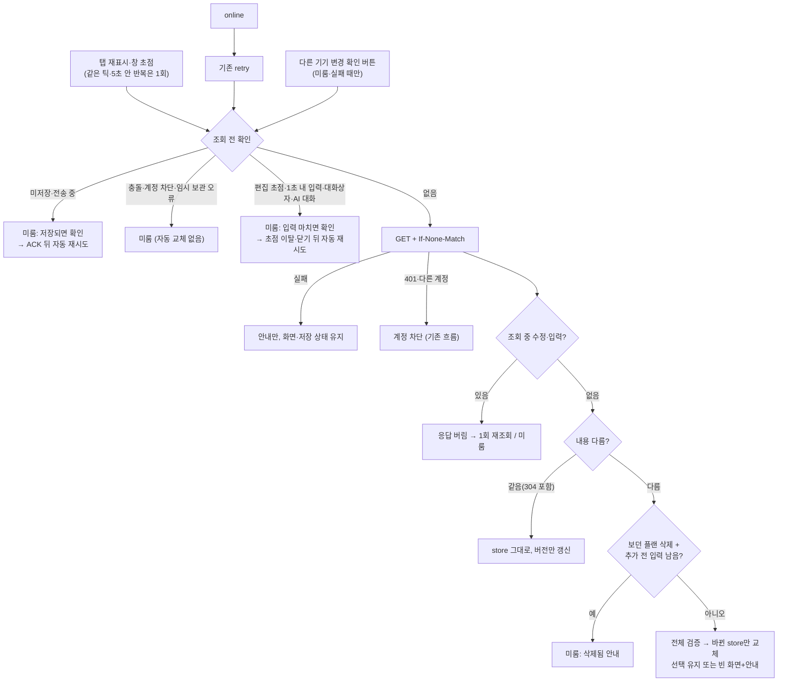

# 안전한 기기 간 최신화 (UI·UX 4순위)

> **10/5 총괄 검토 완료·미배포.** 변경 코드와 최종 통과 근거를 검토했다. 아래 구현 당시 상태는 이 판정으로 갱신한다. [최종 코드 검토](final-code-review.md)

2026-10-04 · 기준: 작업 직전 미커밋 소스(작업 복귀·W6 포함, baseline 해시 `/private/tmp/plannet-roadmap-continuation-20261004/safe-refresh/baseline-sha256.json`). **Claude Opus 구현·작업자 검증 완료. 총괄 검토 대기. 서비스 미반영.** 커밋·push·배포·재시작 없음. API·DB·의존성 변경 없음.

## 무엇을 했나

다른 기기에서 바꾼 내용을 탭으로 돌아올 때(탭 재표시·창 초점)와 네트워크 복구 때 조건부 조회(ETag)로 반영한다. 이 탭에 저장 안 된 수정·전송 중 요청·충돌/계정 차단·읽을 수 없는 임시 보관이 있거나, 사용자가 입력 중이면 화면을 바꾸지 않고 이유를 표시한 뒤 끝나면 다시 확인한다. 폴링은 없다.

## 동작 변화

| 상황 | 이전 | 이후 |
|---|---|---|
| 다른 기기 수정·삭제·추가 후 탭 복귀 | 새로고침 전까지 이전 내용 | 1회 조회로 반영. 선택·주소 유지. `다른 기기에서 바뀐 내용을 반영했어요.` |
| 변경 없음(304) | — | store·편집기·AI 대화·가져오기 확인 창 그대로, 쓰기 0 |
| 보던 플랜이 다른 기기에서 삭제 | — | 빈 작업 공간, 주소 `/`(replace), `보던 플랜이 다른 기기에서 삭제됐어요…`. 아직 추가하지 않은 입력(`data-local-draft`)이 남아 있으면 화면 유지·안내, 비우면 자동 반영 |
| 저장 전·전송 중 | — | 조회·교체 없음 `이 탭의 수정이 저장되면…` → ACK 뒤 자동 확인. 임시 보관 키는 ACK 때만 지워짐 |
| 입력 중(초점·한글 조합·1초 내 입력·모달·AI 대화) | — | 조회 없음 또는 응답 미적용, 초점 이탈·닫기 뒤 자동 확인. 입력 값은 그대로 |
| 조회 중 수정(되돌린 경우 포함)·입력 | — | 그 응답 버림. 지연된 자동 저장은 조회가 끝난 뒤 다시 예약(멈추지 않음) |
| 네트워크 실패·잘못된 응답 | — | 내용·`저장됐어요` 상태 유지, `확인하지 못했어요… 마지막으로 불러온 내용` 안내 + `다른 기기 변경 확인`. 로그아웃 막지 않음 |
| 401·다른 계정 응답 | — | 기존 계정 차단(쓰기 중단·초안 파일). 다른 계정 내용 미표시 |
| 충돌 | — | 자동 교체 없음. `서버 내용 불러오기`(확인 후 버림)는 기존대로 수동만 |

## 설계 판단

| 결정 | 이유 |
|---|---|
| `start()`를 재사용하지 않고 `refresh()` 추가 | start는 base를 먼저 바꾸고 journal을 쓰며 `loading`으로 편집을 막는다. refresh는 검증을 마친 뒤 base·store를 바꾸고 journal을 건드리지 않는다 |
| 조회 전후 두 번 확인 + `revision`·입력 횟수 비교 | 조회 중 수정·되돌림·store에 아직 없는 입력을 모두 잡는다 |
| 304는 "이 탭 base와 같음"이 아니다 | 미뤄 둔 200이 어댑터 사본을 바꾼 뒤의 304도 base와 비교해 반영한다 |
| 바뀐 종류의 store만 교체 | 만다라트 `resetToken`이 그대로면 AI 대화·JSON 가져오기 확인이 초기화되지 않는다 |
| `useServer`의 `running` 대기를 반복으로 | 직후 시작한 refresh에 `exclusive()`가 동작을 삼키지 않게 |
| 5초 간격 + 끝 1회 | 창 전환 연타를 줄이되 마지막 복귀는 확인. 수동·온라인·보류 해제는 간격 무시 |
| 보류 판정은 DOM(`lib/refreshGuard.ts`) | 컴포넌트 지역 상태를 store에 끌어올리지 않고 확인. 지역 입력 11곳에 `data-local-draft`, 셀 일정 팝오버·헤더 초기화/가져오기 확인에 `data-refresh-hold`, AI 패널은 `holdRefresh` |

## 검증

모두 Chromium 합성 환경, 가상 계정·플랜, 인증·DB·AI는 브라우저 가로채기 또는 기존 모의 서버. 실제 DB·Google·AI·서비스·사용자 브라우저 저장소와 3000/3001/18180/15432 포트는 쓰지 않았다. 로그: `/private/tmp/plannet-roadmap-continuation-20261004/safe-refresh/logs/`.

| 명령 (`apps/web`, 로컬 바이너리) | 결과 |
|---|---|
| `tsc --noEmit -p tsconfig.json` | 통과 (`final-tsc.log`) |
| `eslint src e2e playwright.storage-sync.config.ts` | 통과 (`final-eslint.log`) |
| storage-sync 전체 (새 `STORAGE_SYNC_WORK_DIR`, 새 standalone production 빌드, 3680) | **66 passed** = 기존 39 + 새 logic 20 + 새 browser 7 (`final-storage-sync.log`) |
| `playwright.config.ts --project auth` (3310~3315, 자동 저장 임시 보관·로그아웃 포함) | **64 passed** |
| work-resumption / ux-foundation / monthly-weeks / plan-library / period-and-import | **16 / 19 / 14 / 15 / 9 passed** |
| ai-response-safety (새 `AIRS_WORK_DIR`) / mandalart-io (새 `MIO_WORK_DIR`) 전체 프로젝트 | **34 / 46 passed** |
| `git diff --check` | 통과 |

새 검사가 확인하는 것: 정상 200 수정·삭제·추가 1회 반영과 쓰기·임시 보관 변경 0, 304 무변경, 동시 요청 1회 조회, 미저장·전송 중·충돌·읽을 수 없는 임시 보관 보류, 조회 중 수정/되돌림/지역 입력, 늦게 온 이전 계정 응답 무시, 실패·잘못된 문서의 원자적 거부와 이후 재시도, 401·다른 계정 차단, `useServer`·가져오기와의 경합, 바뀐 store만 교체·선택 유지/삭제. 브라우저: 탭 복귀 연타 1회 조회·주소·추가 전 입력 유지, 삭제+추가 전 입력 대기 후 빈 화면, 메모 초점·Monthly W6 미확정 입력(같은 플랜 원격 수정 → 사실대로 충돌, 입력 보존·파일 저장), 임시 보관은 ACK 때만 삭제, 오프라인→online·잘못된 응답→수동 확인, 다른 계정·401, AI 패널 보류.

실행 중 발생한 일:

- 브라우저 새 검사 첫 실행 **5 passed / 2 failed**: 테스트가 첫 조회 완료 전에 모의 서버를 오프라인으로 바꾼 경합. 로드 완료를 기다리도록 테스트만 고쳐 통과(제품 코드 변경 없음, 단언 완화 없음)
- 검사 민감도 확인(이 세션 시작 뒤 도입된 [검증 정책](../verification-policy.md)에서는 기본 절차가 아님): 엔진의 조회 중 수정 판정·ACK 뒤 재시도·저장 재예약·문서 검증과 DOM/AI 보류를 각각 끄면 해당 검사가 실패함을 확인하고 원본으로 되돌렸다(`mutation-*.log`, 파일 비교로 복원 확인)
- 격리 스위트 임시 복사본은 `TMPDIR`을 작업 폴더 `tmp/`로 지정해 그 안에 남겼다(가상 데이터만)

## 한계·총괄 검토 대기

- Chromium 합성 이벤트로만 확인. 실제 OS 한글 입력기·Safari/iPadOS의 `visibilitychange`/`focus` 순서·실제 Spring/PostgreSQL ETag와의 결합은 미검증(API 계약은 바꾸지 않음)
- 입력 보류는 DOM 기준이다. 새 지역 입력을 만들 때 `data-local-draft`를 빠뜨리면 "보던 플랜 삭제" 경우만 보호가 약해진다(초점·최근 입력 보류는 그대로). AGENTS에 규칙을 적었다
- 편집 칸에 초점을 계속 두면 확인이 계속 미뤄진다(안내·수동 확인 버튼 제공)
- 같은 기록을 두 기기에서 고친 경우는 자동 병합하지 않고 기존 충돌 처리로 간다
- 4순위 중 "저장 시각 표시"는 이번 범위 밖. 템플릿 문서는 템플릿별 기능 변화가 없어 바꾸지 않았다
- 총괄 검토 요청: 5초 간격, AI 패널이 열린 동안 보류, 보던 플랜 삭제 시 추가 전 입력 대기 정책, 안내 문구
