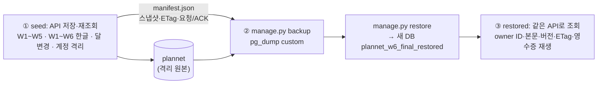

# W6 실제 PostgreSQL 검증 (월간 주간 포커스 5·6개)

> **10/5 총괄 인수 완료·미배포.** 코드·실제 격리 PostgreSQL 저장/재조회·새 DB 복원 근거를 검토했다. 아래 구현 당시 검토 대기·실제 DB 미검증 상태는 이번 판정으로 갱신한다. [최종 코드 검토](final-code-review.md)

2026-10-05 · 기준 `3e08caa` + 기존 미커밋 변경. [W6 보고](monthly-w6.md)의 "실제 DB 6개 저장·복원 미검증" 공백을 닫는다. **Claude Opus 작업자 검증 완료, Codex 총괄 검토 대기.** 커밋·push·배포·기존 컨테이너/볼륨/DB 접근 없음. 앱 코드 변경 없음.

## 무엇을 했나

새로 만든 격리 PostgreSQL 18.6(기존 이미지 재사용)에서 실제 API(MockMvc + Spring + Flyway + JDBC)로 W1~W5·W1~W6 플랜을 저장·재조회하고, 저장소 백업 도구(`infra/storage/manage.py`)로 그 DB를 백업 → **새 DB**로 복원 → 같은 API로 다시 읽었다.

## 동작 확인 (실제 PostgreSQL)

| 위험 | 확인 | 결과 |
|---|---|---|
| 이전 W1~W5 저장본이 바뀜 | 저장 → 재조회 본문 동일, 6주인 달(2026-03)로 옮겨도 정확히 5개·버전 2 | 통과 |
| W1~W6 한글이 깨짐 | 순서 섞인 6개(이모지·따옴표·줄바꿈 포함) 저장 → 재조회 동일 | 통과 |
| 달 변경 때 W5·W6 유실 | 2026-03(6주) → 2027-02(4주) → 2026-10(5주) → 2026-03, 단계마다 재조회 본문·`weeklyFocus` 동일, 버전 2·3·4 | 통과 |
| 계정 섞임 | 두 계정이 같은 ID `w6-plan`에 다른 W6 내용. 각자 자기 것만 보임, 남의 계정 헤더로 읽기·쓰기 409 `account_changed`, 상대 스냅샷 불변 | 통과 |
| 잘못된 모양 저장 | 7개·W7·중복·4개 → 400 `invalid_request`, 기록 0 | 통과 |
| 복원 후 내용·소유자·버전 | 같은 subject → 같은 owner ID(복원된 행이 API 호출 전부터 존재), 스냅샷 전체·ETag가 백업 전과 동일 | 통과 |
| 복원 후 영수증 | 원래 요청 7개 재전송 → 원래 ACK 그대로, 이후 스냅샷·표 지문 불변(쓰기 0) | 통과 |
| DB 없는데 통과 | `PLANNET_REQUIRE_POSTGRES=true` + 연결 거부 포트 → 3 failed. URL 없음 → 3 failed(`PLANNET_TEST_DB_URL is required`) | 실패로 보고됨 (의도) |

표 지문(원본 = 복원본, SHA-256 of `jsonb_agg(to_jsonb(row))`): `plannet_user` 3행 `70121370…`, `planner_record` 3행 `b2e76030…`, `planner_commit_receipt` 7행 `b4c074a2…`, `flyway_schema_history` 3행 `73c5794f…`. 백업 파일 SHA-256 `ad75973c…7ef6`.

## 실행한 검증

격리 자원: compose 프로젝트 `plannet-w6-final-b6d707ba`(컨테이너·네트워크·볼륨 `…-pg18`), `127.0.0.1:25466`, 상태 디렉터리 `/private/tmp/plannet-w6-postgres-final-20261005/fixture/`. 가상 계정·플랜만 사용.

| 명령 (`./gradlew --offline :apps:api:test --rerun --tests …`) | DB | 결과 |
|---|---|---|
| `PlannerMonthlyWeeksPostgresTests` (seed) | `plannet` | **2 passed**, 1 skipped(복원 단계 사례, manifest 없음 — 설계상) |
| `PlannerPostgresTests` (기존, 1회) | 별도 새 DB `plannet_w6_final_existing` | **17 passed**, skipped 0 |
| `manage.py` backup → restore (driver 경유) | `plannet` → `plannet_w6_final_restored` | 성공, 4개 표 지문 동일 |
| `PlannerMonthlyWeeksPostgresTests.restored*` | `plannet_w6_final_restored` | **1 passed**, skipped 0 |
| 같은 클래스, 연결 거부 포트 + REQUIRE | 없음 | **3 failed** (의도) |
| 같은 클래스, 환경변수 없음 (`--rerun` 없이) | 없음 | 3 skipped, exit 0 (기존 opt-in 관행) |
| 바로 이어서 REQUIRE만 켬 (`--rerun` 없이) | 없음 | **3 failed**, UP-TO-DATE 아님 |

전체 로그·JUnit XML: `/private/tmp/plannet-w6-postgres-final-20261005/logs/`. 프론트·검증기·웹 스위트는 [W6 보고](monthly-w6.md)에서 통과해 다시 돌리지 않았다.

## 변경 파일

| 파일 | 내용 |
|---|---|
| `apps/api/src/test/.../storage/PlannerMonthlyWeeksPostgresTests.kt` (새) | 위 사례 + 복원 단계 사례. `PLANNET_TEST_DB_URL` 또는 `PLANNET_REQUIRE_POSTGRES=true`일 때 실행, REQUIRE에서 DB가 없으면 실패 |
| `apps/api/build.gradle.kts` | `PLANNET_REQUIRE_POSTGRES`·`PLANNET_W6_RESTORED_MANIFEST`를 test 입력에 추가 → 이전 결과 재사용(UP-TO-DATE)으로 통과처럼 보이지 않게 |

재현: 격리 DB에서 `PLANNET_TEST_DB_URL=… PLANNET_REQUIRE_POSTGRES=true PLANNET_W6_MANIFEST=<경로>`로 seed → `db.sh backup`/`restore --target <새 DB>` → `PLANNET_W6_RESTORED_MANIFEST=<경로>`로 `--tests '*PlannerMonthlyWeeksPostgresTests.restored*'`.

## 한계·정리

- 브라우저→Next→Spring 전 구간이 아니라 Spring MockMvc(인증은 `oidcLogin`)→실제 PostgreSQL이다. 실제 Google·운영 DB·홈서버 미접근
- `build.gradle.kts` 수정은 DB 단계 실행 뒤에 했다. 이 수정은 test 입력 선언만 바꾸며, 이후 두 캐시 확인은 최종 파일로 실행했다. DB 단계를 다시 돌리지 않았다
- 기존 `PlannerRestartPersistenceTests`(재시작 1건)는 W6와 무관해 돌리지 않았다
- 정리: `docker compose down` + 라벨 확인 후 볼륨 삭제 → 컨테이너·네트워크·볼륨 0개 남음. 비밀번호·env 파일 삭제. 가상 데이터 백업(`fixture/plannet-w6-final-source.dump`)과 manifest는 증거로 `/private/tmp`에 남김
