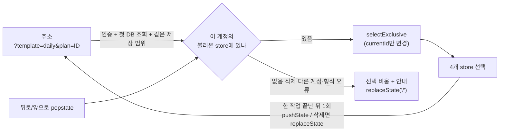

# 작업 복귀·빠른 시작 (UI·UX 2순위)

> **10/5 총괄 검토 완료·미배포.** 변경 코드와 최종 통과 근거를 검토했다. 아래 구현 당시 상태는 이 판정으로 갱신한다. [최종 코드 검토](final-code-review.md)

2026-10-04 · 기준 `3e08caa` + 기존 미커밋 변경(보안 갱신 16.3.8 포함). [UI·UX 검토](../ui-ux-review.md) 2순위. **Claude Opus 구현·검증 완료. Codex 총괄 검토에서 지적 2건(헤더 사용법 초점 표시, 자정 넘긴 `오늘`) → 수정·검증 완료, 수정분은 총괄 재검토 대기**([후속 수정](#총괄-검토-후속-수정-104-저녁-수정-내용은-총괄-재검토-대기)). 커밋·push·배포·서비스 재시작 없음.

## 무엇을 했나

새로고침·새 탭·뒤로/앞으로에서 보던 플랜으로 돌아오고, 빈 화면에서 바로 오늘 할 일이나 최근 작업을 연다. 가이드는 생성 필수 단계에서 빼고 필요할 때 여는 `사용법`으로 바꿨다. API·DB 스키마·동기화 계약·의존성은 바꾸지 않았다.

## 동작 변화

| 영역 | 이전 | 이후 |
|---|---|---|
| 새로고침·새 탭 | 로그인 서비스는 선택이 메모리에만 있어 항상 빈 안내 화면 | 주소 `?template=<t>&plan=<id>`로 같은 계정의 플랜을 다시 연다. 4개 템플릿 모두 |
| 뒤로/앞으로 | 주소 변화 없음 | 플랜을 고를 때마다 기록 1개. 같은 문서 안 이동(전체 새로고침 없음) |
| 잘못된 주소 | — | 형식 오류(템플릿·ID 규칙·중복 파라미터)·없는 ID·삭제된 ID·다른 템플릿·다른 계정 ID는 열지 않는다. 다른 곳에 조회하지 않고 안내 후 주소를 비운다 |
| 인증·로딩 경계 | — | 로그인 확인 중·확인 실패·첫 DB 조회 실패 동안 주소를 읽거나 지우지 않는다. 로그아웃은 기존대로 `/`로 이동 |
| 빈 작업 공간 | "플랜을 선택하거나 새로 만들어주세요" 문구 | `오늘 할 일`: 오늘 일간 Daily 없음 → `오늘 플랜 만들기`, 1개 → `오늘 플랜 열기`, 여럿 → 모두 나열. `최근 작업` 5개(updatedAt, 같으면 `template:id`) |
| 생성 흐름 | 템플릿 → 날짜 → **가이드 → 시작하기** | 템플릿 → 날짜 **확인으로 생성**. 기본 제목·날짜·모바일 사이드바 닫힘·초점 복귀 유지 |
| 가이드 | 생성 때마다 표시. 만다라트만 메뉴에 `가이드` | 편집 헤더 `사용법`(4개 템플릿, 시작 버튼은 `확인`으로 닫기만) + 템플릿 선택의 `<템플릿> 사용법 보기`(시작하기 → 날짜 선택) |

## 설계 판단

| 결정 | 이유 |
|---|---|
| 주소에는 템플릿+ID만. 브라우저 저장소에 마지막 선택을 두지 않음 | 제목·이메일·내용 노출과 계정 간 잔존을 막는다. 주소가 이동 기록을 맡는다 |
| 적용 조건 = `allHydrated && (!storageEnabled \|\| sync.loaded)` + `getPlannerStorageScope() === storageScope` | 기존 작업 공간 진입 조건을 그대로 쓴다. 동기화 상태 계약은 바꾸지 않았다 |
| ID 규칙은 API `PlannerValidator`와 같은 정규식 | 서버가 받지 않는 값은 조회 대상이 아니다 |
| 선택 → 주소 반영을 microtask로 1회 | `selectExclusive`가 다른 store를 먼저 비워서 생기는 중간 '선택 없음'이 기록에 쌓이는 결함을 첫 실행에서 발견해 수정 |
| 보던 플랜이 삭제돼 선택이 바뀌면 `replaceState` | 뒤로 가기가 삭제된 플랜 주소로 돌아가지 않게 |
| 첫 적용은 `useLayoutEffect` | 복원할 플랜이 있을 때 빈 화면이 잠깐 보이지 않게 |
| history는 `pushState(null, …)` | Next.js가 감싼 history가 라우터 내부 상태를 이어받아 popstate 때 전체 새로고침하지 않는다 |
| 로컬 모드(인증 꺼짐)에서 주소가 비어 있으면 기존 persist 선택 유지 | 기존 로컬 동작을 바꾸지 않는다 |
| `오늘`은 브라우저 현지 날짜·일간 카테고리 Daily만 | 날짜 이동(`findPeriodPlan`)과 같은 기준. 다른 카테고리 Daily는 최근 작업·사이드바에서 연다 |
| 오늘 플랜 생성은 버튼에서만, `ref`로 연속 클릭 1회 | 불러오기·이동·새로고침만으로는 쓰기 없음 |
| 생성 로직을 `lib/planCreation.ts`로 이동, 초점 링을 `FOCUS_RING` 상수로 공유 | 사이드바·빠른 시작이 같은 기본 제목·날짜 규칙을 쓴다(DRY) |

## 변경 파일 (이번 작업분만, baseline 해시 대비)

- 새 파일: `src/lib/planSelectionUrl.ts`, `src/hooks/usePlanSelectionUrl.ts`, `src/components/WorkspaceHome.tsx`, `src/lib/planCreation.ts`, `e2e/work-resumption/work-resumption.spec.ts`, `playwright.work-resumption.config.ts`
- 수정: `PlannerWorkspace.tsx`(주소 hook·빈 작업 공간), `Sidebar.tsx`(날짜 확인으로 생성, 사용법 → 날짜 선택, 사용법 버튼 이름), `Header.tsx`(모든 템플릿 `사용법`), 가이드 4종(`startLabel`), `templateRegistry.ts`(가이드 props 타입), `constants.ts`(`FOCUS_RING`), `Landing.tsx`(공유 상수 사용만)
- 테스트 갱신: `e2e/support/helpers.ts`(`createPlan`이 가이드 대신 "대화상자 없음"을 확인), `e2e/templates.spec.ts`(삭제 후 빈 작업 공간 문구), `e2e/ux-foundation/ux-foundation.spec.ts`(가이드를 템플릿 선택의 사용법 경로에서 검증, 생성 직후 가이드 없음 확인). 기존 초점·Tab·Esc 단언은 유지
- 문서: 이 보고서, `docs/templates/{daily,mandalart,block6,monthly}.md`, `AGENTS.md`(Work resumption), `docs/ui-ux-review.md`, `docs/roadmap-status.md`

## 실행한 검증

모두 Chromium 합성 환경. 격리 포트·새 빌드, 가상 계정·가상 플랜. 인증·DB·AI는 브라우저 가로채기 또는 기존 모의 서버. 실제 DB·Google·AI·사용자 브라우저 저장소·3000/3001/18180/15432 포트에 접근하지 않았다. 로그는 `/private/tmp/plannet-opus-roadmap-20261004/logs/`.

| 명령 (`apps/web`) | 결과 |
|---|---|
| `npx tsc --noEmit -p tsconfig.json` | 통과 (`tsc-final.log`) |
| `npx eslint` | 통과 (`lint-final.log`) |
| `git diff --check` | 통과 |
| `npx playwright test -c playwright.work-resumption.config.ts` (3660, 새 webpack 빌드) | 1차 **9 passed / 4 failed**(뒤로 가기: 위 microtask 결함) → 수정 후 **13 passed**, 최종 소스 재실행 **13 passed** (`e2e-work-resumption-final.log`) |
| `npx playwright test -c playwright.ux-foundation.config.ts` (3650) | **19 passed** |
| `npx playwright test -c playwright.plan-library.config.ts` (3530~3533, local+auth, `templates.spec.ts` 포함) | **15 passed** |
| `npx playwright test -c playwright.config.ts --project auth` (3310~3315) | **64 passed** (랜딩·로그인/로그아웃·DB 전용·자동 저장 임시 보관·계정 격리·AI 인증) |
| `npx playwright test -c playwright.period-and-import.config.ts` (3640) | **9 passed** |
| `STORAGE_SYNC_WORK_DIR=<새 디렉터리> npx playwright test -c playwright.storage-sync.config.ts` (3680, 새 standalone Turbopack production 빌드) | **39 passed** |
| `MIO_WORK_DIR=<새> … mandalart-io --project desktop --project mobile` (3650) | **12 passed** |
| `AIRS_WORK_DIR=<새> … ai-response-safety --project desktop --project mobile` (3520) | **17 passed** |

새 스위트 13개가 확인하는 것:

| 범주 | 내용 |
|---|---|
| 복원 (360/768/1440) | 4개 템플릿을 차례로 선택 → 주소가 정확히 `?template&plan`, 제목·이메일 없음 → 뒤로 4회·앞으로 4회 → 같은 문서 유지 → 새로고침 → 새 탭에서 4개 직접 열기. 1.5초 대기 후 저장 요청 0·버전 불변·조회는 이 계정만. 페이지 가로 넘침 0 |
| 잘못된 ID | 형식 오류 5종, 없는 ID, 삭제 표식 ID, 다른 템플릿 ID → 안내·주소 비움·내용 미표시·선택 없음. 이후 정상 선택 시 안내 사라짐. 저장 0 |
| 삭제 | 선택한 플랜 삭제 → 주소 `/`(replace), 뒤로=이전 플랜, 앞으로=빈 화면 |
| 계정 경계 | B 계정에서 A의 ID → 안내, 조회 요청은 B 1회뿐. A로 연 탭이 B 세션으로 새로고침 → A 제목·할 일 미표시 |
| 인증·로딩 | 확인 중(me 보류)·확인 실패(500)·첫 DB 조회 실패 동안 플랜 미표시, 주소 유지, 조회 0(인증 단계). 회복 후 복원 |
| 로그아웃 | 주소 `/`, 뒤로 가기에도 랜딩·플랜 미표시·추가 조회 0 |
| 빠른 시작 (360/1440) | 새로고침만으로 생성 0 → 같은 작업 안 2회 클릭에 1개만 생성(일간·10/4·`2026.10.04`·expectedVersion 0) → 기존 기록 버전 불변 → 뒤로 가면 `오늘 플랜 열기`, 다시 생성 없음 |
| 같은 날 2개 | 모두 나열(최근 만든 순), 생성 버튼 없음, 고른 것만 열림, 저장 0 |
| 가이드 | 4개 템플릿+반복 생성 5회 모두 가이드 없이 생성·+ 버튼 초점 복귀, 기본 제목 `(2)`·`(3)` 유지. 헤더 사용법 열기·Esc·초점 복귀·`확인`은 생성 없음. 템플릿 선택 사용법 → 시작하기 → 날짜(Esc는 템플릿 선택) → 생성. 360px 사용법 버튼 화면 안, 생성 후 사이드바 닫힘 |

화면(가상 데이터): `test-results/work-resumption-final/` 아래 `home-{360,768,1440}.png`, `restored-daily-{360,768,1440}.png`, `notice-unavailable-1440.png`, `home-two-today-768.png`, `created-daily-360.png`. 이미지로 직접 열어 배치·안내·넘침을 확인했다.

## 실행 중 발생한 일

- storage-sync 첫 실행은 작업 디렉터리를 지정하지 않아 기존 기본 임시 경로(`$TMPDIR/plannet-storage-sync`, 이번 작업 전부터 있음)를 썼다. 그 안의 `node_modules`에 `next`가 없어 하네스의 `npx next build`가 **npm 레지스트리에서 `next@16.3.8`을 npx 캐시로 내려받았고** 빌드는 실패했다. 저장소의 manifest·lock·`node_modules`는 바뀌지 않았고 `npm audit`은 실행하지 않았다. 새 작업 디렉터리를 지정해 재실행했고 내려받기 없이 통과했다
- 하네스가 만든 임시 빌드 복사본(`$TMPDIR/plannet-period-import-*`)은 기존 방식대로 남아 있다. 플랜 본문·비밀은 없다

## 총괄 검토 후속 수정 (10/4 저녁, 수정 내용은 총괄 재검토 대기)

총괄 검토에서 받은 지적 2건을 고쳤다. 아래 수정 자체는 아직 총괄이 보지 않았다.

| 지적 | 재현(수정 전) | 수정 | 확인 |
|---|---|---|---|
| 헤더 `사용법` 버튼에 키보드 초점 표시 없음(전역 CSS가 outline을 지우고, 공통 링은 대화상자 안만) | Tab으로 초점 → `:focus-visible`인데 `box-shadow: none` | 공유 `FOCUS_RING` 적용. 새로 만든 다른 조작 요소 확인: 빈 화면 항목·생성 버튼·사이드바 닫기는 이미 `FOCUS_RING`, 템플릿 선택의 `사용법 보기`는 대화상자 안이라 base 링 적용 | 키보드 Tab에서만 2겹 box-shadow, 초점이 떠나면 `none`. 주변 여백 포함 화면으로 링 확인 |
| 빈 화면 `오늘`이 렌더 시각에 고정 | (1) 23:59:50에 연 탭이 자정을 넘겨도 `10월 4일` (2) 잠든 탭(타이머 없이 시각만 다음 날)에서 생성 → 어제 날짜 `2026.10.04` 생성, 이미 있던 10/5 플랜은 무시 | `useLocalToday`: 탭 재표시·창 초점·현지 자정(하루 한 번 타이머, 깨어난 뒤 재설정)에 다시 읽음. 생성 버튼은 누르는 순간 날짜와 Daily store를 다시 확인해 그날 플랜이 1개면 열고, 여럿이면 목록만 갱신 | 자정 타이머로 `10월 5일` 갱신 후 10/5 생성 1건. 잠든 탭 클릭은 기존 10/5 플랜을 열고 저장 0. `visibilitychange`로 10/6 갱신, 저장 0 |

- 새 검사 3개(`총괄 검토 후속`): 수정 전 **3 failed**, 수정 후 **3 passed**. 이후 전체 스위트 **16 passed**
- 불러오기·이동만으로 쓰기 없음, 계정 경계·인증 보호는 그대로(기존 13개 통과). 폴링 없음
- 기록: `/private/tmp/plannet-opus-roadmap-w6-20261004/logs/e2e-wr-followup-{before,after}-fix.log`, `e2e-work-resumption.log`, 화면 `test-results/wr-followup-ring/…/help-focus-visible.png`

## 한계·총괄 검토 대기

- Chromium 합성 검증이다. 실제 OS 한글 입력기·Safari/iPadOS·실제 Spring/PostgreSQL·실제 Google 로그인과의 결합은 이번에 확인하지 않았다(저장 계약을 바꾸지 않아 기존 실제 DB 검증 범위를 재사용)
- 빈 날짜 조회 상태(`viewedDay`·`viewedMonth`)는 주소에 넣지 않는다. 로그인 서비스에서 새로고침하면 빈 작업 공간으로 돌아간다
- 같은 페이지 안 계정 전환은 기존대로 새로고침으로 처리한다. 테스트는 새로고침 시점의 계정 변경으로 확인했다
- 만다라트 가이드의 첫 단계 `스킵하기`는 헤더 사용법에서도 닫기로 동작한다(문구 유지)
- 총괄 검토 요청: 주소 형식(`template`, `plan`), 빈 작업 공간 문구·`오늘` 기준(일간 카테고리만), 헤더 `사용법` 위치, storage-sync 첫 실행의 npx 내려받기 기록
