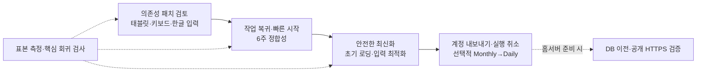

# 홈서버 이전 전 UI·UX·성능 개선 검토

2026-09-30 · **검토 완료. 1순위 ‘기본 조작’ 첫 묶음 구현·검증·총괄 최종 검토 완료. 2순위 ‘작업 복귀·빠른 시작’ 구현·검증 완료(10/4), 총괄 지적 2건 수정(재검토 대기). 3순위 ‘6주 정합성’ 구현·작업자 검증(10/4, 총괄 검토 대기). 4순위 ‘안전한 최신화’ 구현·작업자 검증(10/4, 총괄 검토 대기)** ([6. 진행 상황](#6-진행-상황)) · [로드맵](roadmap-status.md)

**권고:** 당장은 매일 쓰는 동선과 입력 품질을 먼저 개선하고, 초기 로딩과 기록 증가에 따른 비용을 줄인다. 홈서버 이전과 독립적으로 진행할 수 있다. 기존 인증·DB 저장·충돌 보호는 유지한다.

## 1. 우선순위

크기는 작업 범위의 상대 비교다. **작음**은 국소 변경, **중간**은 여러 화면·상태 처리, **큼**은 저장 계약이나 복원 설계를 포함한다. 아래 순서는 효과·시급도·변경 위험을 함께 고려한 제안이며 일정 확정은 아니다.

| 순서 | 개선 단위 | 현재 근거 → 개선안 | 효과 | 크기 |
|---|---|---|---|---|
| 선행 | 의존성 보안 유지보수 | Next.js 16.1.1 → **16.3.8** 갱신·적용 여부 확인·로그인·저장 회귀 완료(총괄 검토 완료, 미배포). 9/30 공지가 미룬 critical 1·high 1은 후속 릴리스 대기 | 공개 전 필수 | 중간 |
| **1** | 태블릿·키보드·한글 입력 | 768/820px에서 페이지 넘침, 생성 모달 Esc/초점 처리 누락, Daily 수정 중 조합 Enter가 편집을 종료 → 반응형 폭·공통 모달·입력 가드 정리 | **높음·즉시 체감** | 중간 |
| **2** | 작업 복귀·빠른 시작 | 새로고침 후 선택 해제, 첫 화면은 안내 문구뿐, 생성 시마다 가이드 → URL로 플랜 선택 복원, ‘오늘 할 일’·‘최근 작업’ 진입, 가이드는 선택적으로 | **높음·매일 사용** | 중간 |
| **3** | 6주인 달의 주차 정합성 | 날짜 계산은 W6 지원, Monthly와 API는 W1~W5 고정 → 공통 주차 기준·W6 입력/저장·기존 5개 데이터 호환 | **높음·기능 오류 예방** | 중간 |
| **4** | 다른 기기 변경 반영·저장 안내 | 탭 재진입 이벤트에 재조회 없음 → 미저장 수정이 없을 때 조건부 재조회, 수정 중이면 초안 유지·변경 안내. 저장 시각/재시도 안내 정리 | 높음 | 중간 |
| **5** | 초기 JavaScript 줄이기 | 로그인 전에도 편집기·이모지·드래그 코드 로드 → 화면·템플릿·모달을 필요할 때 로드 | 중간~높음 | 중간 |
| **6** | 입력 시 변경 비교 최적화 | 모든 store 변경마다 전체 기록 비교 → 변경한 플랜 중심 추적, 변경 없는 데이터 재직렬화·정렬 줄이기 | 기록 증가 시 높음 | 중간 |
| **7** | 내 데이터 파일 내보내기 | 정상 저장본의 일반 JSON 내보내기는 만다라트 중심 → 4개 템플릿·반복 할 일·휴일의 계정별 파일 내보내기. 복원은 미리보기·검증·충돌 정책을 따로 설계 | 데이터 신뢰·이동성 | 내보내기 중간 / 복원 큼 |
| **8** | 삭제 실수 되돌리기 | 플랜 삭제 확인은 있으나 삭제 후 복구 UI 없음 → 짧은 시간 ‘실행 취소’, 이후 필요하면 DB 휴지통 확장 | 중간~높음 | 중간 |
| **9** | 계획 간 선택적 연결 | Daily는 Block6·만다라트 가져오기 UI가 있지만 Monthly 목표 선택 경로는 없음 → 공통 출처 선택, 선택 항목만 복사·중복 방지 | 중간 | 중간 |
| 병행 | 품질 측정·회귀 자동화 | 많은 테스트가 있으나 저장소 내 GitHub Actions·일관된 성능 기준 없음 → 빠른 로컬 검사 명령, CI 구성, 모바일/키보드·표본 데이터 성능 기록 | 이후 변경 비용 감소 | 중간 |

## 2. 직접 확인한 근거

별도 `127.0.0.1:3107`에서 기존 production 빌드로 점검했다. 새 Chromium 브라우저에 가상 계정·가상 플랜만 사용했고 모든 API 응답을 가로채 메모리에서 처리했다. 실제 DB·Google·AI·사용자 브라우저에는 접근하지 않았다. 현재 Web 소스 95개는 9/28 검증 스냅샷과 해시가 같았다. 실서비스 속도나 전체 접근성 적합성 인증을 측정한 결과는 아니다.

| 관찰 | 결과 | 해석·관련 코드 |
|---|---|---|
| 화면 폭 360 / 768 / 820 / 1024px | Daily 페이지의 가로 넘침 **0 / 256 / 204 / 0px**. 768·820에서는 로그아웃·일부 입력 버튼이 화면 밖에 위치 | `PlannerWorkspace`의 `md:min-w-[1024px]`와 실제 중간 화면 폭이 맞지 않음. 그리드의 의도적 가로 스크롤과 페이지 전체 넘침을 분리할 것 |
| 선택한 Daily 새로고침 | DB 가상 기록은 유지되지만 편집기가 사라지고 플랜 선택 안내로 복귀. URL은 `/` 그대로 | `currentId`는 계정 메모리 상태. URL에 선택 정보만 두면 플랜 본문 브라우저 저장 없이 복귀 가능 |
| 템플릿 선택 모달 | dialog 역할 없음, Esc로 닫히지 않음, Tab이 배경 플랜으로 이동 | `Sidebar.TemplateModal`. 이미 `PlanLibrary`에는 초점 순환·Esc 처리가 있어 공통화할 출발점이 있음 |
| 모바일 새 플랜 생성 | 만다라트·Block6를 만든 뒤에도 열린 사이드바가 편집기를 덮음. 모바일에서는 열린 사이드바의 닫기 버튼이 숨겨져 배경을 눌러 닫아야 함 | 기존 플랜 선택은 자동으로 닫히지만 `handleGuideStart`에는 해당 처리가 없음. 생성 후 편집기로 이동하고 명시적 닫기 버튼 제공 |
| 한글 조합 Enter | Daily 수정 input에 `isComposing=true`, `keyCode=229`인 가상 Enter를 보내면 편집 종료 | Daily 신규 입력은 가드가 있지만 수정 input에는 없음. AI 입력도 코드상 가드가 없음. 실제 OS 한글 입력기·Safari 확인은 후속 |
| 다른 기기에서 수정한 상황 | 가상 서버 내용 변경 후 focus/visibilitychange 이벤트를 발생시켜도 조회 횟수 **1→1**, 이전 제목 유지 | `usePlannerSync`에는 online 재시도만 있음. 다른 계정 데이터가 섞였다는 의미가 아니며 최신화 동선의 개선점 |
| 2026년 3월 30일 | 공통 날짜 함수는 **W6**, 월간 화면에는 W6 없음 | `createInitialWeeklyFocus()`는 5개, `PlannerValidator`도 정확히 5개·번호 1~5만 허용. UI만 늘리면 저장 실패 |
| 초기 스크립트 | 익명 랜딩과 로그인 후 화면 모두 **7개, 압축 약 279KB / 압축 해제 약 1.04MB** | 528KB짜리 한 청크에 이모지·드래그·여러 편집기·AI UI 포함. 네트워크를 느리게 만든 환경의 로딩 시간은 아직 미측정 |

추가로 만다라트·Block6의 1440/360px 생성 동선·화면도 확인했다. 두 템플릿은 해당 폭에서 페이지 전체 가로 넘침이 없었다. Block6의 넓은 주간 그리드는 내부 가로 스크롤을 사용하므로, 접을 수 있는 보조 패널과 스크롤 안내는 별도 사용성 개선 후보다. 현재 점검은 새로고침·입력·모달·반응형의 선택된 흐름을 확인한 것이며, 기존 HTTPS 24개·API 56개 결과를 이번 검토의 테스트 수에 합산하지 않는다.

**입력 비용 표본:** 실제 `PlannerSync.capture()`를 사용해 플랜마다 가상 할 일 20개를 두고 제목 하나만 바꿨다. 5회 준비 후 30회 측정했으며, Node에서 순수 변경 비교만 측정한 값이다. React 렌더링·브라우저 저장·서버 지연이나 INP 값은 포함하지 않는다.

| 플랜 수 | 비교 시간 중앙값 | 95번째 백분위 | 전체 응답 JSON 크기 |
|---:|---:|---:|---:|
| 10 | 1.05ms | 1.39ms | 약 15KB |
| 100 | 9.02ms | 9.25ms | 약 153KB |
| 1,000 | 88.68ms | 92.58ms | 약 1.56MB |

## 3. 구현 경계와 완료 기준

| 묶음 | 구체적인 범위 | 완료 기준·주의점 |
|---|---|---|
| 기본 조작 | 태블릿 레이아웃, 모달의 초점 진입/순환/복귀·Esc, 가려진 사이드바의 키보드 접근 차단, 입력 조합 중 Enter 가드 | 360·768·820·1024·1440px에서 주요 조작 가능. 키보드만으로 생성·닫기·선택 가능. 각 템플릿의 한글 입력에 회귀 없음 |
| 작업 복귀 | URL의 템플릿+플랜 ID로 선택 복원, 뒤로/앞으로, 오늘 플랜 열기/명시적 생성, 빈 화면의 직접 행동 버튼 | 새로고침·새 탭에서 같은 계정의 플랜 복원. 없는 ID·다른 계정·삭제된 플랜은 안전한 안내. 선택 복원만으로 DB 쓰기 발생 없음 |
| 가이드·시각 정리 | 생성 필수 단계에서 가이드 분리, 필요할 때 도움말 열기. 제목/기간/도구의 배치, 작은 글씨·터치 영역·초점 표시 통일 | 반복 생성 시 불필요한 가이드 반복 없음. 도움말은 기존 규칙의 `text-xs`. 색상 대비는 측정 후 조정. 전체 디자인 교체까지 확대하지 않음 |
| 주차 | Monthly·Block6·날짜 선택기의 공통 주차, W6 추가, API 검증 변경 | 4·5·6주인 달과 연말/연초, 기존 5개 포커스 읽기·수정·재저장 확인. 날짜를 바꿔도 기존 포커스 내용을 임의로 삭제하지 않음 |
| 안전한 최신화 | 탭 활성화·네트워크 복구 시 조건부 조회, 필요하면 수동 새로고침 버튼 | 미저장 수정·전송 중 요청·충돌이 있으면 자동 교체 금지. 조회 중 새 수정/계정 전환에도 초안 보호. 잦은 polling 없이 시작 |
| 성능 | 레지스트리의 템플릿 설명과 편집기 import 분리, 이모지/AI/가이드 지연 로딩, 불필요한 전체 구독·정렬·canonical JSON 비교 축소 | 변경 전후 초기 전송량·입력 시간 비교. 저장 전 변경분의 즉시 임시 보관과 동일 requestId 재전송 보존. 최적화를 이유로 브라우저 전체 캐시를 다시 도입하지 않음 |
| 데이터 회복 | 정상 저장본 계정 내보내기 → 삭제 실행 취소 → 복원 설계 | 공개 `/api/backup`을 다시 켜지 않음. 현재 계정만 포함, 버전 있는 파일 형식·미리보기·기존 데이터 보존. 삭제 후 되돌리기도 서버 버전 충돌 처리 |
| 테스트·운영 관측 | 핵심 검사 묶음, 브라우저 오류 복구 화면, 저장 실패·지연의 제한된 집계 | 오류 로그에 플랜 본문·이메일·토큰을 넣지 않음. 외부 분석 도구는 우선 도입하지 않음. CI 구성 작성과 외부 서비스 활성화는 구분 |

전체 플랜 첫 조회·삭제 표식·작은 영수증 행 누적은 장기 확장 과제다. **지금 바로 DB 정규화나 페이지 분할부터 할 필요는 없다.** 현재 동기화는 ‘전체 기준 데이터에서 사라진 항목’을 삭제로 해석하므로, 첫 조회를 일부만 내려주는 변경은 동기화 계약을 먼저 바꿔야 한다. 우선 프런트의 반복 비교 비용부터 줄이고 실제 데이터 크기로 API 분할 필요성을 판단한다.

## 4. 권장 실행 순서

**첫 구현 묶음 추천:** 태블릿 폭 수정 + 한글 Enter 가드 + 모달 공통 동작. 범위를 작게 검토할 수 있고 저장 구조 변경 없이 효과를 확인할 수 있다. 의존성 갱신은 별도 변경으로 검증해 원인 추적을 쉽게 한다. 이후 URL 복귀·오늘 진입과 주차 정합성을 진행한다.

현재는 후순위로 둘 것: 업적·새 템플릿·전면 테마 교체, PWA 오프라인 전체 저장, Redis/MSA/다중 replica, JSONB 전면 정규화, 대규모 분석 도구. 사용자 한 명의 현재 활용에서 얻는 이득과 구현·운영 비용을 고려했다.

## 5. 보안 유지보수와 참고 기준

- 검토 시점 저장소 버전은 Next.js **16.1.1**, React **19.2.3**이었다(10/4 Next.js 16.3.8로 갱신, [의존성 보안 보고](session-reports/dependency-security.md)). [공식 5월 보안 공지](https://vercel.com/changelog/next-js-may-2026-security-release)의 Next.js 영향 범위에 갱신 전 16.1.1이 포함된다. 개별 이슈의 실제 노출 여부는 사용하는 기능에 따라 다르므로 현재 앱의 공격 가능성을 일괄 단정하지 않는다.
- 9/22 공지의 `ImageResponse` RCE는 **16.2.0 이상 16.3.6 미만**을 대상으로 하므로 현재 16.1.1에 그 이슈가 적용된다고 주장하지 않는다. 업그레이드는 중간의 영향 버전에 멈추지 않고 패치된 지원 버전을 선택한다. [공식 9/22 공지](https://nextjs.org/blog/nextjs-security-update-september-22-2026)
- 9/30 보안 릴리스(16.3.8)는 검토 시점에 사전 공지였다. 10/4 실제 공지·레지스트리를 확인해 갱신했다. 공지가 미룬 critical 1·high 1은 아직 해결되지 않았다. [공식 사전 공지](https://nextjs.org/blog/upcoming-nextjs-security-release-september-2026) · [9/30 릴리스](https://nextjs.org/blog/september-2026-security-release)
- 모달의 초점 순환·Esc·호출 위치 복귀는 [W3C 모달 패턴](https://www.w3.org/WAI/ARIA/apg/patterns/dialog-modal/)을 기준으로 한다. 필요할 때 컴포넌트를 로드하는 방식은 [Next.js 지연 로딩 안내](https://nextjs.org/docs/app/guides/lazy-loading)를 따른다.
- 성능 개선 후에는 별도로 LCP·INP·CLS를 측정한다. 참고 목표는 LCP 2.5초 이하, INP 200ms 이하, CLS 0.1 이하이며 실제 사용자 75번째 백분위 기준이다. 위 로컬 함수 벤치마크는 이 기준의 통과 여부를 의미하지 않는다. [Web Vitals](https://web.dev/articles/vitals)

자동 `npm audit`는 의존성 목록·버전의 외부 전송을 이유로 자동 승인 검토에서 거절되어 실행하지 못했다. 대신 공개 공식 공지를 수동 확인했다. 따라서 전체 의존성 취약점 감사가 완료된 것은 아니다.

## 6. 진행 상황

| 묶음 | 상태 | 내용 |
|---|---|---|
| 1순위 기본 조작 (태블릿·키보드·한글 입력) | **첫 묶음 구현·검증·총괄 최종 검토 완료** | [작업·최종 검토 보고](session-reports/ux-foundation.md) |
| 선행 의존성 보안 (Next.js 16.3.8) | **구현·검증 완료, 총괄 검토 완료, 미배포** | [의존성 보안 보고](session-reports/dependency-security.md): 9/30 7건 적용 여부(운영 해당 없음, `next dev` MCP만 개발 환경), tsc·lint, 회귀 74+39+19 통과 |
| 2순위 작업 복귀·빠른 시작 | **구현·검증 완료, 총괄 검토 대기, 미배포** | [작업 복귀 보고](session-reports/work-resumption.md): 주소 `?template&plan`으로 새로고침·새 탭·뒤로/앞으로 복원(이 계정 store만, 잘못된 ID는 안내), 빈 화면 `오늘 할 일`·`최근 작업`, 가이드는 헤더 `사용법`으로 분리. 새 13개 + 기존 19·15·64·9·39·12·17 통과(Chromium 합성). 총괄 지적(헤더 `사용법` 초점 표시 없음, 자정을 넘긴 탭의 `오늘` 고정) 재현 3건 → 수정 후 통과, **수정분 재검토 대기** |
| 3순위 6주인 달의 주차 정합성 | **구현·작업자 검증, 총괄 검토 대기, 미배포** | [W6 보고](session-reports/monthly-w6.md): 월~일·1일이 든 주=W1 규칙을 Monthly 달력·Block6·날짜 선택기·이번 주 포커스에 통일, Monthly W6 입력·저장(API 5개 또는 6개 연속 번호), 이전 5개는 읽기·이동만으로 안 바뀜, 날짜 변경·복제 시 그 달에 없는 주 내용 보관 표시. 실제 DB·Safari 미검증 |
| 4순위 다른 기기 변경 반영 | **구현·작업자 검증, 총괄 검토 대기, 미배포** | [안전한 최신화 보고](session-reports/safe-refresh.md): 탭 재표시·창 초점·온라인 복구 때 ETag 조건부 조회(같은 틱 중복·5초 안 반복은 1회로). 미저장·전송 중·충돌/계정 차단·읽을 수 없는 임시 보관·편집 초점/최근 입력·대화상자·AI 대화 중이면 내용을 바꾸지 않고 미룬 이유를 표시, 끝나면 다시 확인. 조회 중 수정(되돌린 경우 포함)은 그 응답을 버림. 바뀐 store만 교체, 304는 무변경. 보던 플랜 삭제는 빈 화면+안내(추가 전 입력이 남아 있으면 대기). 저장 시각 표시는 이번 범위 밖. Chromium 합성·모의 API |
| 방향 문서 3 UI·UX 정보 우선순위 | **첫 묶음 구현·작업자 검증, 총괄 검토 대기, 미배포** | [헤더 정리 보고](session-reports/ui-focus.md): 날짜·도구·`⋮` 한 줄, 메뉴 키보드·중복 제거, 초기화·덮어쓰기 공통 확인 창(첫 초점 취소), 초기화 시 플랜 날짜 유지 |
| 성능 첫 묶음 (초기 로딩·입력 비교) | **구현·작업자 검증, 총괄 검토 대기, 미배포** | [성능 보고](session-reports/performance.md): 로그인 전 화면에서 작업 공간 분리, 편집기·사용법·이모지·AI 지연 로드(Suspense 없는 `lazyComponent`), 같은 참조 비교 생략·최신화 참조 유지. 같은 조건 전후 측정(실험실 값) |
| 5~9순위, 병행 품질 | 미착수 | 이번 변경에 포함하지 않음 |

첫 묶음에서 바뀐 것:

- **태블릿 폭:** 작업 공간 `md:min-w-[1024px]` 제거. 헤더 1줄 배치를 `lg` 이상으로 옮겨 사이드바 옆 태블릿 본문에서 2단으로 표시. 360·768·820·1024·1440px에서 Daily·만다라트·Block6·Monthly의 페이지 가로 넘침 0, 로그아웃·이메일·입력·헤더 버튼이 화면 안. Block6 주간 그리드는 기존대로 내부 가로 스크롤. `body` 넘침 숨김은 쓰지 않음
- **공통 모달:** `useModalDialog`(dialog 역할·이름, 초점 진입, Tab 순환, Esc, 초점 복귀, 열린 동안 배경 초점 되돌림)를 템플릿 선택·날짜 선택·가이드 4종에 적용. 날짜 선택은 헤더 `플랜 날짜 변경`·보관함 복제에서도 같은 동작. PlanLibrary는 기존 초점 복원·`suspended` 동작을 유지하고 Tab 순환만 공통 함수로 교체
- **사이드바:** 접힌 사이드바는 `inert`. 모바일에 `사이드바 닫기` 버튼, 열면 닫기 버튼에·닫으면 열기 버튼에 초점. 모바일에서 새 플랜 생성(4개 템플릿 확인)·복제 완료 뒤 사이드바를 닫아 편집기를 보여준다. 접힌 상태에서 선택 핸들러가 사이드바를 여는 문제도 함께 막음
- **한글 조합 Enter:** Daily 할 일 수정·AI 입력에 `isImeComposing`(isComposing 또는 keyCode 229) 가드. 기존 Daily 신규 입력도 같은 함수 사용

**남은 후속(이번 묶음 밖):** 사이드바 삭제 확인·Header 초기화/가져오기 확인·백업 복원·Daily 주간 가져오기·Monthly 목표 불러오기 모달, 셀 일정·색상·이모지·반복 할 일 팝오버, 행 메뉴, AI 패널은 공통 모달 동작 미적용. 모바일에서 사이드바가 열린 동안 뒤 본문은 배경 클릭은 막히지만 Tab으로는 닿는다. 실제 OS 한글 입력기·Safari/iPadOS는 미확인(Chromium 합성 이벤트로만 확인). 가이드를 생성 필수 단계에서 분리하는 일은 2순위 묶음에서 반영했다([작업 복귀 보고](session-reports/work-resumption.md)).

## 근거 파일

- UI: [PlannerWorkspace](../apps/web/src/components/PlannerWorkspace.tsx), [Sidebar](../apps/web/src/components/Sidebar.tsx), [PlanLibrary](../apps/web/src/components/PlanLibrary/PlanLibrary.tsx), [DailyGrid](../apps/web/src/components/Daily/DailyGrid.tsx), [Header](../apps/web/src/components/Header.tsx)
- 주차: [weekUtils](../apps/web/src/lib/weekUtils.ts), [Monthly 타입](../apps/web/src/types/monthly.ts), [API 검증](../apps/api/src/main/kotlin/com/hadam/plannet/storage/PlannerValidator.kt)
- 성능·저장: [templateRegistry](../apps/web/src/lib/templateRegistry.ts), [usePlannerSync](../apps/web/src/hooks/usePlannerSync.ts), [plannerSync](../apps/web/src/lib/plannerSync.ts), [plannerSyncStores](../apps/web/src/lib/plannerSyncStores.ts), [plannerSyncApi](../apps/web/src/lib/plannerSyncApi.ts)
- 실행 근거: `/private/tmp/plannet-ux-review-20260930/`의 `browser-review.json`, `additional-review.json`, `template-review.json`, `capture-benchmark.json`, 화면 PNG와 재현 스크립트. 가상 데이터만 포함한다. 추가 화면 수집의 첫 시도는 모바일에서 숨겨진 닫기 버튼을 이용하려다 대기 조건이 실패했고, 실제 제공되는 배경 클릭으로 닫아 다시 확인했다.

검토 단계의 변경은 검토 문서와 로드맵 반영뿐이었다. 이후 기본 조작 첫 묶음의 앱 구현은 [6. 진행 상황](#6-진행-상황)에 있으며, 실제 데이터 변경·커밋·푸시는 포함하지 않는다.
