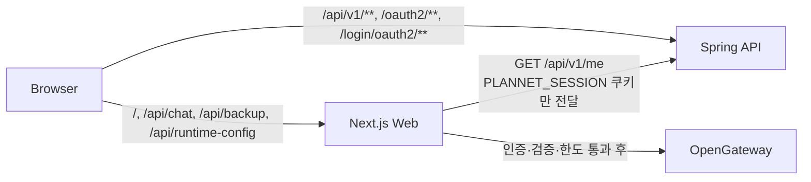

# Web ↔ Spring 인증 연동 (Web 측)

작성일: 2026-09-23 · 계약: [auth-v1](./contracts/auth-v1.md) · 구현: `apps/web`

Spring(`apps/api`)이 Google 로그인·세션·로그아웃을 소유한다. Web은 세션을 만들거나 저장하지 않는다. 대신 로그인 UI를 계약에 맞게 표시하고, Web이 직접 처리하는 API(`/api/chat`, `/api/backup`)를 서버에서 보호한다. 기존 Auth.js(`next-auth`, `/api/auth/**`)는 제거했다.

## 1. 요청 흐름

| 동작 | 호출 | 비고 |
|---|---|---|
| 설정 확인 | 브라우저 → `GET /api/runtime-config` (Web) | `{ authEnabled, backupEnabled }`. 요청마다 서버 환경변수를 읽는다 |
| 로그인 상태 | 브라우저 → `GET /api/v1/me` (Spring) | 200 인증, 401 미인증, 그 밖은 "확인 불가" |
| 로그인 | `window.location.assign('/oauth2/authorization/google')` | 실패 시 `/?authError=login_failed\|auth_unavailable` → 안내 표시 후 쿼리 제거 |
| 로그아웃 | `GET /api/v1/csrf` → `POST /api/v1/logout` + `[headerName]: token` | 204면 `/`로 새로 불러와 메모리의 계정 데이터를 비운다. `403 csrf_invalid`면 토큰을 다시 받아 1회 재시도 |
| AI | 브라우저 → `POST /api/chat` (Web) → Web 서버가 `API_INTERNAL_URL/api/v1/me`로 세션 확인 | 아래 3절 |

## 2. 정적 빌드와 인증 토글

`/` 페이지는 정적으로 빌드된다. 예전에는 `layout.tsx`가 빌드 시점에 `AUTH_ENABLED`를 읽어서, 컨테이너 환경변수를 바꿔도 로그인 UI가 따라오지 않았다. 반면 API route는 실행 시점 값을 읽어 둘이 어긋났다.

이제 레이아웃은 설정을 읽지 않는다. `AuthProvider`가 브라우저에서 `/api/runtime-config`(`force-dynamic`, `Cache-Control: no-store`)를 호출하고, 인증이 켜져 있을 때만 `/api/v1/me`를 부른다. 같은 빌드 산출물이 실행 환경에 따라 UI를 켜고 끄는 것을 E2E에서 검증한다. 테스트는 인증 환경변수 없이 한 번 빌드하고, 설정이 다른 서버 4개로 띄운다.

## 3. `/api/chat` 보호

처리 순서가 보안 경계다. 앞 단계에서 거부되면 외부 AI를 호출하지 않는다.

| 순서 | 검사 | 실패 응답 |
|---|---|---|
| 1 | CSRF: `Content-Type: application/json`, 그리고 Origin이 허용 출처와 같아야 한다. Origin이 없으면 `Sec-Fetch-Site: same-origin`이어야 한다 | 403 `csrf_rejected` |
| 2 | `AUTH_ENABLED=true`인지 확인 | 503 `auth_disabled` |
| 3 | `PLANNET_SESSION` 쿠키 하나만 골라 `API_INTERNAL_URL/api/v1/me`로 확인한다 (timeout 2초, redirect 따라가지 않음, 캐시 없음) | 쿠키 없음·401 → 401 `unauthenticated`. 설정 누락·timeout·연결 실패·5xx·계약 불일치 → 503 `auth_unavailable` |
| 4 | 요청 검증 (본문 32KB, 메시지 20개·user 500자·전체 8000자, 마지막은 user, `assistedCount` 0~2, 그리드 값 100자, 제어 문자와 프롬프트 구분자 `" [ ] \n` 제거) | 400 `invalid_request` / 413 `payload_too_large` |
| 5 | 사용 제한 (4절) | 429 `rate_limited` + `Retry-After` |
| 6 | 외부 AI 호출 (timeout 20초, 재시도 0회) | 502 `ai_failed` (내부 오류 문자열은 노출하지 않음) |
| 7 | 응답 검증 (action enum, message 1000자, 목표 100자, 실천 계획 정확히 8개·각 30자) | 적용하지 않고 안내 메시지만 200으로 반환 |

- 브라우저가 보낸 사용자 ID, `authenticated` 값, 임의 헤더는 읽지 않는다. 인증 판단은 Spring `me`의 200 응답에만 근거한다.
- 내부 주소는 서버 환경변수로만 정한다. 요청의 Host나 `X-Forwarded-*`로 만들지 않는다.
- 세션 쿠키 값은 RFC 6265 문자와 4KB 이하만 전달한다 (헤더 주입 방지).

## 4. AI 사용 제한의 범위와 한계

| 한도 | 기본값 | 환경변수 |
|---|---|---|
| 사용자별 분당 | 5 | `AI_RATE_LIMIT_PER_MINUTE` |
| 사용자별 24시간 | 50 | `AI_RATE_LIMIT_PER_DAY` |
| 프로세스 전체 24시간 (비용 상한) | 500 | `AI_GLOBAL_LIMIT_PER_DAY` |
| 사용자별 동시 요청 | 1 | — |

- 사용자 키는 서버가 검증한 `${authProvider}:${externalSubject}`다. 잘못된 설정값은 무제한이 아니라 기본값으로 처리한다.
- 인사말처럼 외부 호출이 없는 요청과, 검증에서 거부된 요청은 한도를 쓰지 않는다.
- **한계**: 카운터는 Node 프로세스 메모리에 있다. 재시작하면 초기화된다. replica N개는 각자 세므로 실제 허용량은 최대 N배다. 24시간 창은 첫 호출부터의 고정 창이다(자정 기준 아님). 지속 한도나 다중 replica가 필요하면 Redis 같은 공유 저장소로 옮겨야 한다. 현재 계약상 API도 replica 1개 전제다.

## 5. Web 변경 요청의 CSRF 방어

Spring의 CSRF 토큰(로그아웃용)과 별개로, Web route는 `lib/server/csrf.ts`에서 스스로 검증한다. 대상은 `/api/chat`과 `/api/backup` POST다.

- JSON Content-Type을 강제한다. HTML form이나 `no-cors` fetch로는 보낼 수 없으므로, 교차 출처 요청은 preflight에서 막힌다.
- Origin 검사: `APP_ORIGINS`(쉼표 구분)가 있으면 정확히 일치해야 한다. 없으면 Origin의 host와 요청 `Host`가 같아야 한다. Ingress는 Host를 보존해야 한다. 공개 배포에서는 `APP_ORIGINS=https://<domain>` 고정을 권장한다.
- `127.0.0.1:3312` → `127.0.0.1:3313`처럼 포트만 다른 same-site 페이지는 SameSite=Lax 쿠키가 실제로 전송된다. 이 경우도 Origin 검사로 막히는 것을 E2E에서 확인한다.

## 6. `/api/backup` 차단

백업 파일은 사용자 구분이 없는 공용 저장소라 공개 환경에서는 쓸 수 없다. 서버에서 GET(목록·파일)과 POST를 모두 거부한다(403 `backup_disabled`). UI 숨김은 보조 수단일 뿐이다.

| 조건 | 결과 |
|---|---|
| `AUTH_ENABLED=true` | 항상 차단 (`LOCAL_BACKUP_ENABLED=true`여도) |
| `LOCAL_BACKUP_ENABLED=true` / `false` | 그 값을 따른다 |
| 설정 없음 | `next dev`에서만 허용, 프로덕션 빌드(Docker·k8s)는 차단 |

- 허용된 경우에도 POST는 CSRF 검사를 거친다. 저장 경로는 `LOCAL_BACKUP_DIR`(기본 `.local-backup`)이다.
- 빌드 추적에서 `.local-backup/**`을 제외했다(`next.config.ts`의 `outputFileTracingExcludes`). 수정 전에는 standalone 출력에 로컬 백업 스냅샷이 복사되었다.

## 7. 계정별 LocalStorage 격리

서버 동기화는 이번 범위가 아니다. 목표는 같은 브라우저에서 계정 데이터가 섞이거나 기존 공통 데이터가 자동 귀속되는 것을 막는 것이다.

| 상태 | 저장 키 |
|---|---|
| 로그인 안 함·인증 꺼짐·인증 확인 불가 | 기존 키 그대로 (`plannet-mandalart` 등). 로그인 도입 전 데이터가 여기 보존된다 |
| 로그인 | `plannet-*@acct:<encodeURIComponent(authProvider:externalSubject)>` |

- 6개 store(만다라트, Block6, 월간, 일간, 반복 할 일, 휴일)는 모두 `plannerStorage`를 쓰고 `skipHydration`으로 둔다. 인증 확인이 끝나 범위가 정해진 뒤 `usePlannerStorageHydration`이 한 번에 복원한다. 범위가 정해지기 전의 읽기는 빈 값을 돌려주고 쓰기는 버린다.
- 로그인·로그아웃은 페이지를 새로 불러온다. 한 페이지에서 범위가 바뀌면 강제로 다시 불러온다.
- 로그인했는데 기존 공통 데이터가 있으면 "계정과 분리해 보존했어요. 로그아웃하면 다시 볼 수 있어요"라고 안내한다. 가져오기(import)는 후속 범위다.
- 키에는 해시 대신 원문을 인코딩해 쓴다(충돌로 두 계정이 섞이는 것 방지). 이메일은 넣지 않는다. API 세션과 합의한 조건: 서버가 검증한 `me` 응답에서만 만들고, 항상 `authProvider:externalSubject` 쌍을 쓰며, 서버에 저장하지 않는다. 이것은 섞임 방지용이지 보안 경계가 아니다. 내부 `userId`가 생기면 그 값으로 키를 다시 만든다.
- 인증 서버 장애로 확인이 안 되면 로그인 전 로컬 범위를 표시하고 상단에 안내와 "다시 시도"를 보여준다. AI는 이 상태에서 쓸 수 없다.

## 8. 설정

### Web 환경변수

| 변수 | 필수 | 설명 |
|---|---|---|
| `AUTH_ENABLED` | 공개 배포 | `true`일 때만 로그인 UI와 AI가 켜진다. 없으면 AI는 항상 거부된다 |
| `API_INTERNAL_URL` | 인증 on일 때 | Spring 내부 주소. 로컬 k8s `http://mandalart-api:8080`, 개별 실행 `http://127.0.0.1:8080`. 없으면 AI가 503으로 거부된다 |
| `AUTH_SESSION_COOKIE_NAME` | 선택 | 기본 `PLANNET_SESSION` |
| `AUTH_API_TIMEOUT_MS` | 선택 | 기본 2000, 최대 10000 |
| `APP_ORIGINS` | 공개 배포 권장 | CSRF 허용 origin 고정 |
| `AI_RATE_LIMIT_PER_MINUTE`, `AI_RATE_LIMIT_PER_DAY`, `AI_GLOBAL_LIMIT_PER_DAY` | 선택 | 4절 |
| `LOCAL_BACKUP_ENABLED`, `LOCAL_BACKUP_DIR` | 선택 | 6절 |
| `OPENGATEWAY_API_KEY`, `OPENGATEWAY_BASE_URL`, `OPENGATEWAY_MODEL` | AI 사용 시 | 기존과 같음 |

제거된 변수: `AUTH_SECRET`, `AUTH_URL`, `AUTH_GOOGLE_ID`, `AUTH_GOOGLE_SECRET`(Auth.js 전용). Google client는 이제 API의 `GOOGLE_CLIENT_ID`/`GOOGLE_CLIENT_SECRET`로 넣는다.

### 진입점 라우팅 (Ingress)

`/api/v1/**`, `/oauth2/**`, `/login/oauth2/**`만 API로 보내고 나머지는 Web으로 보낸다. `/api/**` 전체를 넘기면 `/api/chat`·`/api/backup`·`/api/runtime-config`가 깨진다. Host 헤더를 보존해야 한다(CSRF Origin 검사와 Spring callback 계산에 쓰인다).

## 9. 테스트

`npm run web:test:e2e`(= `apps/web`에서 `npx playwright test`)는 `e2e/support/start-stack.mjs`로 전용 스택을 띄운다. 이미 떠 있는 서버는 재사용하지 않는다(`reuseExistingServer: false`).

| 포트 | 역할 |
|---|---|
| 3310 | Web: 인증 off + 백업 명시적 on (기존 템플릿 회귀 테스트) |
| 3311 | Web: 인증 on + 모의 Spring (edge 뒤) |
| 3312 | 모의 Spring(auth-v1 계약) + 모의 AI |
| 3313 | edge proxy (Ingress 역할) |
| 3314 | Web: 환경변수 없음 (기본값 검증) |
| 3315 | Web: 인증 on + `API_INTERNAL_URL` 누락 |

- 빌드는 `.next/e2e`와 `tsconfig.e2e.json`을 써서 개발자의 `.next`와 `tsconfig.json`을 건드리지 않는다. `.env*`는 읽지 않고(`__NEXT_PROCESSED_ENV`), 모든 AI 주소는 모의 서버로 고정한다. 실제 외부 AI는 호출하지 않는다.
- `E2E_SKIP_BUILD=1`이면 기존 E2E 빌드를 재사용한다.
- 모의 서버 상태를 공유하므로 `workers: 1`로 순차 실행한다.
